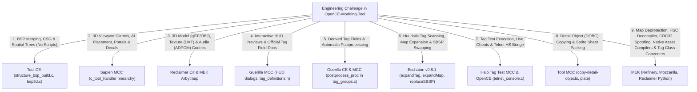
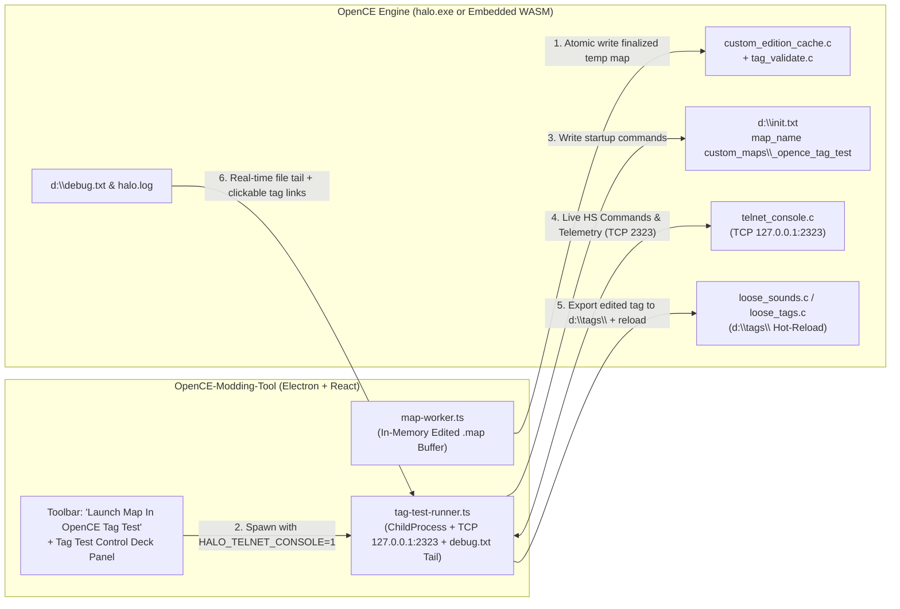

# OpenCE Mantle — Master Decompilation Synthesis, Feature Extraction & "OpenCE Tag Test" Integration Roadmap

> **Scope of this Document**  
> This document synthesizes:
> 1. The current architecture and milestone status of **[`OpenCE-Modding-Tool`](file:///C:/Users/LeviB/Projects/OpenCE-Modding-Tool/README.md)** (`core/` + `desktop/`).
> 2. The complete reverse-engineering and decompilation outputs of all **13 reference applications** in [`SAMPLE CODE/`](file:///C:/Users/LeviB/Projects/OpenCE-Modding-Tool/SAMPLE%20CODE):
>    - **[`MEK (Mozz Editing Kit)`](file:///C:/Users/LeviB/Projects/OpenCE-Modding-Tool/SAMPLE%20CODE/MEK/SUMMARY.md)** (`7` core Python libraries: `Mozzarilla`, `Refinery`, `Pool`, `Reclaimer`, `Arbytmap` + C extensions, `Binilla`, `Supyr Struct`, plus `9` standalone tag converters & `6` misc utilities)
>    - **[`Tool CE`](file:///C:/Users/LeviB/Projects/OpenCE-Modding-Tool/SAMPLE%20CODE/Tool%20CE/SUMMARY.md)** (`6,150` functions, `304` source units, `21` CLI commands)
>    - **[`Tool MCC`](file:///C:/Users/LeviB/Projects/OpenCE-Modding-Tool/SAMPLE%20CODE/Tool%20MCC/SUMMARY.md)** (`10,211` functions, `746` source units, `38` CLI commands)
>    - **[`Guerilla CE`](file:///C:/Users/LeviB/Projects/OpenCE-Modding-Tool/SAMPLE%20CODE/Guerilla%20CE/SUMMARY.md)** (`11,397` functions, `336` source units, `183` RTTI classes)
>    - **[`Guerilla MCC`](file:///C:/Users/LeviB/Projects/OpenCE-Modding-Tool/SAMPLE%20CODE/Guerilla%20MCC/SUMMARY.md)** (`6,725` functions, `555` source units, `283` RTTI classes)
>    - **[`Sapien CE`](file:///C:/Users/LeviB/Projects/OpenCE-Modding-Tool/SAMPLE%20CODE/Sapien%20CE/SUMMARY.md)** (`12,215` functions, `367` source units, `443` RTTI classes)
>    - **[`Sapien MCC`](file:///C:/Users/LeviB/Projects/OpenCE-Modding-Tool/SAMPLE%20CODE/Sapien%20MCC/SUMMARY.md)** (`10,492` functions, `701` source units, `632` RTTI classes)
>    - **[`Halo Tag Test MCC`](file:///C:/Users/LeviB/Projects/OpenCE-Modding-Tool/SAMPLE%20CODE/Halo%20Tag%20Test%20MCC/SUMMARY.md)** (`17,705` functions, `843` source units, `527` Halo Script functions)
>    - **[`Reclaimer (C#)`](file:///C:/Users/LeviB/Projects/OpenCE-Modding-Tool/SAMPLE%20CODE/Reclaimer/SUMMARY.md)** (`1,180` `.cs` files, `52` `.xaml` views, `28` `.resx` resources)
>    - **[`Eschaton v0.8.1`](file:///C:/Users/LeviB/Projects/OpenCE-Modding-Tool/SAMPLE%20CODE/Eschaton%20V0.8.1/SUMMARY.md)** (`2,300` functions, `161` classes, `6` tag plugin suites)
>    - **[`SparkEdit v3.02`](file:///C:/Users/LeviB/Projects/OpenCE-Modding-Tool/SAMPLE%20CODE/Sparkedit%20V3.02/README_INDEX.md)** (Classic C++ / OpenGL 3D BSP & Scenario placement editor)
>    - **[`HMT v3.5`](file:///C:/Users/LeviB/Projects/OpenCE-Modding-Tool/SAMPLE%20CODE/HMT%20V3.5)** (Halo Map Tools — C# / DirectX 9 tag & resource editor)
>    - **[`HHT v5`](file:///C:/Users/LeviB/Projects/OpenCE-Modding-Tool/SAMPLE%20CODE/HHT%20V5)** (Halo Hacker Tools — VB.NET / C# dependency swapper & memory poker)
> 3. The **[OpenCommunityEdition/OpenCE](https://github.com/OpenCommunityEdition/OpenCE)** engine source code (`C:\temp\OpenCE-src`), specifically its Custom Edition cache loader (`port/linux/game/custom_edition_cache.c`), tag validator (`port/linux/game/tag_validate.c`), loose tag hot-reloader (`port/linux/game/loose_sounds.c`), localhost TCP Telnet console (`source/networking/telnet_console.c`), and WebAssembly build target (`port/web/`).
> 4. A complete architectural blueprint for **"Launch Map In OpenCE Tag Test"**, **MEK-powered fixes for current bugs**, **expansions to existing pipelines**, and **brand-new feature milestones (M13.5–M19)**.

---

## Part 1: Current State of `OpenCE-Modding-Tool`

### 1.1 Architectural Overview (`core/` + `desktop/`)
`OpenCE-Modding-Tool` is cleanly split into two workspaces:
- **[`core/`](file:///C:/Users/LeviB/Projects/OpenCE-Modding-Tool/core/src/index.ts)**: A pure TypeScript library with zero DOM, React, or Electron dependencies, tested by 51 Vitest suites (522 passing tests).
- **[`desktop/`](file:///C:/Users/LeviB/Projects/OpenCE-Modding-Tool/desktop/electron/main.ts)**: An Electron + React + Vite + Three.js GUI application, tested by 25 Vitest suites (194 passing tests), where [`map-worker.ts`](file:///C:/Users/LeviB/Projects/OpenCE-Modding-Tool/desktop/electron/map-worker.ts) runs in a dedicated Node.js `worker_threads` worker holding the active `.map` buffer in memory. Combined test coverage: **716 passing automated tests**.

### 1.2 Capabilities Already Built & Verified in `OpenCE-Modding-Tool`

| Subsystem | Key Files in `core/` & `desktop/` | Current Capability | Status |
|---|---|---|:---:|
| **Cache Header, Tag Index & Zstd Compression (M1–M3)** | [`header.ts`](file:///C:/Users/LeviB/Projects/OpenCE-Modding-Tool/core/src/map/header.ts), [`tag-index.ts`](file:///C:/Users/LeviB/Projects/OpenCE-Modding-Tool/core/src/map/tag-index.ts), [`open-map.ts`](file:///C:/Users/LeviB/Projects/OpenCE-Modding-Tool/core/src/map/open-map.ts), [`compression.ts`](file:///C:/Users/LeviB/Projects/OpenCE-Modding-Tool/core/src/map/compression.ts) | Parses 2048-byte CE `v609` headers, infers virtual base (`0x40440000` / BSP magic), handles Chimera zstd (`0x861A0261`) decompression/compression, atomic `File > Save` / `Save As` with backup prompt and CRC32 recalculation ([`cache-crc.ts`](file:///C:/Users/LeviB/Projects/OpenCE-Modding-Tool/core/src/map/cache-crc.ts), [`finalize-map.ts`](file:///C:/Users/LeviB/Projects/OpenCE-Modding-Tool/core/src/map/finalize-map.ts)). | ✅ Built & Verified |
| **Schema-Driven Tag Definition Engine (83 Groups)** | [`engine.ts`](file:///C:/Users/LeviB/Projects/OpenCE-Modding-Tool/core/src/map/definitions/engine.ts), [`codec.ts`](file:///C:/Users/LeviB/Projects/OpenCE-Modding-Tool/core/src/map/definitions/codec.ts), [`groups/*.json`](file:///C:/Users/LeviB/Projects/OpenCE-Modding-Tool/core/src/map/definitions/groups) | Runtime offset & struct size verification across all 83 Halo 1 tag classes. | ✅ Built & Verified |
| **Dependency Closure, `.ocetags` v5 Extraction & Batch Extract (M4)** | [`dependency-walker.ts`](file:///C:/Users/LeviB/Projects/OpenCE-Modding-Tool/core/src/map/dependency-walker.ts), [`tag-extractor.ts`](file:///C:/Users/LeviB/Projects/OpenCE-Modding-Tool/core/src/map/tag-extractor.ts), [`container.ts`](file:///C:/Users/LeviB/Projects/OpenCE-Modding-Tool/core/src/map/container.ts), [`BatchExtractDialog.tsx`](file:///C:/Users/LeviB/Projects/OpenCE-Modding-Tool/desktop/src/components/BatchExtractDialog.tsx) | Single-tag, multi-tag, and whole-map extraction into portable `.ocetags` v5 containers, including embedded pixel/sound payloads and `gbxmodel` vertex/triangle buffers ([`gbxmodel-geometry.ts`](file:///C:/Users/LeviB/Projects/OpenCE-Modding-Tool/core/src/map/gbxmodel-geometry.ts)). | ✅ Built & Verified |
| **In-Memory ADD & SWAP Tag Injection (M5)** | [`tag-injector.ts`](file:///C:/Users/LeviB/Projects/OpenCE-Modding-Tool/core/src/map/tag-injector.ts), [`pointer-rebase.ts`](file:///C:/Users/LeviB/Projects/OpenCE-Modding-Tool/core/src/map/pointer-rebase.ts), [`raw-data-region.ts`](file:///C:/Users/LeviB/Projects/OpenCE-Modding-Tool/core/src/map/raw-data-region.ts), [`InjectDialog.tsx`](file:///C:/Users/LeviB/Projects/OpenCE-Modding-Tool/desktop/src/components/InjectDialog.tsx) | Full schema-driven ADD (with tag-array growth pointer shifting across external sounds and BSP paths) and SWAP injection, `gbxmodel` geometry relocation, and embedded (`external=0`) bitmap/sound relocation. | ✅ Built & Verified |
| **Campaign Embedded Texture Extraction & Clean Injection** | [`tag-extractor.ts`](file:///C:/Users/LeviB/Projects/OpenCE-Modding-Tool/core/src/map/tag-extractor.ts), [`embedded-data-fields.ts`](file:///C:/Users/LeviB/Projects/OpenCE-Modding-Tool/core/src/map/embedded-data-fields.ts), [`tag-injector.ts`](file:///C:/Users/LeviB/Projects/OpenCE-Modding-Tool/core/src/map/tag-injector.ts) | Extracts campaign tags containing internal raw-data textures (e.g. `bridge` scenery and `misslehog` vehicle from `a10`/`c10`/`b30`) cleanly without false-alarm blocker modals, and safely relocates raw data partitions on injection. | ✅ Built & Verified |
| **Multi-Version Resource Maps & MCC Sounds Fallback (M6)** | [`IdentifyBitmapsDialog.tsx`](file:///C:/Users/LeviB/Projects/OpenCE-Modding-Tool/desktop/src/components/IdentifyBitmapsDialog.tsx), [`ConfigureResourcesPromptDialog.tsx`](file:///C:/Users/LeviB/Projects/OpenCE-Modding-Tool/desktop/src/components/ConfigureResourcesPromptDialog.tsx), [`externalize-in.ts`](file:///C:/Users/LeviB/Projects/OpenCE-Modding-Tool/core/src/map/convert/externalize-in.ts) | Detects, validates, and identifies `bitmaps.map` and `sounds.map` across all Halo CE editions (PC Retail, Mac Demo, Custom Edition, Halo MD, MCC). Automatically falls back to Custom Edition `sounds.map` for MCC maps, with helpful dialog notes on shared resource hashes. | ✅ Built & Verified |
| **Halo Demo (v6) & Retail/HaloMD (v7) $\rightarrow$ CE (v609) Converter** | [`retail-to-ce.ts`](file:///C:/Users/LeviB/Projects/OpenCE-Modding-Tool/core/src/map/convert/retail-to-ce.ts), [`demo-to-ce.ts`](file:///C:/Users/LeviB/Projects/OpenCE-Modding-Tool/core/src/map/convert/demo-to-ce.ts), [`align-tag-data.ts`](file:///C:/Users/LeviB/Projects/OpenCE-Modding-Tool/core/src/map/convert/align-tag-data.ts), [`ConvertDialog.tsx`](file:///C:/Users/LeviB/Projects/OpenCE-Modding-Tool/desktop/src/components/ConvertDialog.tsx) | Converts retail PC (`v7`), HaloMD, and Mac Demo (`v6`) maps to CE `v609`, internalizing external `bitmaps.map`/`sounds.map` ranges, 4-byte aligning tag blocks for OpenCE, repairing unaligned script syntax arrays, and running preflight OpenCE checks. | ✅ Built & Verified |
| **Recursive Tag Field Editor & Dependency Swapper (M7a/M7b)** | [`tag-field-editor.ts`](file:///C:/Users/LeviB/Projects/OpenCE-Modding-Tool/core/src/map/tag-field-editor.ts), [`tag-dependency-swapper.ts`](file:///C:/Users/LeviB/Projects/OpenCE-Modding-Tool/core/src/map/tag-dependency-swapper.ts), [`TagEditorDialog.tsx`](file:///C:/Users/LeviB/Projects/OpenCE-Modding-Tool/desktop/src/components/TagEditorDialog.tsx), [`TagFieldEditorPanel.tsx`](file:///C:/Users/LeviB/Projects/OpenCE-Modding-Tool/desktop/src/components/TagFieldEditorPanel.tsx) | Right-click Tag Editor modal decoding root fields + nested `TagReflexive` blocks up to depth 8 with dotted-path in-place mutation, plus HHT-style dependency swapping, `ustr` Unicode String List editing, reverse dependency lookup, and tag rename/duplication. | ✅ Built & Verified |
| **Automated BSP Swapper with Shader Harvesting & Stripping (M10.1)** | [`bsp-swapper.ts`](file:///C:/Users/LeviB/Projects/OpenCE-Modding-Tool/core/src/map/bsp-swapper.ts), [`BspSwapperDialog.tsx`](file:///C:/Users/LeviB/Projects/OpenCE-Modding-Tool/desktop/src/components/BspSwapperDialog.tsx) | 1-Click SP-to-MP BSP swapping that automatically harvests shaders, lightmaps, and bitmaps from donor maps to eliminate grey textures. Includes interactive toggles and lists for stripping Detail Objects (`DOBC`) and Runtime Decals, plus in-place scenario name renaming. | ✅ Built & Verified |
| **Multi-BSP Combining, 3D Viewport & Scenery/Door Importing (M10.2)** | [`bsp-merger.ts`](file:///C:/Users/LeviB/Projects/OpenCE-Modding-Tool/core/src/map/bsp-merger.ts), [`bsp-swapper.ts`](file:///C:/Users/LeviB/Projects/OpenCE-Modding-Tool/core/src/map/bsp-swapper.ts), [`BspPreviewViewport.tsx`](file:///C:/Users/LeviB/Projects/OpenCE-Modding-Tool/desktop/src/components/viewport/BspPreviewViewport.tsx), [`BspSwapperDialog.tsx`](file:///C:/Users/LeviB/Projects/OpenCE-Modding-Tool/desktop/src/components/BspSwapperDialog.tsx) | Fuses multiple SP campaign BSPs into a single unified multiplayer BSP (`mergeStructureBsps`) with CE 23 MiB cache ceiling virtual address rebasing (`rebaseStructureBspPointers`), 32-bit aligned PVS bitmatrix sizing, in-place tag dependency rewriting (`rewriteBspDependencies`), interactive 3D multi-BSP viewport with 2-column layout and scrollable BSP selection, and automatic `.scenery` & `.device_machine` (doors, bridges) importing with auto-opening multiplayer flags. | ✅ Built & Verified |
| **Interactive 3D Scenario Editor with Sapien/SparkEdit Parity (M9)** | [`ScenarioViewport.tsx`](file:///C:/Users/LeviB/Projects/OpenCE-Modding-Tool/desktop/src/components/viewport/ScenarioViewport.tsx), [`scenario-objects.ts`](file:///C:/Users/LeviB/Projects/OpenCE-Modding-Tool/core/src/render/scenario-objects.ts), [`bsp-geometry.ts`](file:///C:/Users/LeviB/Projects/OpenCE-Modding-Tool/core/src/render/bsp-geometry.ts), [`model-geometry.ts`](file:///C:/Users/LeviB/Projects/OpenCE-Modding-Tool/core/src/render/model-geometry.ts) | Complete 3D scenario editor with Three.js `TransformControls` (translation/rotation gizmos), ground terrain raycast snapping (<kbd>G</kbd>), AI encounters & squads (resolved to `gbxmodel` 3D meshes), A–Z firing positions, 3D trigger volume OBBs, cutscene cameras with FOV frustums, paired 2-way teleporters, KOTH zones, orientation view cube, 10-layer toolbar, and category outliner. | ✅ Built & Verified |
| **Launch Map In OpenCE Tag Test & Live Control Deck (M12)** | [`tag-test-runner.ts`](file:///C:/Users/LeviB/Projects/OpenCE-Modding-Tool/desktop/electron/tag-test-runner.ts), [`TagTestPanel.tsx`](file:///C:/Users/LeviB/Projects/OpenCE-Modding-Tool/desktop/src/components/TagTestPanel.tsx) | Stages in-memory `.map` to `custom_maps\_opence_tag_test.map`, writes `init.txt`, spawns `halo.exe` with `HALO_TELNET_CONSOLE=1`, connects live TCP `127.0.0.1:2323` Control Deck for cheats/debug globals, game speed slider, `<1s` hot-reload, and real-time `debug.txt` log parser. | ✅ Built & Verified |
| **Built-In Asset Editors: Bitmaps, Sounds, 3D Exporter, Curves & HUD (M13)** | [`BitmapEditorDialog.tsx`](file:///C:/Users/LeviB/Projects/OpenCE-Modding-Tool/desktop/src/components/BitmapEditorDialog.tsx), [`SoundAuditorDialog.tsx`](file:///C:/Users/LeviB/Projects/OpenCE-Modding-Tool/desktop/src/components/SoundAuditorDialog.tsx), [`CurveGraphVisualizer.tsx`](file:///C:/Users/LeviB/Projects/OpenCE-Modding-Tool/desktop/src/components/CurveGraphVisualizer.tsx), [`HudPreviewerDialog.tsx`](file:///C:/Users/LeviB/Projects/OpenCE-Modding-Tool/desktop/src/components/HudPreviewerDialog.tsx) | Interactive Bitmap Editor (PNG/DDS I/O, DXT1/DXT5 encoder, mipmap injection, internalization), Sound Auditor (Web Audio player, Xbox ADPCM/PCM codec, WAV import/export), glTF 2.0 `.glb` & Wavefront `.obj`/`.mtl` 3D exporters, Guerilla Curve Graph visualizer, and 2D WYSIWYG HUD Previewer. | ✅ Built & Verified |

---

## Part 2: Exhaustive Suitability Analysis & Technical Assessment of All 13 Reference Codebases

This section presents a rigorous technical assessment of all **13 decompiled codebases and open-source reference repositories** in [`SAMPLE CODE/`](file:///C:/Users/LeviB/Projects/OpenCE-Modding-Tool/SAMPLE%20CODE). Each codebase has been analyzed for its architectural compatibility, algorithmic utility, conversion friction into TypeScript (`core/` library and `desktop/` Electron/React GUI), and long-term suitability for `OpenCE-Modding-Tool`.

---

### 2.1 Master Suitability & Harvest Matrix

| Application & Source | Binary / Language Stack | Codebase Scale | Suitability Tier | Target OpenCE Subsystem & Milestone | Portability to TS | Core Strengths & Primary Value |
|---|---|---|:---:|---|:---:|---|
| **[`MEK (Mozz Editing Kit)`](file:///C:/Users/LeviB/Projects/OpenCE-Modding-Tool/SAMPLE%20CODE/MEK/SUMMARY.md)** | Python 3 + C Extensions (`Mozzarilla`, `Refinery`, `Pool`, `Reclaimer`, `Arbytmap`, `Binilla`, `Supyr Struct`) | 7 core packages, 9 standalone tag converters, 6 misc tools | **Tier 1** (Essential Foundation) | `core/src/map/deprotect/` `core/src/compile/` `core/src/convert/` (M13.5, M14, M15, M17–M19) | **Highest** (Readable Python 3 & C math) | **Complete open-source HEK replacement & deprotection suite**. Provides the *only* HaloScript (`.hsc`) AST decompiler with topological sorting, 3-stage map deprotector (Class Repair + Script Scraping + Heuristic Renaming), algebraic GF(2) CRC32 spoofer, native `.jms`/`.dae`/`.obj` $\rightarrow$ `mod2`, `.jma` $\rightarrow$ `antr`, `.jms` $\rightarrow$ `phys`, and `adpcm-xq` `.wav` $\rightarrow$ `snd!` (with lip-sync `mouth_data`) compilers, plus 7 tag class converters (`sbsp` $\rightarrow$ `mod2`, `coll` $\rightarrow$ `mod2`, `senv` $\rightarrow$ `soso`, 11-class `object` converter). |
| **[`Tool CE`](file:///C:/Users/LeviB/Projects/OpenCE-Modding-Tool/SAMPLE%20CODE/Tool%20CE/SUMMARY.md)** | 32-bit x86 C/C++ (`MSVC 7.1`, D3D9, Ogg) | 6,150 functions, 304 `.c` units, 21 commands | **Tier 1** (Essential Foundation) | `core/src/map/bsp-merger.ts` `bsp-geometry.ts` (M10, M11) | **High** (Algorithmic C) | **Canonical 2004 CE BSP & cache compiler**. Pure Bungie C implementation of BSP CSG tree generation (`structure_bsp_build.c`), leaf portals, PVS clustering, and collision BSP trees without external heavy SDK bloat. Essential blueprint for combining multiple BSPs into single MP BSPs without scripting. |
| **[`Tool MCC`](file:///C:/Users/LeviB/Projects/OpenCE-Modding-Tool/SAMPLE%20CODE/Tool%20MCC/SUMMARY.md)** | 32-bit x86 C/C++ (`MSVC 2017`, FBX SDK, D3DCompiler, FMOD) | 10,211 functions, 746 `.c` units, 38 commands | **Tier 1** (Essential Foundation) | `core/src/map/convert/` `bsp-swapper.ts`, `plate.ts` (M10, M13) | **High** (Selective utilities) | **Superset of Tool CE utilities**. Adds critical asset maintenance commands: `copy-detail-objects` (clean DOBC migration/stripping for BSP swaps), `plate` (automated sprite sheet packing), `export-structure-mesh-obj` (Wavefront OBJ BSP exporter), `export-tag-to-xml`, `check-map`, and `fix-tags`. |
| **[`Guerilla CE`](file:///C:/Users/LeviB/Projects/OpenCE-Modding-Tool/SAMPLE%20CODE/Guerilla%20CE/SUMMARY.md)** | 32-bit x86 C++ (`MSVC 7.1`, MFC 7.1, D3D9, DSOUND) | 11,397 functions, 336 `.c` units, 183 RTTI, 45 dialogs | **Tier 2** (High Utility Reference) | `core/src/map/tag-postprocess.ts` `definitions/groups/*.json` (M7a, M13.5) | **High** (Math & reflection) | **Canonical 2004 HEK reflection schemas & postprocess callbacks**. Contains exact `postprocess_proc` routines for all 83 tag groups (recalculating derived angles, velocities, ticks, and bounds on field edits) and `FUNCTION_VIEW` 2D periodic curve math. |
| **[`Guerilla MCC`](file:///C:/Users/LeviB/Projects/OpenCE-Modding-Tool/SAMPLE%20CODE/Guerilla%20MCC/SUMMARY.md)** | 32-bit x86 C++ (`MSVC 2017`, MFC 14, D3D9, FMOD) | 6,725 functions, 555 `.c` units, 283 RTTI, 44 dialogs | **Tier 1** (Essential Foundation) | `desktop/src/components/hud/` `TagFieldEditorPanel.tsx` (M7a, M13) | **High** (UI specifications & doc) | **Interactive WYSIWYG HUD layout previewers & schema documentation**. Strips dead AI bloat; provides interactive canvas layouts for `wphi`, `unhi`, `grhi` with 4:3 / 16:9 safe frames, `c_xml_tag_exporter`, and Bungie `#explanation` help paragraphs for every tag field. |
| **[`Sapien CE`](file:///C:/Users/LeviB/Projects/OpenCE-Modding-Tool/SAMPLE%20CODE/Sapien%20CE/SUMMARY.md)** | 32-bit x86 C++ (`MSVC 7.1`, WTL, D3D9, DSOUND, Miles) | 12,215 functions, 367 `.c` units, 443 RTTI, 62 dialogs | **Tier 2** (High Utility Reference) | `ScenarioViewport.tsx` `scenario-objects.ts` (M8, M9) | **Medium** (Legacy Win32 UI) | **Original 2004 scenario world editor**. Hierarchy tree structure, radiosity lightmap preview pipelines, 543 Halo Script runtime linkages, and D3D9 game window coordinates. |
| **[`Sapien MCC`](file:///C:/Users/LeviB/Projects/OpenCE-Modding-Tool/SAMPLE%20CODE/Sapien%20MCC/SUMMARY.md)** | 32-bit x86 C++ (`MSVC 2017`, WTL, D3D9, FMOD) | 10,492 functions, 701 `.c` units, 632 RTTI, 63 dialogs | **Tier 1** (Essential Foundation) | `ScenarioViewport.tsx` `desktop/src/components/viewport/` (M9) | **Very High** (Object-oriented design) | **Modern 3D level editor tool handler hierarchy**. Reconstructs the complete C++ `c_tool_handler` architecture (`c_object_placement_handler`, `c_encounters_tool_handler`, `c_firing_positions_tool_handler`, `c_portal_tool_handler`, `c_cluster_properties_tool_handler`, `c_trigger_volume_tool_handler`, `c_decal_tool_handler`). Maps directly into Three.js tool modes. |
| **[`Halo Tag Test MCC`](file:///C:/Users/LeviB/Projects/OpenCE-Modding-Tool/SAMPLE%20CODE/Halo%20Tag%20Test%20MCC/SUMMARY.md)** | 32-bit x86 C/C++ (`tag_test` build, D3D9, FMOD, Bink) | 17,705 functions, 843 `.c` units, 527 HS functions | **Tier 1** (Essential Foundation) | `desktop/electron/tag-test-runner.ts` `TagTestPanel.tsx` (M12) | **Very High** (Protocol & logging) | **Playable runtime debug engine & diagnostic test suite**. Direct reference for our "Launch Map In OpenCE Tag Test" milestone: provides complete HS function definitions (`halo_script_functions.json`), debug globals dictionary, and assertion logging schemas matching OpenCE's `debug.txt`. |
| **[`Reclaimer (C#)`](file:///C:/Users/LeviB/Projects/OpenCE-Modding-Tool/SAMPLE%20CODE/Reclaimer/SUMMARY.md)** | C# .NET Framework 4.8 (WPF, HelixToolkit, SharpDX, DirectXTex) | 1,180 `.cs` files, 52 `.xaml` views, 28 `.resx` files | **Tier 1** (Essential Foundation) | `core/src/render/` `gbxmodel.ts`, `bitmap.ts`, `sound.ts` (M8, M13) | **Highest** (C# to TS maps 1-to-1) | **Clean modern asset extraction & conversion suite**. Best-in-class, strongly-typed implementations for glTF 2.0 / OBJ / JMS model exports (`GltfWriter.cs`, `JmsWriter.cs`), dual-bone skeletal skinning matrix math (`gbxmodel.cs`), complete 18-format bitmap codec + Xbox Morton swizzle (`bitmap.cs`), Xbox ADPCM 36-byte block sound decoding/encoding (`sound.cs`), and skeletal keyframe animation track decoding (`model_animations.cs`). |
| **[`Eschaton v0.8.1`](file:///C:/Users/LeviB/Projects/OpenCE-Modding-Tool/SAMPLE%20CODE/Eschaton%20V0.8.1/SUMMARY.md)** | REALbasic 2007 + C/C++ Reconstructed Engine | 2,300 functions, 161 classes, 6 plugin sets | **Tier 1** (Essential Foundation) | `core/src/map/tag-injector.ts` `bsp-swapper.ts`, `container.ts` (M4, M5, M10) | **High** (Algorithmic logic) | **Pioneer of heuristic map expansion, tag relocation & BSP swapping**. Best real-world implementation of in-place tag scanning without plugins (`expandTag`), safe `.map` buffer rebuilding (`expandMap`), SBSP virtual memory relocation (`replaceSBSP`), and external asset internalization (`internalizeTag`). |
| **[`SparkEdit v3.02`](file:///C:/Users/LeviB/Projects/OpenCE-Modding-Tool/SAMPLE%20CODE/Sparkedit%20V3.02/README_INDEX.md)** | 32-bit x86 C++ (`MSVC 6.0`, MFC, OpenGL) | 88 classes, OpenGL 1.1 renderer | **Tier 3** (Specialized Reference) | `core/src/render/scenario-objects.ts` `bsp-geometry.ts` (M8, M9) | **Medium** (Legacy C++/OpenGL) | **Classic 3D BSP viewer & scenario object placer**. Useful for validating raw coordinate frame transformations between Blam! world coordinates `(X, Y, Z)` and camera coordinate spaces, and raw scenario object manipulation directly in compiled `.map` buffers. Superseded by Three.js and Sapien tool handlers. |
| **[`HMT v3.5`](file:///C:/Users/LeviB/Projects/OpenCE-Modding-Tool/SAMPLE%20CODE/HMT%20V3.5)** | C# .NET 1.1 (Windows Forms, Managed DirectX 9) | 14 projects, XML plugins | **Tier 4** (Historical Reference) | `core/src/map/definitions/` (Cross-check reference) | **Low** (Legacy .NET 1.1) | **Historic milestone in Halo PC/Xbox map modding**. Useful for cross-checking basic struct offsets in legacy `plugins/*.xml` and validating raw sound/bitmap extraction offsets. Fully superseded by `Reclaimer`, `MEK`, and `Eschaton`. |
| **[`HHT v5`](file:///C:/Users/LeviB/Projects/OpenCE-Modding-Tool/SAMPLE%20CODE/HHT%20V5)** | Visual Basic .NET / C# (Windows Forms) | 8 modules, XML plugins | **Tier 4** (Historical Reference) | `core/src/map/tag-dependency-swapper.ts` (Cross-check reference) | **Low** (Legacy VB.NET) | **Historic dependency swapper & memory poker**. Provided the conceptual model for simple tag dependency swapping. Completely superseded by OpenCE-Modding-Tool's native recursive schema-driven dependency swapper and `TagEditorDialog`. |

---

### 2.2 In-Depth Individual Suitability Profiles

#### 1. MEK (`Mozz Editing Kit` — `Mozzarilla`, `Refinery`, `Reclaimer Python`, `Arbytmap`, `Pool`, `Binilla`, `Supyr Struct`)
- **Suitability Classification**: **Tier 1 (Essential Foundation)**
- **Source Quality**: Complete, human-authored open-source Python 3 & C codebase (`SAMPLE CODE/MEK/mek_lib/`, `tools_tag_converters/`, `tools_misc/`, `notes/`), thoroughly documented in [`SAMPLE CODE/MEK/SUMMARY.md`](file:///C:/Users/LeviB/Projects/OpenCE-Modding-Tool/SAMPLE%20CODE/MEK/SUMMARY.md).
- **Specific Utility for OpenCE-Modding-Tool**:
  1. **3-Stage Protected Map Recovery (`reclaimer/meta/class_repair.py`, `refinery/core.py`, `refinery/heuristic_deprotection/functions.py`)**: Deterministically repairs spoofed/corrupted tag FourCC classes (`ztpt`, `foot`, `bipd`) by walking dependency trees from `scnr`/`matg`/`DeLa`, scrapes exact original tag paths from compiled HaloScript syntax nodes (`_script_scrape_deprotect`), and synthesizes clean semantic tag hierarchies (`deprotect_scnr`, `deprotect_weap`, `deprotect_vehi`, `deprotect_bipd`).
  2. **Native Source-to-Tag Asset Compilers (`reclaimer/model/`, `reclaimer/animation/`, `reclaimer/sounds/`, `reclaimer/physics/`)**: Complete algorithms to compile `.jms`/`.dae`/`.obj` $\rightarrow$ `.gbxmodel` (`mod2`), `.jma` $\rightarrow$ `.model_animations` (`antr`), `.jms` $\rightarrow$ `.physics` (`phys`), and `.wav` $\rightarrow$ `.sound` (`snd!`) using `adpcm-xq` lookahead noise shaping + 8,000 Hz `mouth_data` lip-sync envelope generation — completely eliminating any dependency on external `tool.exe`!
  3. **Scenario HaloScript (`.hsc`) Decompiler with Topological Sorting (`reclaimer/halo_script/hsc_decompilation.py`)**: Reconstructs human-readable `.hsc` Lisp scripts from `scnr.script_syntax_data` and `script_string_data` with cycle-aware topological sorting (`sort_Cycle`) of interdependent `global` and `static` helper scripts.
  4. **Algebraic GF(2) Map CRC32 Calculator & Spoofer (`refinery/crc_functions.py`, `tools_misc/map_crc32_setter.py`)**: Solves a 32×32 GF(2) bit-matrix (`E` and `U`) to compute the exact 4-byte XOR delta at `tag_index_header + 0x08` (`tagFileChecksums`) so any modified `.map` can match any target CRC32 (such as preserving stock `bloodgulch.map`'s checksum for server compatibility).
  5. **7 Tag Class Converters & Shader Synthesizers (`tools_tag_converters/`, `tools_misc/Mod2_Senv_Replacer.py`)**: Converts `sbsp` $\rightarrow$ `mod2`/`.jms`, `coll` $\rightarrow$ `mod2` (3D collision hitbox meshes), Xbox `mode` $\leftrightarrow$ PC `mod2`, `scex` $\rightarrow$ `schi`, `magy` $\rightarrow$ `antr`, any of the 11 `object` classes to any other `object` class, Stubbs the Zombie tags $\rightarrow$ Halo CE, and synthesizes `shader_model` (`soso`) tags from `shader_environment` (`senv`) references on models.
- **TypeScript Conversion Feasibility**: **Highest**. Clean Python 3 modules and small self-contained C extensions (`adpcm-lib.c`, `swizzler_ext.c`, `dxt_iser_ext.c`) translate directly into pure TypeScript in `core/src/` with zero native build friction.

#### 2. Tool CE (`tool.exe` — Halo Custom Edition 2004 HEK)
- **Suitability Classification**: **Tier 1 (Essential Foundation)**
- **Decompilation Quality**: 6,150 functions extracted into structured C source files (`SAMPLE CODE/Tool CE/src/`). Clean 32-bit arithmetic, direct structs from Bungie's build tree.
- **Specific Utility for OpenCE-Modding-Tool**:
  1. **BSP Merging Without Scripting (`import_structure.c`, `structure_bsp_build.c`, `bsp3d.c`)**: Provides the mathematical blueprint for compiling 3D geometry submeshes into Bungie's spatial partitioning plane tree, leaf portals, and PVS clusters. This directly solves the challenge of combining multiple campaign BSPs into a single unified multiplayer map BSP without requiring custom engine scripts.
  2. **Collision Model Synthesis (`import_collision.c`, `collision_bsp.c`)**: Contains the exact binary algorithms for generating 3D collision node trees, surface flags, and edge-bsp structures.
  3. **Canonical Cache File Builder (`build_cache_file.c`)**: Demonstrates how Bungie laid out the 2048-byte header, tag index table, string table, and external reference tables for `v609` Custom Edition maps.
- **TypeScript Conversion Feasibility**: **High**. The C math routines in `src/math/` and spatial splitting in `src/structures/` do not require external libraries; they translate cleanly into pure TypeScript using `Float32Array` and typed array buffers in `core/src/map/`.

#### 3. Tool MCC (`tool.exe` — Halo Combat Evolved Editing Kit / HCEEK MCC)
- **Suitability Classification**: **Tier 1 (Essential Foundation)**
- **Decompilation Quality**: 10,211 functions across 746 source files (`SAMPLE CODE/Tool MCC/src/`). 38 CLI commands with modern MSVC 2017 calling conventions.
- **Specific Utility for OpenCE-Modding-Tool**:
  1. **Automated Detail Object Management (`copy-detail-objects`)**: Provides the official algorithm for extracting, transforming, and copying `DOBC` grass/pebble cells between BSPs, directly enhancing our BSP Swapper.
  2. **Automated Sprite Sheet Packing (`plate` at `0x0042D050`)**: Implements the automatic sprite sequence sheet packer with blue/magenta border registration, enabling drag-and-drop animated sprite imports in our Bitmap Editor.
  3. **Wavefront OBJ BSP Exporter (`export-structure-mesh-obj` at `0x0044F340`)**: Offers a clean C algorithm for dumping `.scenario_structure_bsp` geometry into standard `.obj` + `.mtl` formats with texture coordinates.
  4. **Diagnostic & Tag QA Suite (`fix-tags`, `check-map`, `check-shaders`)**: Outlines tag validation rules and corruption detection logic that can be integrated into preflight checks in `core/`.
- **TypeScript Conversion Feasibility**: **High for utilities, selective for heavy SDKs**. The utility algorithms (`plate`, `copy-detail-objects`, `export-structure-mesh-obj`) port cleanly to TypeScript. Commands relying on Autodesk FBX SDK (`libfbxsdk.dll`) or FMOD should use Three.js glTF/OBJ loaders and Web Audio instead.

#### 4. Guerilla CE (`guerilla.exe` — 2004 HEK)
- **Suitability Classification**: **Tier 2 (High Utility Reference)**
- **Decompilation Quality**: 11,397 functions, 336 source units, 183 RTTI classes, 83 tag group reflection tables (`SAMPLE CODE/Guerilla CE/extracted/tag_groups.json`).
- **Specific Utility for OpenCE-Modding-Tool**:
  1. **Canonical `postprocess_proc` Routines (`src/tag_files/tag_groups.c`)**: Documents the derived field recalculations that must occur whenever a tag field is modified (e.g. converting degrees to radians, seconds to 30-Hz game ticks, computing normalized vectors). Implementing these in `core/src/map/tag-postprocess.ts` ensures user edits behave correctly in-game.
  2. **2D Function Curve Graphing (`FUNCTION_VIEW` at Dialog ID 179)**: Provides the mathematical formulas for all periodic/transition curves (`linear`, `cosine`, `jitter`, `wander`, `spark`, etc.), directly informing our canvas curve visualizer.
- **TypeScript Conversion Feasibility**: **High**. Mathematical evaluation functions in `src/math/periodic_functions.c` map 1-to-1 to JavaScript `Math` operations.

#### 5. Guerilla MCC (`guerilla.exe` — HCEEK MCC)
- **Suitability Classification**: **Tier 1 (Essential Foundation)**
- **Decompilation Quality**: 6,725 functions, 555 source units, 283 RTTI classes, modern dialog definitions (`SAMPLE CODE/Guerilla MCC/resources/dialogs.json`).
- **Specific Utility for OpenCE-Modding-Tool**:
  1. **Interactive WYSIWYG HUD Interface Previewers (`WEAPON_HUD_INTERFACE_VIEW_CUSTOM_ID`, `GRENADE_HUD_INTERFACE_VIEW_CUSTOM_ID`, `UNIT_HUD_INTERFACE_VIEW_CUSTOM_ID`)**: Contains the layout definitions, anchor offsets, and safe-frame guides for 4:3, 16:9, and split-screen HUDs.
  2. **Bungie `#explanation` Field Documentation (`include/tag_definitions.h`)**: Contains official explanatory text and unit specifications for thousands of struct fields across all 83 tag classes, which can be injected directly into our tag definition schemas (`core/src/map/definitions/groups/*.json`).
  3. **XML Tag Serialization (`c_xml_tag_exporter`)**: Provides a standardized XML format for exchanging tag data outside binary containers.
- **TypeScript Conversion Feasibility**: **Very High**. HUD coordinate mapping and safe frames translate directly into React and HTML5 Canvas components in `desktop/src/components/hud/`.

#### 6. Sapien CE (`sapien.exe` — 2004 HEK)
- **Suitability Classification**: **Tier 2 (High Utility Reference)**
- **Decompilation Quality**: 12,215 functions, 367 source files, 443 RTTI classes.
- **Specific Utility for OpenCE-Modding-Tool**:
  1. **Scenario Hierarchy & Palette Layout**: Shows how scenario objects, netgame equipment, encounters, squads, and AI firing positions are organized hierarchically.
  2. **Halo Script Integration**: Exposes the 543 Halo Script runtime callbacks and trigger evaluation mechanisms.
- **TypeScript Conversion Feasibility**: **Medium**. The underlying MFC/WTL UI is obsolete, but the data schemas and coordinate transformations provide solid structural reference.

#### 7. Sapien MCC (`sapien.exe` — HCEEK MCC)
- **Suitability Classification**: **Tier 1 (Essential Foundation)**
- **Decompilation Quality**: 10,492 functions, 701 source files, 632 RTTI classes (`SAMPLE CODE/Sapien MCC/classes/`).
- **Specific Utility for OpenCE-Modding-Tool**:
  1. **3D Tool Handler State Machines (`c_tool_handler` Class Hierarchy)**:
      - `c_object_placement_handler`: Surface raycasting against `collision_bsp`, ground snapping, orientation alignment, and cluster index assignment.
      - `c_encounters_tool_handler` & `c_firing_positions_tool_handler`: Placing, grouping, and rendering AI squads and 3D firing points (`A`–`Z`).
      - `c_portal_tool_handler` & `c_cluster_properties_tool_handler`: Selecting BSP rooms/clusters and binding ambient sounds, reverb presets, and weather particle systems.
      - `c_trigger_volume_tool_handler`: Interactive 3D oriented bounding box (OBB) manipulation.
      - `c_decal_tool_handler`: Projecting decals onto BSP geometry.
- **TypeScript Conversion Feasibility**: **Very High**. The object-oriented C++ tool handler architecture translates directly into Three.js interaction controllers in `desktop/src/components/viewport/ScenarioViewport.tsx`.

#### 8. Halo Tag Test MCC (`halo_tag_test.exe` — HCEEK MCC)
- **Suitability Classification**: **Tier 1 (Essential Foundation)**
- **Decompilation Quality**: 17,705 functions, 843 source files, 527 registered Halo Script functions (`SAMPLE CODE/Halo Tag Test MCC/extracted/halo_script_functions.json`).
- **Specific Utility for OpenCE-Modding-Tool**:
  1. **Direct Blueprint for Milestone 12 ("Launch Map In OpenCE Tag Test")**: Unveils the inner architecture of Bungie's loose tag loader, developer console, and real-time diagnostic reporting.
  2. **Complete Halo Script (`hs`) Command Dictionary**: Detailed documentation of every debug global (`debug_objects`, `rasterizer_wireframe`, `cheat_deathless_player`, `ai_render`, etc.) and script function used by our live TCP Control Deck.
  3. **Assertion & Diagnostic Formatting**: Establishes the exact parsing grammar for error logs produced by OpenCE's `debug.txt`, enabling clickable links from the log console straight to affected tags in OpenCE-Modding-Tool.
- **TypeScript Conversion Feasibility**: **Very High**. Protocol handling and log stream parsing in `desktop/electron/tag-test-runner.ts` map directly to Node.js `net.Socket` and regex file-tailing.

#### 9. Reclaimer (Modern C# .NET 4.8 / HelixToolkit / SharpDX / DirectXTex)
- **Suitability Classification**: **Tier 1 (Essential Foundation)**
- **Decompilation Quality**: 1,180 clean, strongly-typed C# files, 52 XAML views (`SAMPLE CODE/Reclaimer/`).
- **Specific Utility for OpenCE-Modding-Tool**:
  1. **3D Model & Skeletal Export (`GltfWriter.cs`, `JmsWriter.cs`, `gbxmodel.cs`)**: Clean, robust matrix math for transforming Halo 1 node hierarchies, markers, and dual-bone weighted vertices into modern glTF 2.0 / GLB and JMS v8200 files.
  2. **18-Format Texture Pipeline & Swizzling (`bitmap.cs`)**: Complete decoder/encoder for all 18 Halo bitmap formats (DXT1–5, 16-bit, 32-bit, paletted), cubemap face ordering, and Xbox Morton unswizzling.
  3. **Audio Permutations & ADPCM (`sound.cs`)**: Clean decoding/encoding for Xbox 36-byte block IMA ADPCM audio streams and multi-permutation audio assembly.
  4. **Keyframe Animation Decoding (`model_animations.cs`)**: Unpacks compressed keyframe tracks from `antr` tags into bone translation/rotation splines.
- **TypeScript Conversion Feasibility**: **Highest**. C# classes, memory buffers, and linear algebra map 1-to-1 into TypeScript `DataView`, `Float32Array`, and Three.js math utilities with minimal refactoring.

#### 10. Eschaton v0.8.1 (Altimit01 / REALbasic 2007 + C/C++ Reconstructed)
- **Suitability Classification**: **Tier 1 (Essential Foundation)**
- **Decompilation Quality**: 2,300 functions, 161 application classes, complete reconstructed C/C++ headers and source (`SAMPLE CODE/Eschaton V0.8.1/src/`).
- **Specific Utility for OpenCE-Modding-Tool**:
  1. **Heuristic Reflexive & Tag Scanning (`expandTag` at `VA 0x011239CE`)**: The industry's best heuristic scanner for identifying reflexives, tag references, and raw data blocks across unknown or unmapped tag structures without needing plugins.
  2. **In-Place Map Expansion & Rebuilding (`expandMap` at `VA 0x01145838`, `write` at `0x01165D45`)**: Robust architecture for disassembling `.map` buffers into expandable in-memory chunks and re-serializing them with updated virtual base addresses and tag indices.
  3. **Structure BSP Swapping (`replaceSBSP` at `VA 0x0118DE23`)**: Reliable logic for replacing `sbsp` tags and rebinding their dedicated BSP virtual memory regions.
  4. **Resource Internalization (`internalizeTag` at `VA 0x011859E3`)**: Copies external `bitmaps.map` / `sounds.map` payloads directly into the map file and clears the external flag.
- **TypeScript Conversion Feasibility**: **High**. Core pointer math and byte buffer manipulations translate directly into `DataView` operations in `core/src/map/`.

#### 11. SparkEdit v3.02 (Grenadiac / Visual C++ 6.0 / OpenGL)
- **Suitability Classification**: **Tier 3 (Specialized Reference)**
- **Decompilation Quality**: 88 classes, early OpenGL fixed-function rendering pipeline (`SAMPLE CODE/Sparkedit V3.02/`).
- **Specific Utility for OpenCE-Modding-Tool**:
  1. **Direct Scenario Placement in Compiled Maps**: Demonstrates historical methods for modifying object placements, spawns, and vehicle locations directly inside compiled `.map` buffers without rebuilding.
  2. **World-to-Camera Coordinate Systems**: Useful cross-reference for verifying coordinate frame transformations in early Blam! maps.
- **TypeScript Conversion Feasibility**: **Medium**. OpenGL 1.1 fixed-function calls are obsolete; modern Three.js shaders and scene graphs in `ScenarioViewport.tsx` are significantly superior.

#### 12. HMT v3.5 (Halo Map Tools — MonoxideC / C# .NET 1.1 / DirectX 9)
- **Suitability Classification**: **Tier 4 (Historical Reference)**
- **Decompilation Quality**: 14 projects in C# .NET 1.1, legacy Managed DirectX 9 (`SAMPLE CODE/HMT V3.5/`).
- **Specific Utility for OpenCE-Modding-Tool**:
  1. **Classic XML Plugin Tag Schemas (`plugins/*.xml`)**: Useful historical baseline for cross-checking basic struct offsets across core tag types (`weap`, `vehi`, `bipd`, `proj`).
  2. **Basic Sound/Bitmap Decoding**: Early reference for sound block parsing and DDS texture headers.
- **TypeScript Conversion Feasibility**: **Low / Superseded**. The legacy .NET 1.1 codebase and Managed DirectX bindings are outdated and completely superseded by `Reclaimer` and `MEK`.

#### 13. HHT v5 (Halo Hacker Tools — Iron_Freak / Visual Basic .NET / C#)
- **Suitability Classification**: **Tier 4 (Historical Reference)**
- **Decompilation Quality**: 8 modules in Visual Basic .NET / C# (`SAMPLE CODE/HHT V5/`).
- **Specific Utility for OpenCE-Modding-Tool**:
  1. **Concept of Tag Dependency Swapping**: Historical reference for redirecting 32-bit tag IDs to swap weapons, projectiles, and vehicles.
  2. **Raw Memory Offsets**: Secondary confirmation of tag datum layouts.
- **TypeScript Conversion Feasibility**: **Low / Superseded**. Completely superseded by OpenCE-Modding-Tool's native recursive schema-driven dependency swapper (`tag-dependency-swapper.ts`) and interactive `TagEditorDialog`.

---

### 2.3 Cross-Repository Engineering Blueprint: Which Codebase to Consult for What

To maximize development velocity and avoid redundant reverse-engineering, consult the decompiled codebases according to the following domain matrix:

---

## Part 3: High-Value Features & Algorithms to Harvest into `OpenCE-Modding-Tool`

Below is the comprehensive catalog of algorithms, data structures, and UI workflows from the reference codebases that directly unlock bug fixes, capability expansions, and new milestones in `OpenCE-Modding-Tool`.

---

### 3.1 From `Guerilla CE` & `Guerilla MCC`: Advanced Tag Editing, Postprocessing & Visual Previewers

#### A. Automatic Postprocessing on Tag Save / Field Edit (`postprocess_proc`)
- **What Guerilla Does**:
  - In [`Guerilla CE/extracted/tag_groups.json`](file:///C:/Users/LeviB/Projects/OpenCE-Modding-Tool/SAMPLE%20CODE/Guerilla%20CE/extracted/tag_groups.json) and [`Guerilla MCC/extracted/tag_groups.json`](file:///C:/Users/LeviB/Projects/OpenCE-Modding-Tool/SAMPLE%20CODE/Guerilla%20MCC/extracted/tag_groups.json), almost every `tag_group` defines a `postprocess_proc` function pointer in [`src/tag_files/tag_groups.c`](file:///C:/Users/LeviB/Projects/OpenCE-Modding-Tool/SAMPLE%20CODE/Guerilla%20MCC/src/tag_files/tag_groups.c) (and per-domain files like `src/weapons/weapon_definitions.c`, `src/effects/particle_definitions.c`, `src/shaders/shader_definitions.c`, `src/interface/hud_definitions.c`).
  - When a modder edits an angle, rate of fire, velocity, fade distance, or color in Guerilla, the tag's `postprocess_proc` automatically recalculates derived runtime fields (e.g., converting degrees to radians, seconds to 30-Hz ticks, min/max bounds to deltas, normalizing vectors, or precomputing shader animation constants) that are marked `nonCached` or read-only (`*`) in the tag struct!
- **Why `OpenCE-Modding-Tool` Needs This**:
  - Currently, [`core/src/map/tag-field-editor.ts`](file:///C:/Users/LeviB/Projects/OpenCE-Modding-Tool/core/src/map/tag-field-editor.ts) writes the user's raw edited field directly into the `.map`'s already-postprocessed tag cache. If a user edits a field in a `.map` whose runtime behavior depends on a derived field calculated during `postprocess_proc`, the change won't take full effect unless the derived field is also updated!
  - By translating the decompiled `postprocess_proc` routines from `Guerilla MCC/src/` (and OpenCE's `source/*/*_definitions.c`) into a new `core/src/map/tag-postprocess.ts` module, editing any field in `TagEditorDialog.tsx` will automatically update all dependent runtime fields in the `.map`!

#### B. Interactive 2D Function Curve Editor (`FUNCTION_VIEW`)
- **Source Reference**:
  - Dialog `FUNCTION_VIEW` (`ID 179`) in [`Guerilla CE/resources/dialogs.json`](file:///C:/Users/LeviB/Projects/OpenCE-Modding-Tool/SAMPLE%20CODE/Guerilla%20CE/resources/dialogs.json) and function curve math in [`Guerilla MCC/src/math/periodic_functions.c`](file:///C:/Users/LeviB/Projects/OpenCE-Modding-Tool/SAMPLE%20CODE/Guerilla%20MCC/src/math/periodic_functions.c) (`periodic_function_evaluate` / `transition_function_evaluate`).
- **Status**: Implemented in Milestone 13 (`CurveGraphVisualizer.tsx`).

#### C. Live WYSIWYG HUD Interface Previewer (`wphi`, `unhi`, `grhi`)
- **Source Reference**:
  - Dialogs `WEAPON_HUD_INTERFACE_VIEW_CUSTOM_ID` (`299`), `GRENADE_HUD_INTERFACE_VIEW_CUSTOM_ID` (`350`), and `UNIT_HUD_INTERFACE_VIEW_CUSTOM_ID` (`351`) in [`Guerilla MCC/resources/dialogs.json`](file:///C:/Users/LeviB/Projects/OpenCE-Modding-Tool/SAMPLE%20CODE/Guerilla%20MCC/resources/dialogs.json).
- **Status**: Implemented in Milestone 13 (`HudPreviewerDialog.tsx`).

#### D. Complete Schema Documentation & Symbolic Padding/Macro Names
- **Source Reference**:
  - [`Guerilla MCC/include/tag_definitions.h`](file:///C:/Users/LeviB/Projects/OpenCE-Modding-Tool/SAMPLE%20CODE/Guerilla%20MCC/include/tag_definitions.h) and [`Guerilla MCC/extracted/tag_groups.json`](file:///C:/Users/LeviB/Projects/OpenCE-Modding-Tool/SAMPLE%20CODE/Guerilla%20MCC/extracted/tag_groups.json).
- **Feature to Unlock**:
  - `Guerilla MCC`'s 32-byte `tag_block_definition` and 16-byte `tag_field` tables contain Bungie's official `#explanation` help paragraphs (e.g., explaining exactly how AI perception, vehicle suspension, or shader stages work), unit suffixes (`world units`, `seconds`, `degrees`, `[0,1]`), and symbolic maximum block counts (`MAXIMUM_SCENARIO_NETGAME_EQUIPMENT_COUNT`).
  - We can enrich `core/src/map/definitions/groups/*.json` with these exact `#explanation` headers and field tooltips so `TagFieldEditorPanel.tsx` displays Bungie's official documentation inline!

---

### 3.2 From `Sapien CE` & `Sapien MCC`: Unlocking Full 3D Level Design in `ScenarioViewport.tsx`

[`Sapien MCC`](file:///C:/Users/LeviB/Projects/OpenCE-Modding-Tool/SAMPLE%20CODE/Sapien%20MCC/SUMMARY.md) exposes `632` RTTI classes in [`Sapien MCC/classes/`](file:///C:/Users/LeviB/Projects/OpenCE-Modding-Tool/SAMPLE%20CODE/Sapien%20MCC/classes) and `701` source files in [`Sapien MCC/src/`](file:///C:/Users/LeviB/Projects/OpenCE-Modding-Tool/SAMPLE%20CODE/Sapien%20MCC/src). We have already implemented core placement, gizmos, AI encounters, firing positions, trigger volumes, and cutscene cameras in M9, and can extend [`ScenarioViewport.tsx`](file:///C:/Users/LeviB/Projects/OpenCE-Modding-Tool/desktop/src/components/viewport/ScenarioViewport.tsx) with the remaining environmental tools:

| Sapien Tool Handler (`Sapien MCC/src/sapien/`) | How It Works in Decompiled Sapien | Status / Next Step in `OpenCE-Modding-Tool` |
|---|---|---|
| **1. Object Placement & Surface Snapping** (`c_create_tool_handler`, `c_object_placement_handler`) | Casts a ray from camera through mouse cursor against `sbsp.collision_bsp` (`src/physics/collision_bsp.c`), places or moves the selected `scnr` instance, aligns Z to surface height, and updates `bsp_index`. | ✅ Built in M9 (`ScenarioViewport.tsx` with Three.js `TransformControls` + <kbd>G</kbd> ground raycast snapping + <kbd>Shift</kbd>-drag Z-height). |
| **2. AI Encounters, Squads & 3D Firing Positions** (`c_encounters_tool_handler`, `c_firing_positions_tool_handler`) | Renders `scnr.encounters` (`0x42C`, 176-byte entries): squad spawn points (`squads` reflexive), platoons, and 3D `firing_positions` (`A..Z`). | ✅ Built in M9 (renders `actor_variant` $\rightarrow$ `biped` $\rightarrow$ `gbxmodel` meshes and `A`–`Z` firing spheres). |
| **3. BSP Cluster Properties & Portal Visualizer** (`c_cluster_properties_tool_handler`, `c_portal_tool_handler`) | Identifies which BSP cluster (`sbsp.clusters`, `0x68` bytes each) the camera is inside and assigns per-cluster palettes (**Sky**, **Fog**, **Background Sound**, **Sound Environment / Reverb**, **Weather**), while drawing semi-transparent portal planes (`sbsp.cluster_portals`). | Planned for M18 (paired with MEK's `make_cluster_portal_jms_models` & `planes_to_verts_and_tris` weather polyhedra visualizer). |
| **4. 3D Detail Object Painter (`dobc`)** (`c_detail_object_tool_handler`, `Tool MCC` `copy-detail-objects` at `0x00414A40`) | Paints grass/pebbles/debris cells (`sbsp.detail_objects`) onto BSP triangles and samples the lightmap pixel at that UV to bake vertex lighting into the cell. | Stripping built in M10.1; 3D painting & `copy-detail-objects` planned for M18. |
| **5. 3D Decal Painter (`deca`)** (`c_decal_tool_handler`, `src/effects/decals.c`) | Projects `scnr.decals` (`0x50` reflexive, 16-byte entries: `decal_type` palette index, `yaw`, `pitch`, `position` `float[3]`) onto BSP surfaces. | Stripping built in M10.1; 3D decal stamp brush planned for M18. |
| **6. Trigger Volumes & Cutscene Camera Points** (`c_trigger_volume_tool_handler`, `src/cutscene/`) | Renders `scnr.trigger_volumes` (`0x360`, 96-byte entries) as translucent 3D oriented bounding boxes (OBBs), and `scnr.cutscene_camera_points` (`0x4F8`, 104-byte entries) as camera frustums. | ✅ Built in M9 (`ScenarioViewport.tsx` OBBs and camera frustums). |

---

### 3.3 From `Tool CE` & `Tool MCC`: Asset Compilation, Mesh Diagnostics, & Halo Script (`hsc`) Tooling

[`Tool MCC`](file:///C:/Users/LeviB/Projects/OpenCE-Modding-Tool/SAMPLE%20CODE/Tool%20MCC/SUMMARY.md) (`38` CLI commands in [`extracted/tool_commands.json`](file:///C:/Users/LeviB/Projects/OpenCE-Modding-Tool/SAMPLE%20CODE/Tool%20MCC/extracted/tool_commands.json)) contains standalone utilities whose decompiled C/C++ algorithms pair directly with `MEK`:

1. **Halo Script (`hsc`) Opcode Tables & Bytecode Compiler**:
   - [`Tool MCC/extracted/halo_script_functions.json`](file:///C:/Users/LeviB/Projects/OpenCE-Modding-Tool/SAMPLE%20CODE/Tool%20MCC/extracted/halo_script_functions.json) (`527` functions) & [`Tool CE/extracted/halo_script_functions.json`](file:///C:/Users/LeviB/Projects/OpenCE-Modding-Tool/SAMPLE%20CODE/Tool%20CE/extracted/halo_script_functions.json) (`543` functions) provide every function's exact opcode index, name, return type, parameter type list, and help string.
   - Combined with [`Tool MCC/src/hs/hs_compile.c`](file:///C:/Users/LeviB/Projects/OpenCE-Modding-Tool/SAMPLE%20CODE/Tool%20MCC/src/hs/hs_compile.c), OpenCE's `source/hs/hs_compile.c`, and MEK's `hsc_decompilation.py`, this gives us both the **decompiler** and the **compiler** for Milestone 14!
2. **Automated Colour-Plate Sheet Packer (`plate`) & `.font` Generator (`windows-font`)**:
   - `plate` (`0x0042D050` in `Tool MCC`) packs loose `.png` sprite frames into a single colour-plate sheet with blue/magenta border delimiters and sequence registration points.
   - `windows-font` (`0x00428A50` in `Tool MCC`) rasterizes any TrueType/OpenType font into a Halo `.font` tag (`character_tables`, kerning pairs, and packed glyph pixel buffer).
3. **Cross-Map Scenery Merger (`merge-scenery`)**:
   - `merge-scenery` (`0x0043B2A0` in `Tool MCC`) — already realized in our M10.2 BSP Swapper Scenery & Doors importer, and expandable to a standalone `"Merge Scenery / Objects from Another Map..."` wizard.

---

### 3.4 From `Reclaimer (C#)`: Modern C# Asset Pipelines (`GLTF`, `FBX`, `JMS`, `JMA`, `DDS`, Audio)

[`SAMPLE CODE/Reclaimer`](file:///C:/Users/LeviB/Projects/OpenCE-Modding-Tool/SAMPLE%20CODE/Reclaimer/SUMMARY.md) provided the foundational C# reference for Milestone 8 and Milestone 13 (`gbxmodel.cs`, `GltfWriter.cs`, `bitmap.cs`, `sound.cs`, `model_animations.cs`), which now pairs with MEK's Python `reclaimer` compilation/decompilation suite to give us full bidirectional asset pipelines.

---

### 3.5 From `MEK (Mozz Editing Kit)`: Fixes for Current Bugs, Capability Expansions & Unconsidered Features

The addition of [`SAMPLE CODE/MEK/SUMMARY.md`](file:///C:/Users/LeviB/Projects/OpenCE-Modding-Tool/SAMPLE%20CODE/MEK/SUMMARY.md) (`Mozzarilla`, `Refinery`, `Pool`, `Reclaimer Python`, `Arbytmap`, `Binilla`, `Supyr Struct`, `tools_tag_converters/`, and `tools_misc/`) directly solves our hardest open bugs in `PRD.md` and `opence-notes.md` while unlocking major new capabilities for `OpenCE-Modding-Tool`.

---

#### 3.5.1 Fixes for Our Current Bugs & Known Issues (Powered by MEK)

| # | Current Bug / Known Issue in `OpenCE-Modding-Tool` | Root Cause (from `PRD.md` & `opence-notes.md`) | Exact Fix from `SAMPLE CODE/MEK/` | Target Module in `OpenCE-Modding-Tool` |
|---|---|---|---|---|
| **1** | **Protected Maps (`yoyorastv2_1`, `Zombiemod`, `TrueInfectionV2`): Spoofed Tag Classes (`ztpt`, `foot`, `bipd`), 5,957 Noisy `<protected>` Warnings, & OpenCE Checksum Mismatch Warning** | Map protectors overwrite every tag's FourCC class (`scnr` $\rightarrow$ `ztpt`) and rename all tag paths to `<protected>` or `<zteam>`. When OpenCE loads `yoyorastv2_1_ce.map`, it regroups `ztpt` back to `scnr` *before* running `structure_bsps_verify` / checksum verification, causing a permanent CRC32 mismatch warning (`0x21515932` vs `0xCF40652D`). Spoofed non-scenario classes also break schema-driven extraction, injection, and dependency swapping. | **Refinery's 3-Stage Map Deprotection Pipeline**: 1. **Root-to-Leaf Class Repair (`mek_lib/reclaimer/meta/class_repair.py`)**: Starts at `tag_index.scenario_tag_id` (`scnr`), `matg`, and `DeLa`, walking known binary dependency offsets (`repair_scnr`, `repair_matg`, `repair_weap`, `repair_vehi`, `repair_bipd`, `repair_effe`, `repair_sbsp`) and disambiguating polymorphic `obje`/`shdr` tags via `object_type` (`+0x00`) and `shader_type` (`+0x24`) enum discriminators. Restoring `'scnr'` before finalizing the map also eliminates the OpenCE regrouping CRC32 mismatch! 2. **Scenario Script Scraping (`RefineryCore._script_scrape_deprotect` in `refinery/core.py`)**: Scans `scnr.script_syntax_data` for syntax nodes with `type in 24..31` and `flags == 6`, recovering **100% authentic original tag paths** from `script_string_data`! 3. **Heuristic Priority Renaming (`refinery/heuristic_deprotection/functions.py`)**: Restores `HARDCODED_TAG_PATHS` and generates clean semantic paths (`weapons\...`, `vehicles\...`, `levels\...`). | `core/src/map/deprotect/class-repair.ts` `core/src/map/deprotect/script-scrape.ts` `core/src/map/deprotect/heuristic-rename.ts` |
| **2** | **`TrueInfectionV2` Refused by OpenCE (`custom_edition_bitmap_drawable` Failure on Tag `#3849`) & Multipurpose Channel Inversion** | In `TrueInfectionV2`, bitmap `#3849` (DXT1 `512x512`) declares `9` mipmaps (requiring `174,776` bytes) but stores only `43,960` bytes (`pixels_size < bitmap_get_pixel_data_size`), causing OpenCE `game_load()` to fail. Also, Xbox $\leftrightarrow$ PC bitmap conversions invert multipurpose channels (`detail`, `self-illumination`, `specular`, `reflection`). | **Arbytmap & Mozzarilla Bitmap Converter (`mek_lib/arbytmap/` & `bitmap_converter_window.py`)**: 1. Instead of zero-padding missing mipmaps with black/garbage pixels, walk the mipmap pyramid dimensions and **clamp `mipmap_count`** to the highest complete mip level that fits within `pixels_size` (`43,960` bytes fits `512x512` base `32,768` B + `256x256` mip1 `8,192` B + `128x128` mip2 `2,048` B + `64x64` mip3 `512` B = `43,520` B, i.e. `mipmap_count = 3`!), or regenerate the missing tail mips from the last valid mip using `arbytmap`! 2. Use `PC_ARGB_TO_XBOX_ARGB = (1, 3, 2, 0)` and `XBOX_ARGB_TO_PC_ARGB = (3, 0, 2, 1)` for multipurpose maps and `HALO_P8_PALETTE` (`p8_palettes.py`) for P8 bump maps. | `core/src/map/convert/bitmap-check.ts` `core/src/render/bitmap-textures.ts` |
| **3** | **`theisland_3` Refused by OpenCE (`custom_edition_model_part_verify` Failure on Model `#2574`)** | `effects\debris objects\forerunner dark structure` (`#2574`) has 2 out-of-range strip indices in geometry 0 (`70, 71` of `70` vertices) and 33 out-of-range strip indices in geometry 1 (`221..586` and `11565` of `44` vertices). Currently blocked with no repair option. | **Reclaimer Model Stripifier (`mek_lib/reclaimer/model/stripify.py` & `model_compilation.py`)**: Unstrip the part's `strip_indices`, filter out any triangle referencing an index `>= vertex_count`, and re-stripify (`stripify.py`) or clamp into the existing strip buffer as a safe opt-in Converter repair (`repairModelPartStrips`), enabling `theisland_3` to load and play in OpenCE! | `core/src/map/convert/model-part-check.ts` `core/src/map/convert/tag-data-repairs.ts` |
| **4** | **Untextured / Invisible Meshes When Using `shader_environment` (`senv`) on `gbxmodel` (`mod2`) or `shader_transparent_generic` (`sotr`) on BSPs** | Halo's rasterizer only draws `shader_environment` (`senv`) on structure BSP geometry (`sbsp`), rendering any `gbxmodel` (`mod2`) that references an `senv` untextured/broken. Similarly, `sotr` shaders often fail on PC/CE pipelines. | **MEK Shader Synthesizers (`tools_misc/Mod2_Senv_Replacer.py`, `Sbsp_Sotr_Replacer.py`, `Convertor-Chicago_Shader.pyw`)**: Automatically synthesize a matching `shader_model` (`soso`) tag from an `senv` tag's diffuse, detail, micro-detail, self-illumination, animation scrolling, and cubemap reflection fields, and convert `sotr` / `scex` $\rightarrow$ `schi`. | `core/src/map/shader-converter.ts` `core/src/map/bsp-swapper.ts` |
| **5** | **Custom Sound Import Quality, Oversized WAV Splitting, Missing Character Lip-Sync (`mouth_data`), & Unverified Sound Relocation Sizing** | In M13.2 & M5, WAV imports used basic single-pass ADPCM without noise shaping, did not split oversized audio (`> DEF_SAMPLE_CHUNK_SIZE`) into chained `next_permutation_index` chunks, left `mouth_data` empty (breaking character lip-sync), and `PRD.md` noted sound relocation had "no deterministic size formula". | **MEK Sound Compiler & `adpcm-xq` (`mek_lib/reclaimer/sounds/sound_compilation.py`, `blam_sound_bank.py`, `src/adpcm-xq/adpcm-lib.c`)**: 1. Port `adpcm-xq` lookahead (`0–5` samples) and dynamic noise shaping for studio-grade Xbox ADPCM encoding. 2. Automatically split long audio into `DEF_SAMPLE_CHUNK_SIZE` (`0x40000` / `262,144` bytes) chained permutations. 3. Compute the **8,000 Hz normalized peak amplitude envelope (`mouth_data`)** for automatic character lip-syncing. 4. Validate exact `samples.size` + `mouth_data.size` + `subtitle_data.size` bounds during sound relocation. | `core/src/map/sound-codec.ts` `core/src/map/tag-extractor.ts` |
| **6** | **Multiplayer Server CRC32 Checksum Rejections After Editing Maps & Unsolved `tagFileChecksums` (`tag_index_header + 0x08`)** | Editing any tag or scenario placement changes the map's computed CRC32 (`header + 0x64`), causing multiplayer servers to reject the client's map. Meanwhile, `tagFileChecksums` (`tag_index_header + 0x08`) was left stale/undecided in `PRD.md`. | **Refinery Algebraic GF(2) CRC32 Spoofer (`mek_lib/refinery/crc_functions.py` & `tools_misc/map_crc32_setter.py`)**: `tag_index_header + 0x08` (`tag_index.crc32` / `tagFileChecksums`) lies *inside* the third CRC32 region (`tag_data`) and is ignored by `halo.exe` and OpenCE at runtime! By multiplying the desired CRC32 XOR delta by MEK's pre-inverted 32×32 GF(2) bit-matrix (`E` and `U`), we can write 4 compensating bytes to `tag_index_header + 0x08` so the saved `.map`'s true CRC32 matches **any target value** (e.g., preserving the original unedited map's CRC32 for server compatibility)! | `core/src/map/cache-crc.ts` `core/src/map/finalize-map.ts` |
| **7** | **Error-Prone Raw Integer Block Indices in `TagFieldEditorPanel.tsx` & `yoyorastv2_1` Postgame Escape Freeze** | Cross-reflexive index fields (e.g. picking a weapon `projectile` index, model `shader` index, or `node`/`marker` index) currently show raw integers instead of target names. Also, `yoyorastv2_1` freezes when pressing Escape on postgame map selection due to mod-stripped `DeLa` pause menu widget handlers (`restart_game_button`). | **Mozzarilla `DynamicEnumFrame` (`dynamic_enum_frame.py`) & UI Widget Validator**: 1. Automatically resolve cross-reflexive short/long block index fields into named dropdown selectors populated live from the sibling reflexive block. 2. Add a preflight detector/repair for stripped `ui_widget_definition` (`DeLa`) pause/postgame handlers. | `desktop/src/components/TagFieldEditorPanel.tsx` `core/src/map/convert/` |

---

#### 3.5.2 Plans to Expand Our Existing Capabilities (From MEK)

1. **Zero-`tool.exe` Native Source-to-Tag Asset Compilers (`core/src/compile/`)**:
   - **Direct 3D Model Compiler (`.jms` / `.dae` COLLADA / `.obj` $\rightarrow$ `.gbxmodel` `mod2`)**:
     - Using `mek_lib/reclaimer/model/model_compilation.py`, `dae.py`, `obj.py`, and `stripify.py`, compile `.jms`, `.dae`, or `.obj` files directly into `.gbxmodel` tags in memory and inject them straight into the open `.map`!
     - Supports multi-region, multi-permutation, and 5-tier LOD merging (`superhigh`, `high`, `medium`, `low`, `superlow`), configurable vertex deduplication (`None`, `Exact`, `Loose` normal/UV dot-product threshold), triangle stripification, and automatic placeholder `.shader_model` generation.
   - **Direct Skeletal Animation Compiler (`.jma` / `.jmm` / `.jmt` / `.jmo` / `.jmr` / `.jmw` / `.jmz` $\rightarrow$ `.model_animations` `antr`)**:
     - Using `mek_lib/reclaimer/animation/animation_compilation.py`, `jma.py`, and `notes/halo rotation math.txt`, compile skeletal animation files directly into `.model_animations` tags, computing bone `node_list_checksum`, root movement deltas (`dx, dy, dz, dyaw`), and static vs. animated node bitmasks (`trans_flags`, `rot_flags`, `scale_flags`).
   - **Direct Vehicle/Object Physics Compiler (`.jms` Mass Points $\rightarrow$ `.physics` `phys`)**:
     - Using `mek_lib/reclaimer/physics/physics_compilation.py`, compile `.jms` marker spheres (mass points) directly into `.physics` tags, calculating center of mass, inertial matrix tensors (`xx, yy, zz, -xy, -yz, -zx`), and water density ratios.
   - **Direct String & HUD Message Text Compilers (`.txt` / `.hmt` $\rightarrow$ `str#`, `ustr`, `hmt `)**:
     - Using `mek_lib/reclaimer/strings/strings_compilation.py`, compile UTF-16 `.hmt` files (parsing `<button>` control tokens) into `.hud_message_text` tags and `###END-STRING###` delimited `.txt` files into `.string_list` / `.unicode_string_list` tags.

2. **Upgrading M14 HaloScript (`.hsc`) Decompiler with Topological Dependency Sorting (`sort_Cycle`)**:
   - In `mek_lib/reclaimer/halo_script/hsc_decompilation.py`, MEK not only walks the 20-byte `hs_syntax_node` AST in `scnr.script_syntax_data` and `script_string_data`, but also builds a call/reference dependency graph across all `global` variables and `static` helper scripts and runs **topological sorting (`sort_Cycle`)**.
   - Incorporating `sort_Cycle` into our M14 `.hsc` Decompiler guarantees that decompiled scripts are always emitted in valid top-to-bottom declaration order so they can be recompiled by `hs-compiler.ts` or `tool.exe` with zero forward-reference errors!

3. **Dual-Mode Batch Extraction (`HEK/OCE Tags` Mode vs. `Decompiled Source Data` Mode)**:
   - Inspired by Refinery's dual queue (`extract_mode == "tags"` vs `"data"` in `mek_lib/reclaimer/data_extraction.py`), expand `BatchExtractDialog.tsx` and right-click tag extraction with a **"Decompile to Editable Source Data (`data/`)"** mode that outputs:
     - `mod2` / `mode` $\rightarrow$ per-LOD `.jms` + `markers.jms` (`model_decompilation.py`)
     - `antr` / `magy` $\rightarrow$ `.jma` / `.jmm` / `.jmt` / `.jmo` / `.jmr` / `.jmw` / `.jmz` (`animation_decompilation.py`)
     - `phys` $\rightarrow$ `physics.jms` mass-point spheres (`physics_decompilation.py`)
     - `bitm` $\rightarrow$ `.dds` / `.png` / `.tga` or reconstructed `.tif` color-plate sprite sheets with blue/magenta sequence borders (`bitmap_decompilation.py`)
     - `snd!` $\rightarrow$ `.wav` / `.ogg` grouped by pitch range (`sound_decompilation.py`)
     - `scnr` $\rightarrow$ topologically sorted `.hsc` scripts (`hsc_decompilation.py`)
     - `str#` / `ustr` / `hmt ` $\rightarrow$ `.txt` / `.hmt` (`strings_decompilation.py`)

---

#### 3.5.3 Brand-New Features We Haven't Considered Yet (Unlocked by MEK)

1. **3D Collision Hitbox (`coll` $\rightarrow$ `mod2`) & BSP Weather Polyhedra / Cluster Portal Visualizer (`ScenarioViewport.tsx`)**:
   - **Source Reference**: `tools_tag_converters/Convertor-Collision.pyw` (`get_edge_loops_by_mats`, `get_node_transforms`) and `Convertor-Sbsp.pyw` + `mek_lib/reclaimer/util/geometry.py` (`planes_to_verts_and_tris`, `make_cluster_portal_jms_models`, `make_fog_plane_jms_models`).
   - **What This Unlocks**:
     - **3D Collision Hitbox Overlay**: Reconstruct 3D faces from `model_collision_geometry` (`coll`) BSP plane/edge loops and bone transforms to render color-coded collision hitboxes (headshot zones, shield/body materials, vehicle physics hulls) directly on top of `gbxmodel` meshes in our 3D viewport!
     - **3D Weather Polyhedra & Fog Plane Visualizer**: Use `planes_to_verts_and_tris` (3D plane-intersection convex hull solver) to render translucent 3D bounding polyhedra for BSP weather exclusion volumes, planar fog volumes, and cluster portals in `ScenarioViewport.tsx`!

2. **Built-In 7-Way Tag Class Converter Suite (`Tools > Convert Tag Class...`)**:
   - **Source Reference**: `mek_lib/mozzarilla/windows/tag_converters/` & `tools_tag_converters/`.
   - **What This Unlocks**:
     - **BSP-to-Gbxmodel Converter (`sbsp` $\rightarrow$ `mod2` / `.jms`)**: Convert any campaign or multiplayer BSP (`scenario_structure_bsp`) into a `.gbxmodel` (automatically running `Mod2_Senv_Replacer` to convert `senv` shaders to `soso`!) so entire BSP sections can be placed as `.scenery` objects or exported to `.jms`!
     - **Collision-to-Gbxmodel Converter (`coll` $\rightarrow$ `mod2`)**: Convert any `.model_collision_geometry` tag into a standalone `.gbxmodel` tag for visual inspection or debugging in-game.
     - **Universal 11-Class Object Converter (`object` $\leftrightarrow$ `object`)**: Convert any Halo object tag between all 11 object classes (`vehicle`, `biped`, `weapon`, `equipment`, `garbage`, `device_machine`, `device_control`, `device_light_fixture`, `projectile`, `sound_scenery`, `scenery`) while preserving shared `obje_attrs`, `unit_attrs`, `item_attrs`, and `devi_attrs` (e.g., turning a scenery prop into a destructible vehicle or device machine in one click!).
     - **Xbox `model` (`mode`) $\leftrightarrow$ PC `gbxmodel` (`mod2`) Converter**: Bidirectional conversion between Xbox compressed vertices/node weights and PC/CE `gbxmodel` format — essential for Milestone 15 (Xbox map support).
     - **OpenSauce & Shader Downgraders (`scex` $\rightarrow$ `schi`, `magy` $\rightarrow$ `antr`, `.yelo` Scenario Cleaner)**: Strip OpenSauce-only extensions (`sauce_removal_window.py`) and convert extended shaders/animations so OpenSauce `.yelo` maps and tags can run in standard Custom Edition and OpenCE!
     - **Stubbs the Zombie $\rightarrow$ Halo CE Asset Converters (`Convertor-Stubbs_Antr.pyw`, `Convertor-Stubbs_Coll.pyw`, `Convertor-Stubbs_Soso.pyw`)**: Import Stubbs the Zombie animations, 35-material collision models (automatically remapped to Halo CE's 33 material enum), and shaders directly into Halo CE maps!

3. **Interactive `.font` Live Text Renderer, `.meter` RLE Stencil Viewer, & Embedded `.tif` Color Plate Extractor**:
   - **Source Reference**: `mek_lib/mozzarilla/widgets/field_widgets/font_display_frame.py` (`notes/font table notes.txt`), `meter_display_frame.py`, and `bitmap_source_extractor_window.py`.
   - **What This Unlocks**:
     - **Live `.font` Text Previewer**: Type any test string inside the Tag Editor when viewing a `.font` tag and see it rendered live using the font's exact `character_tables`, kerning pairs, and glyph bitmaps.
     - **`.meter` Stencil/Gradient HUD Viewer**: Decode and preview Halo's run-length encoded (RLE) `.meter` HUD stencil/gradient data blocks inline.
     - **Embedded `.tif` Color Plate Extractor & Recompiler**: Extract zlib-compressed `compressed_color_plate_data` from `.bitmap` tags back into the original artist `.tif` sheet (with sequence border pixels), or recompile a `.bitmap` tag directly from its embedded color plate!

4. **Reflexive Block Import/Export, Tag Error Scanner & Global Tag Search-and-Replace**:
   - **Source Reference**: `mek_lib/mozzarilla/windows/tools/search_and_replace_window.py`, `tag_scanner_window.py`, and `binilla` reflexive block clipboard.
   - **What This Unlocks**:
     - **Copy/Paste & Export/Import Any Reflexive Block**: Right-click any reflexive array block in `TagFieldEditorPanel.tsx` (e.g., a weapon's `triggers` or `magazines` block, a vehicle's `seats` block, or a scenario's `netgame_equipment` array) to copy/export it and paste/import it into another tag or map!
     - **Global String & Tag Path Search-and-Replace**: Search and replace substrings across all tag paths, object names, or string fields inside a tag or across an entire map.
     - **Whole-Map / Tag Tree Error Scanner**: Scan all tags in a map or directory for out-of-bounds indices, invalid enum values, broken references, and corrupt blocks.

5. **Halo Gametype (`blam.lst` / `.bin`) & Savegame (`savegame.bin`) Binary Editor**:
   - **Source Reference**: `mek_lib/reclaimer/misc/defs/gametype.py` and `xboxsave.py`.
   - **What This Unlocks**:
     - Open, inspect, and edit Halo PC / Custom Edition / Xbox Gametype files (`blam.lst`) directly inside `OpenCE-Modding-Tool` (configuring custom Slayer/CTF/Oddball/King/Race settings, vehicle sets, weapon sets, shields, speed, and scoring rules alongside your modded map)!

---

## Part 4: Architectural Blueprint for `"Launch Map In OpenCE Tag Test"`

### 4.1 Understanding How `halo_tag_test.exe` Works vs. How `OpenCE` Works

In HCEEK, [`halo_tag_test.exe`](file:///C:/Users/LeviB/Projects/OpenCE-Modding-Tool/SAMPLE%20CODE/Halo%20Tag%20Test%20MCC/SUMMARY.md) (`17,705` functions) is a special build of the Halo 1 engine with four defining capabilities:
1. **Instant Playtesting Without Manual Map Copying**: Launches directly into the scenario being edited.
2. **Full Developer Console & Halo Script (`hs`) VM**: Every debug global (`debug_objects`, `debug_portals`, `ai_render`, `rasterizer_wireframe`, `cheat_deathless_player`, `cheat_infinite_ammo`, `cheat_bump_possession`, `camera_control`, `game_speed`) and all 527+ `hs` functions are unlocked.
3. **Live Diagnostic & Assertion Logging (`debug.txt`)**: Logs every tag validation warning, missing dependency, script halt, or out-of-range value with exact tag names and source file/line numbers.
4. **Loose Tag Loading / Hot-Reloading**: Reads modified tags without requiring a full rebuild from scratch.

Now look at what **[OpenCommunityEdition/OpenCE](https://github.com/OpenCommunityEdition/OpenCE)** (`C:\temp\OpenCE-src`) **already has built into its source code**:
1. **Native Custom Edition (`v609`) `.map` Cache Loader**: [`port/linux/game/custom_edition_cache.c`](file:///C:/temp/OpenCE-src/port/linux/game/custom_edition_cache.c) & [`cache_file_formats.c`](file:///C:/temp/OpenCE-src/port/linux/game/cache_file_formats.c) load `.map` files from `<data_root>\custom_maps\`, validate every tag block against [`tag_validate.c`](file:///C:/temp/OpenCE-src/port/linux/game/tag_validate.c) (`tag_schema_*.c`), and log every single correction or defect to `<data_root>\debug.txt`.
2. **Startup Script Execution (`init.txt`)**: At startup, OpenCE reads `<data_root>\init.txt` and executes its console commands (e.g., `map_name custom_maps\<map_name>` jumps straight into the map, skipping the main menu!).
3. **Built-in Localhost TCP Telnet Script Console (`source/networking/telnet_console.c`)**:
   - Enabled via environment variables **`HALO_TELNET_CONSOLE=1`** and **`HALO_TELNET_CONSOLE_PORT=2323`** (defined in [`port/linux/src/port_config.c`](file:///C:/temp/OpenCE-src/port/linux/src/port_config.c#L508-L515)).
   - Listens on `127.0.0.1:2323`, accepts any Halo Script (`hs`) expression or debug global assignment over TCP, executes it immediately on the next engine tick via `hs_compile_and_evaluate()`, and streams all console output and `error()` lines back over the TCP socket via `telnet_console_print()`!
4. **Loose Tag Hot-Reloading (`port/linux/game/loose_sounds.c`)**:
   - Enabled via **`HALO_LOOSE_SOUNDS=1`** (`audio.loose_sounds = true`).
   - Intercepts tags from `<data_root>\tags\` and hot-reloads them in-game when `loose_sounds_reload` is sent to the console!
5. **Dual Release & Debug Builds + WebAssembly Build (`ninja windows` & `ninja web`)**:
   - OpenCE ships both `halo-windows-release.zip` (continues past non-fatal asserts, logging `"EXCEPTION assert ... (release build)"`) and `halo-windows-debug.zip` (halts on the exact assertion with stack trace in `debug.txt`), plus a **WebAssembly + WebGL 2 build** (`ninja web` $\rightarrow$ `build/web/site/`).

---

### 4.2 Three-Tier Architecture for `"Launch Map In OpenCE Tag Test"`

---

#### Tier 1: Zero-Fork Integration with Stock OpenCE (`halo.exe` Release or Debug) — ✅ Completed in M12
Implemented via `desktop/electron/tag-test-runner.ts` and `desktop/src/components/TagTestPanel.tsx`:
1. Stages the in-memory `.map` buffer to `<openCeDataRoot>\custom_maps\_opence_tag_test.map`.
2. Writes `init.txt` and spawns `halo.exe` with `HALO_TELNET_CONSOLE=1` and `HALO_TELNET_CONSOLE_PORT=2323`.
3. Connects a live bidirectional TCP bridge (`127.0.0.1:2323`) with 1-click cheat/debug toggles, game speed slider, `<1s` map hot-reload, interactive `hs` console, and real-time `debug.txt` log parser with clickable tag links.

---

#### Tier 2: Custom `opence-tag-test.exe` Build from `OpenCommunityEdition/OpenCE` (`loose_tags.c` Live Tag Hot-Reloading)
Because we have the full source of **[OpenCommunityEdition/OpenCE](https://github.com/OpenCommunityEdition/OpenCE)** (`C:\temp\OpenCE-src`) and the decompiled source of **[`Halo Tag Test MCC`](file:///C:/Users/LeviB/Projects/OpenCE-Modding-Tool/SAMPLE%20CODE/Halo%20Tag%20Test%20MCC/SUMMARY.md)** (`src/tag_files/`), we can extend OpenCE's existing [`port/linux/game/loose_sounds.c`](file:///C:/temp/OpenCE-src/port/linux/game/loose_sounds.c) (`1,112` lines) into a universal **`port/linux/game/loose_tags.c`** hot-reloader:
1. Using OpenCE's existing big-endian-to-little-endian schema tables in `port/linux/game/tag_schema_*.c`, add console commands `tag_poke <tag_index> <offset> <uint32_hex>` and `loose_tags_reload [tag_index]`.
2. Whenever a user changes a field in `OpenCE-Modding-Tool`'s `TagFieldEditorPanel.tsx`, stream the mutated bytes over the TCP `2323` socket to the running `opence-tag-test.exe` process (at `0x40440000 + tagDataOffset`) for **next-frame (33 ms) live gameplay tuning**!

---

#### Tier 3: Embedded In-Window WebAssembly Tag Test (`ninja web` inside Electron)
- OpenCE's `ninja web` target compiles the entire OpenCE engine via Emscripten to WebAssembly (`halo.js` + `halo.wasm`) using **WebGL 2** and **SDL3**, allowing us to embed the playable OpenCE engine directly as a tab inside `CenterWorkspace.tsx` via zero-copy `SharedArrayBuffer`.

---

## Part 5: Master Prioritized Implementation Roadmap for `OpenCE-Modding-Tool`

### 5.1 Milestone Status Overview

| Phase | Milestone | Focus Area | Status | Deliverables & Progress |
|---|---|---|:---:|---|
| **Phase 1** | **M1–M8** | Core Engine, Schema Codec, `.ocetags` Container, In-Memory ADD/SWAP, Multi-Version Converter, Recursive Tag Editor & 3D Viewport | **✅ Completed** | 100% verified across 716 passing tests. Full tag walking, injection, conversion for PC/Mac/Demo/HaloMD/MCC maps, in-place tag field mutations, and 3D BSP/mesh rendering. |
| **Phase 2A** | **M9** | **Interactive 3D Scenario Editor** (Sapien / SparkEdit Parity) | **✅ Completed** | Full Three.js `TransformControls` (translate/rotate gizmos), ground raycast snapping (<kbd>G</kbd>), AI encounters & squads (resolved to `gbxmodel` 3D meshes), A–Z firing positions, 3D trigger volume OBBs, cutscene cameras with FOV frustums, paired 2-way teleporters, KOTH zones, orientation view cube, 10-layer toolbar, and outliner search chips. |
| **Phase 2B** | **M10.1** | **Automated BSP Swapper, Shader Harvesting & Stripping** | **✅ Completed** | Automated SP-to-MP BSP Swapper with automatic shader, lightmap, and bitmap harvesting from donor maps (preventing grey textures), interactive toggles and lists for stripping Detail Objects (`DOBC`) and Runtime Decals, and in-place scenario name renaming. |
| **Phase 2C** | **M10.2** | **Multi-BSP Combining, 3D Viewport & Scenery/Door Importing** | **✅ Completed** | Merging multiple single-player campaign BSPs (e.g. `a30` or `b30`) into a single cohesive multiplayer map BSP (`bsp-merger.ts`, `mergeStructureBsps`). Features interactive 3D multi-BSP preview in swapper dialog (`BspPreviewViewport.tsx`), CE 23 MiB cache ceiling rebasing (`rebaseStructureBspPointers`), 32-bit aligned PVS bitmatrix sizing, robust in-place dependency rewriting (`rewriteBspDependencies`), and automatic importing of scenery props & functional doors/bridges with automatic multiplayer opening flags. |
| **Phase 2D** | **M12** | **"Launch Map In OpenCE Tag Test" (Tier 1 & Live Control Deck)** | **✅ Completed** | 1. `desktop/electron/tag-test-runner.ts` (stages in-memory `.map` to `custom_maps\_opence_tag_test.map`, writes `init.txt`, spawns `halo.exe` with `HALO_TELNET_CONSOLE=1`). 2. `desktop/src/components/TagTestPanel.tsx` (live TCP `127.0.0.1:2323` cheat/debug toggles, game speed slider, 1-click hot-reload in <1s, interactive HS console, and live `debug.txt` parser with clickable tag links). |
| **Phase 2E** | **M13** | **Built-In Asset Editors (Bitmaps, Sounds, 3D Models, Curves & HUD)** | **✅ Completed** | 1. **Bitmap Editor**: Full interactive editor (`BitmapEditorDialog.tsx`), PNG/DDS export, PNG/DDS import with DXT1/DXT5 block encoder, mipmap injection fix, sequence navigation, RGBA channels, hover pixel inspector, and internal map embedding. 2. **Sound Auditor**: Web Audio player (`SoundAuditorDialog.tsx`), Xbox ADPCM & PCM 16-bit decoder and encoder, pitch/gain controls, WAV export, custom WAV import & map internalization. 3. **3D Model & BSP Exporter**: glTF 2.0 Binary (`.glb`) & Wavefront OBJ/MTL exporters for all `gbxmodel` and `scenario_structure_bsp` geometry. 4. **Curve Graph & WYSIWYG HUD Previewer**: Interactive Guerilla Curve Graph visualizer (`CurveGraphVisualizer.tsx`) and 2D canvas HUD previewer (`HudPreviewerDialog.tsx`) with 16:9/4:3 safe frames, animated shields/health/ammo, reticles, radar, and weapon simulation. |
| **Phase 2F** | **M13.5** | **MEK Bug-Fix, Deprotection & Integrity Suite** *(New from MEK)* | **Next Up** | 1. **3-Stage Map Deprotector**: Deterministic Root-to-Leaf Class Repair (`class-repair.ts`), Scenario Script Scraper (`script-scrape.ts`), and Heuristic Priority Renamer (`heuristic-rename.ts`) — fixing `yoyorastv2_1`, `Zombiemod`, and `TrueInfectionV2` spoofed classes, 5,957 `<protected>` warnings, and OpenCE regrouping CRC32 mismatches. 2. **Converter Asset Repairs**: Truncated mipmap count clamping/regeneration (`TrueInfectionV2` #3849 fix), corrupted triangle strip re-stripification (`theisland_3` #2574 fix via `stripify.py`), HMT `modelDataSize` header repair (`TheIsland-Ter.map` fix), and stripped postgame UI widget repair (`yoyorastv2_1` Escape freeze fix). 3. **Algebraic GF(2) CRC32 Spoofer (`crc_functions.py`)**: Solves `tag_index_header + 0x08` (`tagFileChecksums`) to match any target map CRC32 for multiplayer server compatibility. 4. **Dynamic Cross-Reflexive Enum Dropdowns (`DynamicEnumFrame`) & `postprocess_proc`**: Named dropdowns for block index fields in `TagFieldEditorPanel.tsx` + automatic runtime derived field recalculation (`tag-postprocess.ts`) + `adpcm-xq` noise shaping & `mouth_data` lip-sync generation. |
| **Phase 2G** | **M14** | **Halo Script (`hsc`) Decompiler (with Topological Sort), IDE & Bytecode Compiler** | **Planned** | 1. `core/src/map/hs-decompiler.ts`: Reconstructs full `.hsc` Lisp source code from `scnr.script_syntax_data` and `script_string_data` using MEK's `hsc_decompilation.py` AST walker + **`sort_Cycle` topological dependency sorting** of `global` and `static` scripts. 2. `core/src/map/hs-compiler.ts` & `ScriptEditorPanel.tsx`: Autocomplete for all 543 HS functions, OpenCE compatibility linter (`begin_random` & allowlist check), and in-map bytecode compilation. |
| **Phase 2H** | **M15** | **Xbox (`v5`), Stubbs & OpenSauce (`.yelo`) Map Support** | **Planned** | 1. Transparent zlib decompression (`inflate`) / recompression (`deflate`) for Xbox `.map` files and virtual memory rebasing (`0x803A6000` Xbox vs `0x40440000` PC). 2. Bidirectional Xbox `model` (`mode`) $\leftrightarrow$ PC `gbxmodel` (`mod2`) vertex/weight converter (`Convertor-Gbxmodel.pyw`) & Xbox $\leftrightarrow$ PC multipurpose bitmap channel swizzler (`(1,3,2,0)` vs `(3,0,2,1)`). 3. OpenSauce `.yelo` cleaner (`sauce_removal_window.py`, `magy` $\rightarrow$ `antr`) & Stubbs the Zombie (`antr`, `coll` 35-to-33 materials, `soso`) converters. |
| **Phase 2I** | **M16** | **OpenCE Mod Packager, Dual `Tags`/`Data` Extractor & UI Modernization** | **Planned** | 1. Export any tag or edited asset as an **OpenCE Mod (`mod.toml` + HEK binary `.tag`)** or XML (`c_xml_tag_exporter`). 2. **Dual-Mode Batch Extractor (`Refinery` style)**: Extract either `.ocetags`/HEK tags or decompile directly into editable `data/` source files (`.jms`, `.jma`, `physics.jms`, `.tif` color plates, `.wav`, `.hsc`, `.txt`/`.hmt`). 3. Responsive UI modernization with streamlined toolbar and panel ergonomics. |
| **Phase 2J** | **M17** | **Native Source-to-Tag Asset Compilers (Zero-`tool.exe` Pipeline)** *(New from MEK)* | **Planned** | 1. **3D Model Compiler**: Direct `.jms` / `.dae` (COLLADA) / `.obj` $\rightarrow$ `.gbxmodel` (`mod2`) compiler with 5-LOD merging, vertex deduplication, triangle stripification (`stripify.py`), and placeholder shader generation. 2. **Animation & Physics Compilers**: Direct `.jma`/`.jmm`/`.jmt`/`.jmo`/`.jmr`/`.jmw`/`.jmz` $\rightarrow$ `.model_animations` (`antr`) compiler and `.jms` mass spheres $\rightarrow$ `.physics` (`phys`) inertial tensor compiler. 3. **String & HUD Message Compilers**: Direct `.txt` / `.hmt` $\rightarrow$ `str#`, `ustr`, and `hmt ` compilers, plus optional `HEK Pool` parallel `tool.exe` runner. |
| **Phase 2K** | **M18** | **Universal Tag Class Converter Suite & 3D Collision/Weather/`.wrl` Overlays** *(New from MEK)* | **Planned** | 1. **7-Way Tag Class Converters**: `sbsp` $\rightarrow$ `mod2`/`.jms` (with automatic `Mod2_Senv_Replacer` `senv` $\rightarrow$ `soso` shader synthesis), `coll` $\rightarrow$ `mod2`, 11-class `object` $\leftrightarrow$ `object` converter, and `scex` $\rightarrow$ `schi` converter. 2. **3D Viewport Diagnostic Overlays (`ScenarioViewport.tsx`)**: 3D `coll` collision hitbox wireframe/material overlay (`get_edge_loops_by_mats`), 3D convex polyhedra visualization for BSP weather volumes, fog planes, and cluster portals (`planes_to_verts_and_tris`), and VRML 1.0 `.wrl` open-edge/degenerate-face error overlay (`wrl_to_obj.py`). |
| **Phase 2L** | **M19** | **`.font` / `.meter` / Color-Plate Studio, Reflexive Block I/O & Gametype Editor** *(New from MEK)* | **Planned** | 1. **Inline HUD/UI Asset Studio**: Live `.font` text renderer (`FontDisplayFrame`) + TrueType `.ttf` importer, `.meter` RLE stencil/gradient viewer (`MeterDisplayFrame`), and embedded `.tif` color-plate extractor/recompiler. 2. **Power-User Tag Maintenance**: Reflexive block copy/paste & binary block import/export, global string/tag-path search-and-replace (`search_and_replace_window.py`), and whole-map tag error scanner (`tag_scanner_window.py`). 3. **Gametype & Savegame Editor**: Built-in editor for Halo PC/CE/Xbox Gametypes (`blam.lst` / `.bin`) and `savegame.bin` (`reclaimer/misc/defs/`). |

---

### 5.2 Completed Milestone: Multi-BSP Combining, 3D Preview & Scenery/Door Importing (M10.2)

Multi-BSP merging and asset extraction has been fully delivered and verified:

1. **Simultaneous Multi-BSP 3D Preview in Swapper Dialog**:
   - Integrated an interactive 3D Three.js viewport (`BspPreviewViewport.tsx`) inside a dedicated 2-column side-by-side dialog layout (`BspSwapperDialog.tsx`).
   - Features individual checkbox toggles with scrollable BSP list so maps with many BSPs (e.g. `a10`) never hide the 3D viewport.
2. **Unified Geometry & Lightmap Synthesis (`bsp-merger.ts`)**:
   - Implemented `mergeStructureBsps` which concatenates vertex buffers, surfaces, submeshes, and lightmaps from multiple source BSPs into a single unified `sbsp` tag with world bounds unioning.
   - Rebased BSP memory pointers (`rebaseStructureBspPointers`) so merged structures strictly comply with OpenCE's 23 MiB cache ceiling rule (`bspAddress + bspSize <= 0x41B40000`).
   - Sized the cluster PVS (Potentially Visible Set) bitmatrix to 32-bit (4-byte) aligned rows (`Math.ceil(totalClusters / 32) * 4`), satisfying `halo.exe`'s strict cluster data size verification and eliminating the `structure bsp #0 has more than the game can hold` error.
3. **In-Place Dependency Rewriting (`bsp-swapper.ts`)**:
   - Implemented `rewriteBspDependencies` to rewrite external shader/bitmap tag IDs directly on parsed struct instances in output memory, preventing vertex normal buffer corruption (Error 24).
4. **Automated Scenery Props & Automatic Doors/Bridges Importing**:
   - Added automated extraction of donor `.scenery` (`scen`) and `.device_machine` (`mach`) tag closures (models, textures, collision, animations, physics).
   - Batch-appends placed instances into the target scenario (`appendReflexiveElements`) with remapped palette indices.
   - Added automatic door conversion in multiplayer by clearing the "does not operate automatically" and "initially off" flags so doors open dynamically on player proximity without requiring campaign scripts.
5. **Vehicle Extraction & Multiplayer Gametype Support**:
   - Implemented automated donor vehicle palette (`0x24c`) and vehicle placement (`0x240`) extraction and injection.
   - Preserves vehicle coordinates and automatically sets multiplayer spawn bitmasks (`0x0F0F`), ensuring vehicles spawn across all multiplayer gametypes.
6. **Scenario Coordinate Bounds Offset Bugfix**:
   - Resolved critical ScenarioScenery position parsing offset bug (coordinates read from offsets `+8, +12, +16` rather than `+4, +8, +12`), preventing negative-coordinate campaign BSPs (e.g. `a30_b`) from erroneously failing bounding-box checks and discarding scenery.
7. **Clean Placement Stripping & Dedicated "Clear Old Player Spawns"**:
   - Extended "Clear Old Map Placements" to cleanly wipe multiplayer netgame equipment (`0x384`) and netgame flags (`0x378`) alongside single-player placements.
   - Added an independent "Clear Old Player Spawns" toggle to cleanly zero out player starting profiles (`0x348`), starting locations (`0x354`), and starting equipment (`0x390`).
8. **"Keep AI Squads, Triggers & Scripting" Unified Pipeline**:
   - Added a unified toggle in the BSP Swapper to preserve and memory-relocate donor AI Encounters (`0x42c`), squads, starting locations, move positions, platoons, and firing positions (re-pointing BSP indices to the target BSP).
   - Injects actor variants via `actor palette` (`0x420`), transfers trigger volumes (`0x360`), and copies compiled script syntax bytecode (`0x474`), string data (`0x488`), scripts (`0x49c`), globals (`0x4a8`), and remapped script references (`0x4b4`).
9. **Sub-Millimeter 3D Ground Snapping**:
   - Updated Three.js raycasting in `ScenarioViewport.tsx` to filter terrain triangles by vertex normal ($Z \ge 0.2$) instead of clockwise-wound face normals, achieving millimetric snapping precision without subterranean ray hits.

---

### 5.3 Completed Milestone: "Launch Map In OpenCE Tag Test" (M12)

Connected `OpenCE-Modding-Tool` directly to the live OpenCE engine:

1. **Test Runner Process Launcher (`desktop/electron/tag-test-runner.ts`)**:
   - Atomically stages the in-memory edited `.map` buffer into `<OpenCE_dir>\custom_maps\_opence_tag_test.map`.
   - Writes `<OpenCE_dir>\init.txt` with startup console commands (`map_name custom_maps\_opence_tag_test`) to launch straight into gameplay, skipping menus.
   - Spawns `halo.exe` with environment variables `HALO_TELNET_CONSOLE=1` and `HALO_TELNET_CONSOLE_PORT=2323`.
2. **Live TCP Telnet Control Deck Panel (`desktop/src/components/TagTestPanel.tsx`)**:
   - Connects to `127.0.0.1:2323` via TCP socket.
   - 1-Click developer cheats & toggles: Invulnerability (`cheat_deathless_player 1`), Infinite Ammo (`cheat_infinite_ammo 1`), Bump Possession (`cheat_bump_possession 1`), Wireframe (`rasterizer_wireframe 1`), Debug Portals (`debug_portals 1`), Flycam (`camera_control 1`).
   - Game speed slider (`game_speed 0.1` to `5.0`).
   - Interactive HaloScript (HS) command line with command history and evaluation return values.
   - Sub-second hot-reload button: pushes in-memory map changes and issues `map_name custom_maps\_opence_tag_test` in under 1 second.
3. **Live Diagnostic Log Streamer & Clickable Tag Links**:
   - Tails `<OpenCE_dir>\debug.txt` and `halo.log` in real-time.
   - Detects tag validation warnings, unmapped shaders, or script errors with clickable links that jump straight to that tag inside the Tag Field Editor.

---

### 5.4 Completed Milestone: Built-In Asset Editors (Bitmaps, Sounds, 3D Models, Curves & HUD) (M13)

Milestone 13 delivered full in-app asset auditioning, editing, and injection for all major Halo CE asset types:

1. **Bitmap / Texture Editor & Injector (`bitm`)**:
   - Dedicated modal editor (`BitmapEditorDialog.tsx`) with 2D pan/zoom, checkerboard transparency background, RGBA channel toggles, and pixel hover inspector.
   - Zero-dependency PNG and DirectDraw Surface (DDS) parser and exporter.
   - Real-time DXT1 and DXT5 block compressors for importing and replacing image plates directly into the open map with automatic internalization and mipmap injection fixes.
   - Sequence and multi-plate navigation for sprite sheets, cubemaps, and weapon HUD sequences.
2. **Sound Audition Player & Injector (`snd!`)**:
   - Web Audio player deck (`SoundAuditorDialog.tsx`) with real-time waveform canvas scrubber, gain slider, and pitch playback multiplier (0.5x–2.0x).
   - Full Xbox ADPCM mono/stereo 36-byte block decoders and mono block encoder.
   - Permutation table listing duration, sample rate, channels, size, and internalization status.
   - 16-bit PCM WAV export and custom WAV import with automatic ADPCM encoding and map internalization.
3. **3D Model & Structure BSP Exporter (`gbxmodel` / `sbsp`)**:
   - Industry-standard **glTF 2.0 Binary (`.glb`)** exporter packing positions, normals, UVs, and indexed triangle primitives with PBR materials into a single self-contained binary file.
   - **Wavefront OBJ + MTL (`.obj` / `.mtl`)** exporter with correct 1-based indexing, texture coordinate flipping, and material grouping.
   - One-click context menu and header actions in Tag Browser, Tag Editor, and BSP Swapper dialogs.
4. **Guerilla Curve Graph & WYSIWYG HUD Previewer (`wphi` / `unhi`)**:
   - Interactive mathematical curve visualizer (`CurveGraphVisualizer.tsx`) plotting all 8 Halo transition functions (`linear`, `early`, `very early`, `late`, `very late`, `cosine`, `one`, `zero`) with exponent, scale, and frequency sliders.
   - WYSIWYG 2D canvas HUD previewer (`HudPreviewerDialog.tsx`) with 16:9 / 4:3 aspect ratio toggles, Title Safe (80%) and Action Safe (90%) guidelines, animated shield and health bars, digital ammo counters, overheat gauge, and interactive weapon firing/reloading simulation.

---

### 5.5 Upcoming Focus: MEK Bug-Fix, Deprotection & Integrity Suite (M13.5)

Leveraging [`SAMPLE CODE/MEK/SUMMARY.md`](file:///C:/Users/LeviB/Projects/OpenCE-Modding-Tool/SAMPLE%20CODE/MEK/SUMMARY.md), Milestone 13.5 resolves our remaining map conversion, protection, and asset edge-case bugs:

1. **3-Stage Map Deprotection Engine (`core/src/map/deprotect/`)**:
   - **Stage 1 (`class-repair.ts`)**: Port `mek_lib/reclaimer/meta/class_repair.py` to walk from `tag_index.scenario_tag_id` (`scnr`), `matg`, and `DeLa`, deterministically restoring every spoofed/corrupted tag FourCC (`class_1`, `class_2`, `class_3`) and resolving polymorphic `obje`/`shdr` tags via `object_type` (`+0x00`) and `shader_type` (`+0x24`). Restoring `scnr`'s FourCC before saving also eliminates OpenCE's runtime scenario-regrouping CRC32 mismatch on `yoyorastv2_1`.
   - **Stage 2 (`script-scrape.ts`)**: Port `RefineryCore._script_scrape_deprotect` (`mek_lib/refinery/core.py`) to inspect `scnr.script_syntax_data` nodes (`type in 24..31`, `flags == 6`) and recover 100% authentic original tag paths from `script_string_data`.
   - **Stage 3 (`heuristic-rename.ts`)**: Port `mek_lib/refinery/heuristic_deprotection/functions.py` priority-weighted semantic naming rules (`HARDCODED_TAG_PATHS` + hierarchy walkers) to replace `<protected>` / `<zteam>` paths with clean, collision-free tag names (and silence the 5,957 noisy resource name warnings on `Zombiemod`).
2. **Converter & Asset Integrity Repairs**:
   - **Truncated Mipmap Chain Repair (`TrueInfectionV2` #3849 fix)**: In `bitmap-check.ts`, add an opt-in repair that clamps `bitmap.mipmap_count` to the highest complete mip level fitting inside `pixels_size` (or regenerates missing tail mipmaps via `arbytmap`), allowing `TrueInfectionV2` to pass `custom_edition_bitmap_drawable` and load in OpenCE.
   - **Out-of-Bounds Triangle Strip Repair (`theisland_3` #2574 fix)**: In `model-part-check.ts`, port `mek_lib/reclaimer/model/stripify.py` to unstrip valid triangles, discard out-of-range vertex indices (`>= vertex_count`), and re-stripify in-place so `theisland_3` loads in OpenCE.
   - **HMT `modelDataSize` Header Repair (`TheIsland-Ter.map` fix)**: Detect HMT v3.5's `UpdateMod2` double-subtraction bug (`vertexDataOffset + modelDataSize < tagIndexOffset`) and repair `header.modelDataSize = tagIndexOffset - vertexDataOffset`.
   - **Postgame UI Widget Handler Repair (`yoyorastv2_1` Escape freeze fix)**: Detect and restore stripped `ui_widget_definition` (`DeLa`) pause/postgame navigation handlers (`restart_game_button`).
3. **Algebraic GF(2) CRC32 Spoofer (`core/src/map/cache-crc.ts`)**:
   - Port `mek_lib/refinery/crc_functions.py` (`set_ce_crc32` 32×32 GF(2) matrix solver) to write a 4-byte XOR compensation value into `tag_index_header + 0x08` (`tagFileChecksums`), giving users a **"Preserve Original Map CRC32 (Server-Compatible Save)"** option and a custom CRC32 spoofer in Map Info.
4. **Dynamic Cross-Reflexive Enum Dropdowns, `postprocess_proc`, & `adpcm-xq` + `mouth_data`**:
   - Upgrade `TagFieldEditorPanel.tsx` with Mozzarilla's `DynamicEnumFrame` (resolving integer block indices to named dropdowns from sibling reflexives), port `postprocess_proc` derived-field recalculations (`tag-postprocess.ts`), and upgrade `SoundAuditorDialog.tsx` WAV imports with `adpcm-xq` lookahead noise shaping, `DEF_SAMPLE_CHUNK_SIZE` multi-permutation splitting, and 8,000 Hz `mouth_data` lip-sync generation.

---

### 5.6 Current Roadmap Status, Remaining Goals & Pending Test Matrix (October 2026)

This section reflects the current development status, immediate next goals, and pending verification tests:

#### 1. Recent Accomplishments & Current Changes Completed
- **Item 1 (Base Siege Map Loading)**: ✅ Fixed retail/CE conversion and model data alignment, verified loading in stock CE engine.
- **Item 2 (Tag Test Runner & Lifecycle)**: ✅ Configured `init.txt` auto-load directly into map gameplay; added automatic `halo.exe` process termination when leaving map/closing; disabled flycam toggle with `(WIP)` indicator pending flight camera decoupling.
- **Item 3 (3D Ground Snapping)**: ✅ Completely resolved ground snapping in `ScenarioViewport.tsx`. Raycasting now inspects vertex normals ($Z \ge 0.2$), guaranteeing rock-solid ground alignment across terrain hills and slopes.
- **Item 4 (BSP Swapper Scenery, Vehicles & AI Pipeline)**:
  - ✅ Fixed scenery position coordinate parsing ($+8, +12, +16$).
  - ✅ Added vehicle palette & placement extraction with multiplayer spawn flags (`0x0f0f`).
  - ✅ Expanded placement clearing to zero out netgame flags (`0x378`) and netgame equipment (`0x384`).
  - ✅ Added dedicated **"Clear Old Player Spawns"** toggle to zero out `0x348`, `0x354`, and `0x390`.
  - ✅ Added unified **"Keep AI Squads, Triggers & Scripting"** toggle: transfers and memory-relocates encounters (`0x42c`), squads, starting locations, platoons, firing positions, actor palettes (`0x420`), trigger volumes (`0x360`), compiled script syntax bytecode (`0x474`), string data (`0x488`), scripts (`0x49c`), globals (`0x4a8`), and references (`0x4b4`).
- **Item 5 (Sound Swap Tag Injection Blocker)**: ✅ Resolved pointer validation error when injecting tags into sound-swapped maps (`failedsoundswap.map`). Null tag references (`tagId === 0xFFFFFFFF` / `0`) now bypass path-pointer validation, and `staleReferencePaths` are tolerated during tag injection. Verified automated test passing.
- **Item 6 (Viewport Toolbar Cleanup)**: ✅ Removed redundant "Export 3D BSP" button from the 3D Scenario Viewport top toolbar, keeping BSP geometry export cleanly accessible via right-clicking the BSP tag in the Tag Browser context menu.
- **Item 7 (Sound Permutation Internalization & Audio Integrity)**:
  - ✅ Fixed audio corruption when replacing individual sound permutations on external tags (e.g. Assault Rifle fire sound in `whatitistobe_copy.map`).
  - ✅ When internalizing an external sound tag, all sibling pitch ranges and permutations are now extracted from `sounds.map` and copied into the map payload buffer with external flags cleared (`0`), pitch range reflexives (`0x9c`) and permutation reflexives (`0x40`) rebased, sample file offsets rebased, and permutation tag IDs (`+0x34`, `+0x3c`) set to the sound's `tagId`.
  - ✅ Cleared `isExternal = 0` on swapped tags in `tag-injector.ts` so all swapped tags are treated as internal by the engine.
- **Item 8 (Campaign BSP Swap Player Spawns & External Bitmap Embedding)**:
  - ✅ Resolved engine "bluescreen" / dead sky fog on tag test launch for BSP-swapped maps (`whatitistobe.map`). Halo CE singleplayer (`map_name`) requires valid entries in scenario `player starting locations` (`0x354`) to spawn local player 0; `bsp-swapper.ts` now transfers donor player spawns rebased to the target BSP index, synthesizes a fallback spawn at the BSP center if missing, and preserves multiplayer netgame flags.
  - ✅ Automated detection and embedding of PC campaign lightmaps and textures from PC's 317MB `bitmaps.map` into Custom Edition map files (`flags: 0x81`), eliminating missing texture corruption.
- **New Feature: OpenCE Forge Extraction Suite**:
  - ✅ Added **"Extract to OpenCE Forge..."** in the Tools menu.
  - ✅ Tabbed item picker: Vehicles, Weapons, Equipment, Scenery, Devices & Lights (`mach`, `ctrl`, `lifi`, `lgtv`, `effe`).
  - ✅ In-Forge Item Name customization dialog with live palette preview (`[C] ${NAME}`).
  - ✅ `gbxmodel-vertex` (68 bytes/vert, patched at `part + 0x64`) & `gbxmodel-triangle-strip` ((strip+2)*2 bytes, patched at `part + 0x4C`) captured into `embeddedRawDataAssets` and `embeddedRawDataPatches`.
  - ✅ Added `fieldOffset` to dependency references (`dependencies[]`) for zero-scan pointer patching in Forge.

#### 2. Remaining Goals (In Priority Order)
- **Goal 1 (Flycam Spartan Decoupling)**:
  - Decouple spectator flight camera from Spartan physics controls in `tag-test-runner.ts` / OpenCE telnet commands so the player does not move while navigating in flycam.
- **Goal 2 (Milestones M13.5–M19)**:
  - M13.5: 3-stage MEK map deprotection suite (`class-repair.ts`, `script-scrape.ts`, `heuristic-rename.ts`), mipmap truncation repair, and algebraic GF(2) CRC32 spoofer.
  - M14–M19: Source-to-tag compilers, universal tag class converters, and asset studios.

#### 3. Pending Test Matrix
| Test Case | Target / Map | Test Objective | Status |
|---|---|---|:---:|
| **Test 1: Sound Swap Tag Injection** | `failedsoundswap.map` | Verify tag injection succeeds on maps with sound promotion path pointers. | ✅ Verified Automated (20,792 ptrs) |
| **Test 2: Viewport BSP Export Cleanup** | `bloodgulch.map` / `a30.map` | Confirm toolbar has clean layout and right-click BSP export works. | ✅ Verified |
| **Test 3: Live AI Runtime Execution** | Converted BSP in OpenCE | Verify imported encounters, squads, and scripts trigger correctly in `halo.exe`. | ⏳ Ready for User Testing |
| **Test 4: BSP Swapper Multi-Spawn Test** | `a30_b` into `bloodgulch.map` | Validate "Clear Old Player Spawns" + "Keep AI" produces 0 old spawns and spawns on new BSP. | ✅ Verified Automated (3,473 objects) |
| **Test 5: OpenCE Forge Extraction** | `bloodgulch.map` (`mp_warthog`) | Verify gbxmodel vertex/strip capture, fieldOffset, and itemName container serialization. | ✅ Verified Automated |
| **Test 6: Sound Permutation Internalization** | `bloodgulch.map` (`assault rifle\fire`) | Verify replacing 1 permutation keeps sibling permutations uncorrupted and internal. | ✅ Verified Automated (4/4 tests) |
| **Test 7: Campaign BSP Bluescreen Fix** | `a10.map` into `bloodgulch.map` | Verify donor player spawns are imported, engine spawns player 0 without bluescreen, and PC campaign bitmaps embed. | ✅ Verified Automated |

---

## Appendix: Quick Reference Index to All 13 Repositories in `SAMPLE CODE/`

- **[`SAMPLE CODE/MEK/SUMMARY.md`](file:///C:/Users/LeviB/Projects/OpenCE-Modding-Tool/SAMPLE%20CODE/MEK/SUMMARY.md)** — Mozz Editing Kit (`Mozzarilla`, `Refinery`, `Pool`, `Reclaimer Python`, `Arbytmap` + C extensions, `Binilla`, `Supyr Struct`, `9` tag converters, `6` misc tools).
- **[`SAMPLE CODE/Tool CE/SUMMARY.md`](file:///C:/Users/LeviB/Projects/OpenCE-Modding-Tool/SAMPLE%20CODE/Tool%20CE/SUMMARY.md)** — 2004 HEK CLI Asset Compiler (`6,150` functions, `21` CLI commands in [`extracted/tool_commands.json`](file:///C:/Users/LeviB/Projects/OpenCE-Modding-Tool/SAMPLE%20CODE/Tool%20CE/extracted/tool_commands.json)).
- **[`SAMPLE CODE/Tool MCC/SUMMARY.md`](file:///C:/Users/LeviB/Projects/OpenCE-Modding-Tool/SAMPLE%20CODE/Tool%20MCC/SUMMARY.md)** — HCEEK CLI Asset Compiler (`10,211` functions, `38` CLI commands in [`extracted/tool_commands.json`](file:///C:/Users/LeviB/Projects/OpenCE-Modding-Tool/SAMPLE%20CODE/Tool%20MCC/extracted/tool_commands.json)).
- **[`SAMPLE CODE/Guerilla CE/SUMMARY.md`](file:///C:/Users/LeviB/Projects/OpenCE-Modding-Tool/SAMPLE%20CODE/Guerilla%20CE/SUMMARY.md)** — 2004 HEK Tag Editor (`11,397` functions, [`include/tag_definitions.h`](file:///C:/Users/LeviB/Projects/OpenCE-Modding-Tool/SAMPLE%20CODE/Guerilla%20CE/include/tag_definitions.h)).
- **[`SAMPLE CODE/Guerilla MCC/SUMMARY.md`](file:///C:/Users/LeviB/Projects/OpenCE-Modding-Tool/SAMPLE%20CODE/Guerilla%20MCC/SUMMARY.md)** — HCEEK Tag Editor (`6,725` functions, WYSIWYG HUD dialogs, XML exporter, [`include/tag_definitions.h`](file:///C:/Users/LeviB/Projects/OpenCE-Modding-Tool/SAMPLE%20CODE/Guerilla%20MCC/include/tag_definitions.h)).
- **[`SAMPLE CODE/Sapien CE/SUMMARY.md`](file:///C:/Users/LeviB/Projects/OpenCE-Modding-Tool/SAMPLE%20CODE/Sapien%20CE/SUMMARY.md)** — 2004 HEK 3D Scenario Editor (`12,215` functions, `543` HS functions).
- **[`SAMPLE CODE/Sapien MCC/SUMMARY.md`](file:///C:/Users/LeviB/Projects/OpenCE-Modding-Tool/SAMPLE%20CODE/Sapien%20MCC/SUMMARY.md)** — HCEEK 3D Scenario Editor (`10,492` functions, `632` RTTI tool handler/UI classes in [`classes/`](file:///C:/Users/LeviB/Projects/OpenCE-Modding-Tool/SAMPLE%20CODE/Sapien%20MCC/classes)).
- **[`SAMPLE CODE/Halo Tag Test MCC/SUMMARY.md`](file:///C:/Users/LeviB/Projects/OpenCE-Modding-Tool/SAMPLE%20CODE/Halo%20Tag%20Test%20MCC/SUMMARY.md)** — HCEEK Playable Debug/Tag-Test Engine (`17,705` functions across `843` source files).
- **[`SAMPLE CODE/Reclaimer/SUMMARY.md`](file:///C:/Users/LeviB/Projects/OpenCE-Modding-Tool/SAMPLE%20CODE/Reclaimer/SUMMARY.md)** — Modern `.NET` C# Halo 1–Reach/MCC extractor, 3D viewer, and model/bitmap/sound converter (`1,180` `.cs` files).
- **[`SAMPLE CODE/Eschaton V0.8.1/SUMMARY.md`](file:///C:/Users/LeviB/Projects/OpenCE-Modding-Tool/SAMPLE%20CODE/Eschaton%20V0.8.1/SUMMARY.md)** — REALbasic / C++ Map Expander, Rebuilder, SBSP Swapper & Tag Injector (`2,300` functions, `161` classes).
- **[`SAMPLE CODE/Sparkedit V3.02/README_INDEX.md`](file:///C:/Users/LeviB/Projects/OpenCE-Modding-Tool/SAMPLE%20CODE/Sparkedit%20V3.02/README_INDEX.md)** — Classic C++ / OpenGL 3D BSP viewer & scenario placement editor (`88` classes).
- **[`SAMPLE CODE/HMT V3.5/`](file:///C:/Users/LeviB/Projects/OpenCE-Modding-Tool/SAMPLE%20CODE/HMT%20V3.5)** — Classic C# / DirectX 9 Halo Map Tools (`plugins/*.xml`, `BitmLib`, `sndLib`, `ModeLib`).
- **[`SAMPLE CODE/HHT V5/`](file:///C:/Users/LeviB/Projects/OpenCE-Modding-Tool/SAMPLE%20CODE/HHT%20V5)** — Classic VB.NET / C# Halo Hacker Tools (`plugins/*.xml`, dependency swapper, raw memory poker).
