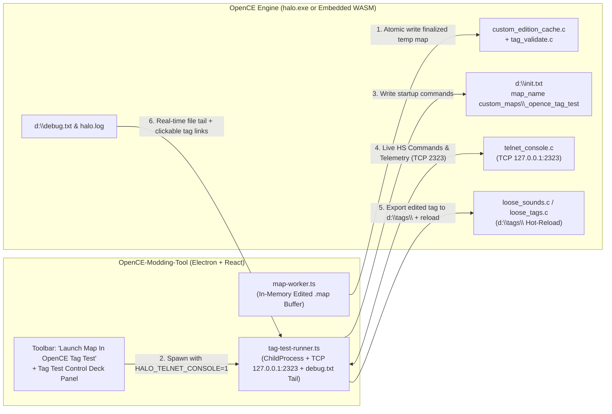

# OpenCE-Modding-Tool — Master Decompilation Synthesis, Feature Extraction & "OpenCE Tag Test" Integration Roadmap

> **Scope of this Document**  
> This document synthesizes:
> 1. The current architecture and milestone status of **[`OpenCE-Modding-Tool`](file:///c:/Users/LeviB/Projects/OpenCE-Modding-Tool/README.md)** (`core/` + `desktop/`).
> 2. The complete reverse-engineering and decompilation outputs of all **8 reference applications** in [`SAMPLE CODE/`](file:///c:/Users/LeviB/Projects/OpenCE-Modding-Tool/SAMPLE%20CODE):
>    - **[`Reclaimer`](file:///c:/Users/LeviB/Projects/OpenCE-Modding-Tool/SAMPLE%20CODE/Reclaimer/SUMMARY.md)** (`1,180` `.cs` files, `52` `.xaml` views, `28` `.resx` resources)
>    - **[`Guerilla CE`](file:///c:/Users/LeviB/Projects/OpenCE-Modding-Tool/SAMPLE%20CODE/Guerilla%20CE/SUMMARY.md)** (`11,397` functions, `336` source units) & **[`Guerilla MCC`](file:///c:/Users/LeviB/Projects/OpenCE-Modding-Tool/SAMPLE%20CODE/Guerilla%20MCC/SUMMARY.md)** (`6,725` functions, `555` source units, `283` RTTI classes)
>    - **[`Sapien CE`](file:///c:/Users/LeviB/Projects/OpenCE-Modding-Tool/SAMPLE%20CODE/Sapien%20CE/SUMMARY.md)** (`12,215` functions, `367` source units) & **[`Sapien MCC`](file:///c:/Users/LeviB/Projects/OpenCE-Modding-Tool/SAMPLE%20CODE/Sapien%20MCC/SUMMARY.md)** (`10,492` functions, `701` source units, `632` RTTI classes)
>    - **[`Tool CE`](file:///c:/Users/LeviB/Projects/OpenCE-Modding-Tool/SAMPLE%20CODE/Tool%20CE/SUMMARY.md)** (`6,150` functions, `21` CLI commands) & **[`Tool MCC`](file:///c:/Users/LeviB/Projects/OpenCE-Modding-Tool/SAMPLE%20CODE/Tool%20MCC/SUMMARY.md)** (`10,211` functions, `746` source units, `38` CLI commands)
>    - **[`Halo Tag Test MCC`](file:///c:/Users/LeviB/Projects/OpenCE-Modding-Tool/SAMPLE%20CODE/Halo%20Tag%20Test%20MCC/SUMMARY.md)** (`17,705` functions across `843` source units, `527` Halo Script functions)
>    - Plus the 4 previously decompiled classic tools ([`SparkEdit v3.02`](file:///c:/Users/LeviB/Projects/OpenCE-Modding-Tool/SAMPLE%20CODE/Sparkedit%20V3.02), [`HMT v3.5`](file:///c:/Users/LeviB/Projects/OpenCE-Modding-Tool/SAMPLE%20CODE/HMT%20V3.5), [`HHT v5`](file:///c:/Users/LeviB/Projects/OpenCE-Modding-Tool/SAMPLE%20CODE/HHT%20V5), [`Eschaton v0.8.1`](file:///c:/Users/LeviB/Projects/OpenCE-Modding-Tool/SAMPLE%20CODE/Eschaton%20V0.8.1) — documented in [`memory/sample-code-reference.md`](file:///c:/Users/LeviB/Projects/OpenCE-Modding-Tool/memory/sample-code-reference.md)).
> 3. The **[OpenCommunityEdition/OpenCE](https://github.com/OpenCommunityEdition/OpenCE)** engine source code (`C:\temp\OpenCE-src`), specifically its Custom Edition cache loader (`port/linux/game/custom_edition_cache.c`), tag validator (`port/linux/game/tag_validate.c`), loose tag hot-reloader (`port/linux/game/loose_sounds.c`), localhost TCP Telnet console (`source/networking/telnet_console.c`), and WebAssembly build target (`port/web/`).
> 4. A complete architectural blueprint for **"Launch Map In OpenCE Tag Test"** so `OpenCE-Modding-Tool` can launch, hot-reload, debug, and live-inspect maps with the full capabilities of `halo_tag_test.exe`.

---

## Part 1: Current State of `OpenCE-Modding-Tool`

### 1.1 Architectural Overview (`core/` + `desktop/`)
`OpenCE-Modding-Tool` is cleanly split into two workspaces:
- **[`core/`](file:///c:/Users/LeviB/Projects/OpenCE-Modding-Tool/core/src/index.ts)**: A pure TypeScript library with zero DOM, React, or Electron dependencies, tested by 41 Vitest suites (493+ tests).
- **[`desktop/`](file:///c:/Users/LeviB/Projects/OpenCE-Modding-Tool/desktop/electron/main.ts)**: An Electron + React + Vite + Three.js GUI application where [`map-worker.ts`](file:///c:/Users/LeviB/Projects/OpenCE-Modding-Tool/desktop/electron/map-worker.ts) runs in a dedicated Node.js `worker_threads` worker holding the active `.map` buffer in memory.

### 1.2 Capabilities Already Built & Verified in `OpenCE-Modding-Tool`

| Subsystem | Key Files in `core/` & `desktop/` | Current Capability |
|---|---|---|
| **Cache Header, Tag Index & Zstd Compression (M1–M3)** | [`header.ts`](file:///c:/Users/LeviB/Projects/OpenCE-Modding-Tool/core/src/map/header.ts), [`tag-index.ts`](file:///c:/Users/LeviB/Projects/OpenCE-Modding-Tool/core/src/map/tag-index.ts), [`open-map.ts`](file:///c:/Users/LeviB/Projects/OpenCE-Modding-Tool/core/src/map/open-map.ts), [`compression.ts`](file:///c:/Users/LeviB/Projects/OpenCE-Modding-Tool/core/src/map/compression.ts) | Parses 2048-byte CE `v609` headers, infers virtual base (`0x40440000` / BSP magic), handles Chimera zstd (`0x861A0261`) decompression/compression, atomic `File > Save` / `Save As` with backup prompt and CRC32 recalculation ([`cache-crc.ts`](file:///c:/Users/LeviB/Projects/OpenCE-Modding-Tool/core/src/map/cache-crc.ts), [`finalize-map.ts`](file:///c:/Users/LeviB/Projects/OpenCE-Modding-Tool/core/src/map/finalize-map.ts)). |
| **Schema-Driven Tag Definition Engine (83 Groups)** | [`engine.ts`](file:///c:/Users/LeviB/Projects/OpenCE-Modding-Tool/core/src/map/definitions/engine.ts), [`codec.ts`](file:///c:/Users/LeviB/Projects/OpenCE-Modding-Tool/core/src/map/definitions/codec.ts), [`groups/*.json`](file:///c:/Users/LeviB/Projects/OpenCE-Modding-Tool/core/src/map/definitions/groups) | Runtime offset & struct size verification across all 83 Halo 1 tag classes. |
| **Dependency Closure, `.ocetags` v5 Extraction & Batch Extract (M4)** | [`dependency-walker.ts`](file:///c:/Users/LeviB/Projects/OpenCE-Modding-Tool/core/src/map/dependency-walker.ts), [`tag-extractor.ts`](file:///c:/Users/LeviB/Projects/OpenCE-Modding-Tool/core/src/map/tag-extractor.ts), [`container.ts`](file:///c:/Users/LeviB/Projects/OpenCE-Modding-Tool/core/src/map/container.ts), [`BatchExtractDialog.tsx`](file:///c:/Users/LeviB/Projects/OpenCE-Modding-Tool/desktop/src/components/BatchExtractDialog.tsx) | Single-tag, multi-tag, and whole-map extraction into portable `.ocetags` v5 containers, including embedded pixel/sound payloads and `gbxmodel` vertex/triangle buffers ([`gbxmodel-geometry.ts`](file:///c:/Users/LeviB/Projects/OpenCE-Modding-Tool/core/src/map/gbxmodel-geometry.ts)). |
| **In-Memory ADD & SWAP Tag Injection (M5)** | [`tag-injector.ts`](file:///c:/Users/LeviB/Projects/OpenCE-Modding-Tool/core/src/map/tag-injector.ts), [`pointer-rebase.ts`](file:///c:/Users/LeviB/Projects/OpenCE-Modding-Tool/core/src/map/pointer-rebase.ts), [`raw-data-region.ts`](file:///c:/Users/LeviB/Projects/OpenCE-Modding-Tool/core/src/map/raw-data-region.ts), [`InjectDialog.tsx`](file:///c:/Users/LeviB/Projects/OpenCE-Modding-Tool/desktop/src/components/InjectDialog.tsx) | Full schema-driven ADD (with tag-array growth pointer shifting across external sounds and BSP paths) and SWAP injection, `gbxmodel` geometry relocation, and embedded (`external=0`) bitmap/sound relocation. |
| **Halo Demo (v6) & Retail/HaloMD (v7) $\rightarrow$ CE (v609) Converter** | [`retail-to-ce.ts`](file:///c:/Users/LeviB/Projects/OpenCE-Modding-Tool/core/src/map/convert/retail-to-ce.ts), [`demo-to-ce.ts`](file:///c:/Users/LeviB/Projects/OpenCE-Modding-Tool/core/src/map/convert/demo-to-ce.ts), [`externalize-in.ts`](file:///c:/Users/LeviB/Projects/OpenCE-Modding-Tool/core/src/map/convert/externalize-in.ts), [`align-tag-data.ts`](file:///c:/Users/LeviB/Projects/OpenCE-Modding-Tool/core/src/map/convert/align-tag-data.ts), [`tag-data-repairs.ts`](file:///c:/Users/LeviB/Projects/OpenCE-Modding-Tool/core/src/map/convert/tag-data-repairs.ts), [`ConvertDialog.tsx`](file:///c:/Users/LeviB/Projects/OpenCE-Modding-Tool/desktop/src/components/ConvertDialog.tsx) | Converts retail PC (`v7`), HaloMD, and Mac Demo (`v6`) maps to CE `v609`, internalizing external `bitmaps.map`/`sounds.map` ranges, 4-byte aligning tag blocks for OpenCE, repairing unaligned script syntax arrays and overlapping blocks, and running preflight OpenCE checks (`model-part-check.ts`, `bitmap-check.ts`, `script-run-check.ts`, `fog-color-check.ts`). |
| **Recursive Tag Field Editor & Dependency Swapper (M7a/M7b)** | [`tag-field-editor.ts`](file:///c:/Users/LeviB/Projects/OpenCE-Modding-Tool/core/src/map/tag-field-editor.ts), [`tag-dependency-swapper.ts`](file:///c:/Users/LeviB/Projects/OpenCE-Modding-Tool/core/src/map/tag-dependency-swapper.ts), [`TagEditorDialog.tsx`](file:///c:/Users/LeviB/Projects/OpenCE-Modding-Tool/desktop/src/components/TagEditorDialog.tsx), [`TagFieldEditorPanel.tsx`](file:///c:/Users/LeviB/Projects/OpenCE-Modding-Tool/desktop/src/components/TagFieldEditorPanel.tsx), [`PropertiesPalette.tsx`](file:///c:/Users/LeviB/Projects/OpenCE-Modding-Tool/desktop/src/components/PropertiesPalette.tsx) | Right-click Tag Editor modal decoding root fields + nested `TagReflexive` blocks up to depth 8 with dotted-path in-place mutation (`magazines[0].rounds recharged`), plus HHT-style dependency swapping, `ustr` Unicode String List editing ([`unicode-string-editor.ts`](file:///c:/Users/LeviB/Projects/OpenCE-Modding-Tool/core/src/map/unicode-string-editor.ts)), reverse dependency lookup ([`tag-reverse-dependencies.ts`](file:///c:/Users/LeviB/Projects/OpenCE-Modding-Tool/core/src/map/tag-reverse-dependencies.ts)), and tag rename/duplication ([`tag-index-editor.ts`](file:///c:/Users/LeviB/Projects/OpenCE-Modding-Tool/core/src/map/tag-index-editor.ts)). |
| **Three.js 3D Scenario Viewport (M8)** | [`bsp-geometry.ts`](file:///c:/Users/LeviB/Projects/OpenCE-Modding-Tool/core/src/render/bsp-geometry.ts), [`model-geometry.ts`](file:///c:/Users/LeviB/Projects/OpenCE-Modding-Tool/core/src/render/model-geometry.ts), [`bitmap-textures.ts`](file:///c:/Users/LeviB/Projects/OpenCE-Modding-Tool/core/src/render/bitmap-textures.ts), [`scenario-objects.ts`](file:///c:/Users/LeviB/Projects/OpenCE-Modding-Tool/core/src/render/scenario-objects.ts), [`ScenarioViewport.tsx`](file:///c:/Users/LeviB/Projects/OpenCE-Modding-Tool/desktop/src/components/viewport/ScenarioViewport.tsx) | Renders `sbsp` 3D meshes, DXT1/3/5 & RGBA textures (internal + `bitmaps.map`), placed `gbxmodel` instances (`vehi`, `scen`, `bipd`, `weap`, `eqip`), and team-colored player spawn markers with 6-DOF WASD fly camera and 4 render modes. |

---

## Part 2: Executive Synthesis of the 8 Decompiled Reference Applications

| Application | Binary / Tech Stack | Scale of Decompilation | Primary Role & Unique Strengths |
|---|---|---|---|
| **[`Reclaimer`](file:///c:/Users/LeviB/Projects/OpenCE-Modding-Tool/SAMPLE%20CODE/Reclaimer/SUMMARY.md)** | `.NET Framework 4.8` WPF (`C#`), HelixToolkit.Wpf.SharpDX, DirectXTex, WWise/FMOD/XMA | `1,180` `.cs` files, `52` `.xaml` views, `28` `.resx` files | Modern C# read/extract/preview suite across Halo 1–5/MCC. Best clean reference for **3D model/BSP export (`GLTF`, `FBX`, `DAE`, `OBJ`, `JMS`, `JMA`, `IMF`)**, **skeletal bone/marker conversion**, **DXT/BCn/Morton swizzle texture decoding**, and **sound permutation extraction**. |
| **[`Guerilla CE`](file:///c:/Users/LeviB/Projects/OpenCE-Modding-Tool/SAMPLE%20CODE/Guerilla%20CE/SUMMARY.md)** | 32-bit x86 (`MSVC 7.1`, MFC 7.1, D3D9, DirectSound) | `11,397` functions, `336` `src/` units, `183` RTTI classes, `45` dialogs | Original 2004 HEK tag editor. Contains all **83 `tag_group` reflection schemas**, runtime `postprocess_proc` callbacks, **2D periodic/transition curve graph editor (`FUNCTION_VIEW`)**, bitmap viewer (`BITMAP_SHOW_GROUP_DIALOG`), and sound permutation player (`SOUND_PERM_DIALOG_ID`). |
| **[`Guerilla MCC`](file:///c:/Users/LeviB/Projects/OpenCE-Modding-Tool/SAMPLE%20CODE/Guerilla%20MCC/SUMMARY.md)** | 32-bit x86 (`MSVC v141` VS 2017, MFC 14, D3D9, FMOD) | `6,725` functions, `555` `src/` units, `283` RTTI classes, `44` dialogs | Replaces `Guerilla CE`. Strips dead AI/script engine bloat; adds **interactive WYSIWYG HUD layout preview dialogs (`GRENADE_HUD_INTERFACE_VIEW_CUSTOM_ID`, `UNIT_HUD_INTERFACE_VIEW_CUSTOM_ID`, `WEAPON_HUD_INTERFACE_VIEW_CUSTOM_ID`)**, **XML tag exporter (`c_xml_tag_exporter`)**, symbolic `sizeof(...)` padding expressions, and MCC tag schema extensions (Metagame scoring, Scavenger Hunt objects, Remastered HUD remaps). |
| **[`Sapien CE`](file:///c:/Users/LeviB/Projects/OpenCE-Modding-Tool/SAMPLE%20CODE/Sapien%20CE/SUMMARY.md)** | 32-bit x86 (`MSVC 7.1`, WTL/Win32, D3D9, DirectSound, Miles) | `12,215` functions, `367` `src/` units, `443` RTTI classes, `62` dialogs | Original 2004 3D scenario editor. Combines Hierarchy View, Properties Palette, Tool Window, Output Window, and live D3D9 Game Window with `543` Halo Script functions and live radiosity. |
| **[`Sapien MCC`](file:///c:/Users/LeviB/Projects/OpenCE-Modding-Tool/SAMPLE%20CODE/Sapien%20MCC/SUMMARY.md)** | 32-bit x86 (`MSVC v141` VS 2017, WTL, D3D9, FMOD, XInput) | `10,492` functions, `701` `src/` units, `632` RTTI classes, `63` dialogs | Replaces `Sapien CE`. Exposes the complete C++ `c_tool_handler` class hierarchy (`c_create_tool_handler`, `c_object_placement_handler`, `c_detail_object_tool_handler`, `c_decal_tool_handler`, `c_cluster_properties_tool_handler`, `c_encounters_tool_handler`, `c_firing_positions_tool_handler`, `c_portal_tool_handler`, `c_trigger_volume_tool_handler`). |
| **[`Tool CE`](file:///c:/Users/LeviB/Projects/OpenCE-Modding-Tool/SAMPLE%20CODE/Tool%20CE/SUMMARY.md)** | 32-bit x86 (`MSVC 7.1` Console, D3D9, Ogg Vorbis) | `6,150` functions, `304` `src/` units, `21` CLI commands | Original 2004 asset compiler, BSP/collision builder, radiosity lightmapper, and `v609` `.map` cache builder. |
| **[`Tool MCC`](file:///c:/Users/LeviB/Projects/OpenCE-Modding-Tool/SAMPLE%20CODE/Tool%20MCC/SUMMARY.md)** | 32-bit x86 (`MSVC v141` Console, `libfbxsdk.dll`, `D3DCompiler_47.dll`, FMOD) | `10,211` functions, `746` `src/` units, `214` RTTI classes, `38` CLI commands | Replaces `Tool CE`. Expands CLI from 21 to **38 commands**, adding `fbx-to-jms`, `fbx-to-jma`, `export-structure-mesh-obj`, `plate`, `copy-detail-objects`, `camera-track`, `fix-tags`, `check-map`, `check-shaders`, `compile-shaders`, `export-sounds-to-fsb`, `export-tag-to-xml`, `script-doc`, and `export-scenario-script-data-to-debug-text`. |
| **[`Halo Tag Test MCC`](file:///c:/Users/LeviB/Projects/OpenCE-Modding-Tool/SAMPLE%20CODE/Halo%20Tag%20Test%20MCC/SUMMARY.md)** | 32-bit x86 (`MSVC v141` `tag_test` build, D3D9, FMOD, Bink) | `17,705` functions, `843` `src/` units, `26,601` assert/source refs | Standalone developer/debug Halo 1 game engine that loads raw unpacked tags directly from `tags\` with full developer console, AI/physics/portal debug overlays, and non-fatal runtime tag error reporting. |

---

## Part 3: High-Value Features & Algorithms to Harvest into `OpenCE-Modding-Tool`

Below is the comprehensive catalog of algorithms, data structures, and UI workflows from the decompiled codebases that directly unlock new milestones in `OpenCE-Modding-Tool`.

---

### 3.1 From `Guerilla CE` & `Guerilla MCC`: Advanced Tag Editing, Postprocessing & Visual Previewers

#### A. Automatic Postprocessing on Tag Save / Field Edit (`postprocess_proc`)
- **What Guerilla Does**:
  - In [`Guerilla CE/extracted/tag_groups.json`](file:///c:/Users/LeviB/Projects/OpenCE-Modding-Tool/SAMPLE%20CODE/Guerilla%20CE/extracted/tag_groups.json) and [`Guerilla MCC/extracted/tag_groups.json`](file:///c:/Users/LeviB/Projects/OpenCE-Modding-Tool/SAMPLE%20CODE/Guerilla%20MCC/extracted/tag_groups.json), almost every `tag_group` defines a `postprocess_proc` function pointer in [`src/tag_files/tag_groups.c`](file:///c:/Users/LeviB/Projects/OpenCE-Modding-Tool/SAMPLE%20CODE/Guerilla%20MCC/src/tag_files/tag_groups.c) (and per-domain files like `src/weapons/weapon_definitions.c`, `src/effects/particle_definitions.c`, `src/shaders/shader_definitions.c`, `src/interface/hud_definitions.c`).
  - When a modder edits an angle, rate of fire, velocity, fade distance, or color in Guerilla, the tag's `postprocess_proc` automatically recalculates derived runtime fields (e.g., converting degrees to radians, seconds to 30-Hz ticks, min/max bounds to deltas, normalizing vectors, or precomputing shader animation constants) that are marked `nonCached` or read-only (`*`) in the tag struct!
- **Why `OpenCE-Modding-Tool` Needs This**:
  - Currently, [`core/src/map/tag-field-editor.ts`](file:///c:/Users/LeviB/Projects/OpenCE-Modding-Tool/core/src/map/tag-field-editor.ts) writes the user's raw edited field directly into the `.map`'s already-postprocessed tag cache. If a user edits a field in a `.map` whose runtime behavior depends on a derived field calculated during `postprocess_proc`, the change won't take full effect unless the derived field is also updated!
  - By translating the decompiled `postprocess_proc` routines from `Guerilla MCC/src/` (and OpenCE's `source/*/*_definitions.c`) into a new `core/src/map/tag-postprocess.ts` module, editing any field in `TagEditorDialog.tsx` will automatically update all dependent runtime fields in the `.map`!

#### B. Interactive 2D Function Curve Editor (`FUNCTION_VIEW`)
- **Source Reference**:
  - Dialog `FUNCTION_VIEW` (`ID 179`) in [`Guerilla CE/resources/dialogs.json`](file:///c:/Users/LeviB/Projects/OpenCE-Modding-Tool/SAMPLE%20CODE/Guerilla%20CE/resources/dialogs.json) and function curve math in [`Guerilla MCC/src/math/periodic_functions.c`](file:///c:/Users/LeviB/Projects/OpenCE-Modding-Tool/SAMPLE%20CODE/Guerilla%20MCC/src/math/periodic_functions.c) (`periodic_function_evaluate` / `transition_function_evaluate`).
- **How It Works**:
  - Halo objects, weapons, lights, shaders, and effects define `A in` / `B in` / `C in` / `D in` and `functions` blocks (`function_type`: `linear`, `early`, `very_early`, `late`, `very_late`, `cosine`, `one`, `zero`; `periodic`: `one`, `zero`, `cosine`, `cosine_variable_period`, `diagonal_wave`, `diagonal_wave_variable_period`, `slide`, `slide_variable_period`, `noise`, `jitter`, `wander`, `spark`) with frequency, phase, exponent, and bounds.
  - Adding an inline HTML5 `<canvas>` curve plotter inside [`TagFieldEditorPanel.tsx`](file:///c:/Users/LeviB/Projects/OpenCE-Modding-Tool/desktop/src/components/TagFieldEditorPanel.tsx) whenever a user expands a `functions` reflexive block lets users visually see the exact oscillation/transition curve as they tweak period, phase, and function enum!

#### C. Live WYSIWYG HUD Interface Previewer (`wphi`, `unhi`, `grhi`)
- **Source Reference**:
  - Dialogs `WEAPON_HUD_INTERFACE_VIEW_CUSTOM_ID` (`299`), `GRENADE_HUD_INTERFACE_VIEW_CUSTOM_ID` (`350`), and `UNIT_HUD_INTERFACE_VIEW_CUSTOM_ID` (`351`) in [`Guerilla MCC/resources/dialogs.json`](file:///c:/Users/LeviB/Projects/OpenCE-Modding-Tool/SAMPLE%20CODE/Guerilla%20MCC/resources/dialogs.json) and [`Guerilla MCC/src/guerilla/`](file:///c:/Users/LeviB/Projects/OpenCE-Modding-Tool/SAMPLE%20CODE/Guerilla%20MCC/src/guerilla).
  - Also cross-referenced with OpenCE's [`port/linux/game/cache_file_formats.c`](file:///C:/temp/OpenCE-src/port/linux/game/cache_file_formats.c) (`hud_placement_block_convert` / `hud_meters_convert`) and [`port/linux/src/hud_hires.c`](file:///C:/temp/OpenCE-src/port/linux/src/hud_hires.c).
- **Feature to Unlock in `OpenCE-Modding-Tool`**:
  - When a user opens a `weapon_hud_interface` (`wphi`), `unit_hud_interface` (`unhi`), or `grenade_hud_interface` (`grhi`) tag in `TagEditorDialog.tsx`, render a live 2D `<canvas>` HUD preview with:
    - Aspect ratio radio toggles: **`4:3`**, **`16:9`**, and **`Split Screen`** (matching `Guerilla MCC` controls `3501`–`3503`).
    - **`Show Safe Frame`** toggle (`3505`).
    - Interactive drag-and-drop of HUD anchor coordinates (`anchor`: `top_left`, `top_right`, `bottom_left`, `bottom_right`, `center`), static element bitmaps, ammo meters, and crosshair reticles!

#### D. Complete Schema Documentation & Symbolic Padding/Macro Names
- **Source Reference**:
  - [`Guerilla MCC/include/tag_definitions.h`](file:///c:/Users/LeviB/Projects/OpenCE-Modding-Tool/SAMPLE%20CODE/Guerilla%20MCC/include/tag_definitions.h) and [`Guerilla MCC/extracted/tag_groups.json`](file:///c:/Users/LeviB/Projects/OpenCE-Modding-Tool/SAMPLE%20CODE/Guerilla%20MCC/extracted/tag_groups.json).
- **Feature to Unlock**:
  - `Guerilla MCC`'s 32-byte `tag_block_definition` and 16-byte `tag_field` tables contain Bungie's official `#explanation` help paragraphs (e.g., explaining exactly how AI perception, vehicle suspension, or shader stages work), unit suffixes (`world units`, `seconds`, `degrees`, `[0,1]`), and symbolic maximum block counts (`MAXIMUM_SCENARIO_NETGAME_EQUIPMENT_COUNT`).
  - We can enrich `core/src/map/definitions/groups/*.json` with these exact `#explanation` headers and field tooltips so `TagFieldEditorPanel.tsx` displays Bungie's official documentation inline!

---

### 3.2 From `Sapien CE` & `Sapien MCC`: Unlocking Full 3D Level Design in `ScenarioViewport.tsx`

[`Sapien MCC`](file:///c:/Users/LeviB/Projects/OpenCE-Modding-Tool/SAMPLE%20CODE/Sapien%20MCC/SUMMARY.md) exposes `632` RTTI classes in [`Sapien MCC/classes/`](file:///c:/Users/LeviB/Projects/OpenCE-Modding-Tool/SAMPLE%20CODE/Sapien%20MCC/classes) and `701` source files in [`Sapien MCC/src/`](file:///c:/Users/LeviB/Projects/OpenCE-Modding-Tool/SAMPLE%20CODE/Sapien%20MCC/src). We can bring Sapien's specialized 3D editing modes directly into `OpenCE-Modding-Tool`'s Three.js [`ScenarioViewport.tsx`](file:///c:/Users/LeviB/Projects/OpenCE-Modding-Tool/desktop/src/components/viewport/ScenarioViewport.tsx):

| Sapien Tool Handler (`Sapien MCC/src/sapien/`) | How It Works in Decompiled Sapien | How to Implement in `OpenCE-Modding-Tool` (`core/src/render/` + `ScenarioViewport.tsx`) |
|---|---|---|
| **1. Object Placement & Surface Snapping** (`c_create_tool_handler`, `c_object_placement_handler`) | Casts a ray from camera through mouse cursor against `sbsp.collision_bsp` (`src/physics/collision_bsp.c`), places or moves the selected `scnr` instance, aligns Z to surface height (or surface normal if `align to normal` is checked), and updates the instance's `bsp_index` and cluster index. | Extend `ScenarioViewport.tsx` with Three.js `TransformControls` + raycasting against the `sbsp` mesh. Right-clicking in 3D spawns a new instance from the active palette; pressing `G` snaps to ground. |
| **2. AI Encounters, Squads & 3D Firing Positions** (`c_encounters_tool_handler`, `c_firing_positions_tool_handler`, `src/ai/ai_scenario_definitions.c`) | Renders `scnr.encounters` (`0x42C`, 176-byte entries): squad spawn points (`squads` reflexive), platoons, and 3D `firing_positions` (24-byte entries with `position` `float[3]` and `group_index` `0..25` = `A..Z`), color-coded by group letter and linked to BSP cluster indices. | Add an **`AI Encounters`** layer toggle in `ScenarioViewport.tsx` that renders squad spawn markers (using their `actor_variant` -> `biped` -> `gbxmodel` mesh!) and `A`–`Z` firing position spheres, allowing modders to place/move AI squads and firing points in 3D on both singleplayer and multiplayer maps! |
| **3.BSP Cluster Properties & Portal Visualizer** (`c_cluster_properties_tool_handler`, `c_portal_tool_handler`, `src/structures/structure_bsp_definitions.c`) | Identifies which BSP cluster (`sbsp.clusters`, `0x68` bytes each) the camera is inside and lets the designer assign per-cluster palettes: **Sky index**, **Fog** (`scnr.planar_fog_palette`), **Background Sound** (`scnr.background_sound_palette`), **Sound Environment / Reverb** (`scnr.sound_environment_palette`), and **Weather Particle System** (`scnr.weather_palette`), while drawing semi-transparent portal planes (`sbsp.cluster_portals`). | Add a **"Cluster Inspector & Portal Overlay"** mode in `ScenarioViewport.tsx`: highlights the current BSP cluster boundary and portals in 3D and opens a floating panel to change that room's ambient sound, reverb, weather (rain/snow), and fog! |
| **4. 3D Detail Object Painter (`dobc`)** (`c_detail_object_tool_handler`, `Tool MCC` `copy-detail-objects` at `0x00414A40`) | Paints grass/pebbles/debris cells (`sbsp.detail_objects`) onto BSP triangles and samples the lightmap pixel at that UV to bake vertex lighting into the cell. `Tool MCC`'s `copy-detail-objects` copies these cells between BSPs. | Render `sbsp.detail_objects` sprites in `ScenarioViewport.tsx`, provide a 3D brush to paint/erase grass & rocks, and include a 1-click **"Copy Detail Objects"** / **"Strip Detail Objects"** button for BSP swaps! |
| **5. 3D Decal Painter (`deca`)** (`c_decal_tool_handler`, `src/effects/decals.c`) | Projects `scnr.decals` (`0x50` reflexive, 16-byte entries: `decal_type` palette index, `yaw`, `pitch`, `position` `float[3]`) onto BSP surfaces. | Render placed scenario decals in `ScenarioViewport.tsx` and allow click-to-stamp blood, blast marks, and Forerunner glyphs onto walls/floors. |
| **6. Trigger Volumes & Cutscene Camera Points** (`c_trigger_volume_tool_handler`, `src/cutscene/`) | Renders `scnr.trigger_volumes` (`0x360`, 96-byte entries with `name`, `forward`/`up` orientation vectors, `position`, and `extents`) as translucent 3D oriented bounding boxes (OBBs), and `scnr.cutscene_camera_points` (`0x4F8`, 104-byte entries) as camera frustums with spline path previews. | Add **`Trigger Volumes`** and **`Cutscene Cameras`** layer toggles in `ScenarioViewport.tsx` with box-extents resize handles and a **"Preview Camera Path"** button that flies the Three.js camera along the cutscene points! |

---

### 3.3 From `Tool CE` & `Tool MCC`: Asset Compilation, Mesh Diagnostics, & Halo Script (`hsc`) Tooling

[`Tool MCC`](file:///c:/Users/LeviB/Projects/OpenCE-Modding-Tool/SAMPLE%20CODE/Tool%20MCC/SUMMARY.md) (`38` CLI commands in [`extracted/tool_commands.json`](file:///c:/Users/LeviB/Projects/OpenCE-Modding-Tool/SAMPLE%20CODE/Tool%20MCC/extracted/tool_commands.json)) contains several standalone utilities whose decompiled C/C++ algorithms can be ported directly into TypeScript inside `core/`:

#### 1. Halo Script (`hsc`) Decompiler, Syntax Checker & Bytecode Compiler
- **Decompiled Sources**:
  - [`Tool MCC/extracted/halo_script_functions.json`](file:///c:/Users/LeviB/Projects/OpenCE-Modding-Tool/SAMPLE%20CODE/Tool%20MCC/extracted/halo_script_functions.json) (`527` functions) & [`Tool CE/extracted/halo_script_functions.json`](file:///c:/Users/LeviB/Projects/OpenCE-Modding-Tool/SAMPLE%20CODE/Tool%20CE/extracted/halo_script_functions.json) (`543` functions) — contains every function's exact opcode index, name, return type (`unparsed`, `special_form`, `function_name`, `passthrough`, `void`, `boolean`, `real`, `short`, `long`, `string`, `script`, `trigger_volume`, `cutscene_flag`, `cutscene_camera_point`, `cutscene_title`, `cutscene_recording`, `device_group`, `ai`, `ai_command_list`, `starting_profile`, `conversation`, `navpoint`, `hud_message`, `object_list`, `sound`, `effect`, `damage`, `looping_sound`, `animation_graph`, `actor_variant`, `damage_effect`, `object_definition`, `game_difficulty`, `team`, `ai_default_state`, `actor_type`, `hud_corner`, `object`, `unit`, `vehicle`, `weapon`, `device`, `scenery`, `object_name`), parameter type list, and help string!
  - [`Tool MCC/src/tool/export_scenario_script_data.c`](file:///c:/Users/LeviB/Projects/OpenCE-Modding-Tool/SAMPLE%20CODE/Tool%20MCC/src) (`export-scenario-script-data-to-debug-text` at `0x00422950`) and [`Tool MCC/src/hs/hs_compile.c`](file:///c:/Users/LeviB/Projects/OpenCE-Modding-Tool/SAMPLE%20CODE/Tool%20MCC/src/hs/hs_compile.c).
  - OpenCE's [`port/linux/game/custom_edition_scripts.c`](file:///C:/temp/OpenCE-src/port/linux/game/custom_edition_scripts.c) and [`source/hs/hs_compile.c`](file:///C:/temp/OpenCE-src/source/hs/hs_compile.c).
- **What This Unlocks in `OpenCE-Modding-Tool`**:
  - **Built-in `.hsc` Script Decompiler**: Every compiled `.map` stores its scripts as an AST of 20-byte `hs_syntax_node` structs inside `scnr.script_syntax_data` (`scnr + 0x480`) and string literals in `scnr.script_string_data` (`scnr + 0x46C`), plus script headers in `scnr.scripts` (`scnr + 0x444`, 92 bytes each) and globals in `scnr.globals` (`scnr + 0x450`, 92 bytes each). Walking the `first_expression_index` / `next_node_index` linked list reconstructs 100% of the map's `.hsc` Lisp source code!
  - **In-App Halo Script Editor & Compiler**: A dedicated **"Scripts (`hsc`)"** tab in `OpenCE-Modding-Tool` with syntax highlighting, autocomplete for all 543 Halo Script functions (powered by `halo_script_functions.json`), OpenCE allowlist & `begin_random` validation (already started in [`core/src/map/convert/script-run-check.ts`](file:///c:/Users/LeviB/Projects/OpenCE-Modding-Tool/core/src/map/convert/script-run-check.ts)), and one-click compilation back into the `.map`'s `script_syntax_data` and `script_string_data`!

#### 2. Structure BSP to Wavefront `.obj` Exporter & `.wrl` Error Visualizer
- **Decompiled Sources**:
  - `export-structure-mesh-obj` (`0x0044F340` in [`Tool MCC/src/tool/import_structure.c`](file:///c:/Users/LeviB/Projects/OpenCE-Modding-Tool/SAMPLE%20CODE/Tool%20MCC/src/tool/import_structure.c)).
  - `.wrl` VRML error writer in [`Tool MCC/src/structures/structure_bsp.c`](file:///c:/Users/LeviB/Projects/OpenCE-Modding-Tool/SAMPLE%20CODE/Tool%20MCC/src/structures) (detects open edges, degenerate triangles, overlapping coplanar surfaces, and portal leaks).
- **What This Unlocks in `OpenCE-Modding-Tool`**:
  - One-click **"Export BSP to `.obj` + `.mtl` (with textures)"** in `TagBrowser.tsx` and `ScenarioViewport.tsx`.
  - **3D `.wrl` Diagnostic Overlay**: Import any `.wrl` file generated by `tool.exe` or run geometry checks directly inside `ScenarioViewport.tsx` to highlight open edges (red lines), degenerate faces (yellow), and portal errors in 3D!

#### 3. Automated Colour-Plate Sheet Packer (`plate`) & `.font` Generator (`windows-font`)
- **Decompiled Sources**:
  - `plate` (`0x0042D050` in [`Tool MCC`](file:///c:/Users/LeviB/Projects/OpenCE-Modding-Tool/SAMPLE%20CODE/Tool%20MCC/SUMMARY.md)) — packs multiple loose sprite/texture frames into a single colour-plate sheet with exact blue/magenta border delimiters and sequence registration points so `bitm` sprite sequences work automatically.
  - `windows-font` (`0x00428A50` in [`Tool MCC`](file:///c:/Users/LeviB/Projects/OpenCE-Modding-Tool/SAMPLE%20CODE/Tool%20MCC/SUMMARY.md)) — rasterizes any TrueType/OpenType system font into a Halo `.font` (`font`) tag (`character_tables`, kerning pairs, and packed glyph pixel buffer).
- **What This Unlocks in `OpenCE-Modding-Tool`**:
  - **Sprite & Reticle Sheet Builder**: Modders drop multiple `.png` frames into the Bitmap Editor and `OpenCE-Modding-Tool` automatically packs the sprite sequence and updates `bitm.sequences`!
  - **TrueType `.font` Importer**: Modders pick any `.ttf`/`.otf` font file and `OpenCE-Modding-Tool` rasterizes the glyphs on an HTML5 `<canvas>` and injects the new `.font` tag directly into `ui.map` or any scenario map!

#### 4. Cross-Map Scenery Merger (`merge-scenery`) & Map/Tag Repair Suite (`fix-tags`, `check-map`)
- **Decompiled Sources**:
  - `merge-scenery` (`0x0043B2A0` in [`Tool MCC`](file:///c:/Users/LeviB/Projects/OpenCE-Modding-Tool/SAMPLE%20CODE/Tool%20MCC/SUMMARY.md)), `fix-tags` (`0x00423DA0`), `check-map` (`0x004105C0`), and `find-dialogue` (`0x0042A220`).
- **What This Unlocks in `OpenCE-Modding-Tool`**:
  - **"Merge Scenery / Objects from Another Map..."**: Import all placed scenery, vehicles, or netgame equipment (along with their palette tags and transitive dependencies!) from one `.map` into another in a single click.

---

### 3.4 From `Reclaimer`: Modern C# Asset Pipelines (`GLTF`, `FBX`, `JMS`, `JMA`, `DDS`, Audio)

[`SAMPLE CODE/Reclaimer`](file:///c:/Users/LeviB/Projects/OpenCE-Modding-Tool/SAMPLE%20CODE/Reclaimer/SUMMARY.md) provides clean, modern, strongly-typed C# implementations that map 1-to-1 to TypeScript:

1. **Multi-Format 3D Model & Skeletal Export/Import (`Reclaimer.Core/Geometry/` & `Reclaimer.Blam/Halo1/gbxmodel.cs`)**:
   - [`gbxmodel.cs`](file:///c:/Users/LeviB/Projects/OpenCE-Modding-Tool/SAMPLE%20CODE/Reclaimer/Reclaimer.Blam/Reclaimer/Blam/Halo1/gbxmodel.cs) + [`GltfWriter.cs`](file:///c:/Users/LeviB/Projects/OpenCE-Modding-Tool/SAMPLE%20CODE/Reclaimer/Reclaimer.Core/Reclaimer/Geometry/Compatibility) + [`JmsWriter.cs`](file:///c:/Users/LeviB/Projects/OpenCE-Modding-Tool/SAMPLE%20CODE/Reclaimer/Reclaimer.Core/Reclaimer/Geometry/Compatibility):
     - Shows the exact matrix math to convert Halo 1's `nodes` (`0x9C`-byte bone hierarchy with `default_translation`, `default_rotation` quaternion, and `4x3` inverse bind matrix), `markers` (`0x40` bytes), `regions`, `permutations`, and 68-byte dual-bone-weighted vertices (`node0_index`, `node1_index`, `node0_weight`, `node1_weight`) into **GLTF 2.0 / GLB**, **JMS (v8200)**, and **Wavefront OBJ**!
   - [`model_animations.cs`](file:///c:/Users/LeviB/Projects/OpenCE-Modding-Tool/SAMPLE%20CODE/Reclaimer/Reclaimer.Blam/Reclaimer/Blam/Halo1/model_animations.cs):
     - Decodes Halo 1 compressed and uncompressed keyframe animations (`antr`) into skeletal bone tracks for live 3D animation playback in Three.js or `.jma` export!
2. **Complete Texture & Cubemap/Swizzle Pipeline (`Reclaimer.Blam/Halo1/bitmap.cs`)**:
   - [`bitmap.cs`](file:///c:/Users/LeviB/Projects/OpenCE-Modding-Tool/SAMPLE%20CODE/Reclaimer/Reclaimer.Blam/Reclaimer/Blam/Halo1/bitmap.cs) handles all 18 Halo 1 bitmap formats (`A8`, `Y8`, `AY8`, `A8Y8`, `R5G6B5`, `A1R5G5B5`, `A4R4G4B4`, `X8R8G8B8`, `A8R8G8B8`, `DXT1`, `DXT3`, `DXT5`, `P8`), Xbox Morton unswizzling, and Halo 1 cubemap face interleaving (`+X, -X, +Y, -Y, +Z, -Z` stored per-face across mipmaps on PC vs. per-mipmap on Xbox).
3. **Xbox ADPCM & Sound Permutation Decoder (`Reclaimer.Blam/Halo1/sound.cs` + OpenCE `custom_edition_sounds.c`)**:
   - [`sound.cs`](file:///c:/Users/LeviB/Projects/OpenCE-Modding-Tool/SAMPLE%20CODE/Reclaimer/Reclaimer.Blam/Reclaimer/Blam/Halo1/sound.cs) paired with OpenCE's [`port/linux/game/custom_edition_sounds.c`](file:///C:/temp/OpenCE-src/port/linux/game/custom_edition_sounds.c) gives both the **decoder** and the **encoder** for Halo's 36-byte-block Xbox IMA ADPCM format (`64` samples per 36-byte block per channel) as well as chained split-permutation assembly (`next_permutation_index`).

---

## Part 4: Architectural Blueprint for `"Launch Map In OpenCE Tag Test"`

### 4.1 Understanding How `halo_tag_test.exe` Works vs. How `OpenCE` Works

In HCEEK, [`halo_tag_test.exe`](file:///c:/Users/LeviB/Projects/OpenCE-Modding-Tool/SAMPLE%20CODE/Halo%20Tag%20Test%20MCC/SUMMARY.md) (`17,705` functions) is a special build of the Halo 1 engine with four defining capabilities:
1. **Instant Playtesting Without Manual Map Copying**: Launches directly into the scenario being edited.
2. **Full Developer Console & Halo Script (`hs`) VM**: Every debug global (`debug_objects`, `debug_portals`, `ai_render`, `rasterizer_wireframe`, `cheat_deathless_player`, `cheat_infinite_ammo`, `cheat_bump_possession`, `camera_control`, `game_speed`) and all 527+ `hs` functions are unlocked.
3. **Live Diagnostic & Assertion Logging (`debug.txt`)**: Logs every tag validation warning, missing dependency, script halt, or out-of-range value with exact tag names and source file/line numbers.
4. **Loose Tag Loading / Hot-Reloading**: Reads modified tags without requiring a full rebuild from scratch.

Now look at what **[OpenCommunityEdition/OpenCE](https://github.com/OpenCommunityEdition/OpenCE)** (`C:\temp\OpenCE-src`) **already has built into its source code**:
1. **Native Custom Edition (`v609`) `.map` Cache Loader**: [`port/linux/game/custom_edition_cache.c`](file:///C:/temp/OpenCE-src/port/linux/game/custom_edition_cache.c) & [`cache_file_formats.c`](file:///C:/temp/OpenCE-src/port/linux/game/cache_file_formats.c) load `.map` files from `<data_root>\custom_maps\`, validate every tag block against [`tag_validate.c`](file:///C:/temp/OpenCE-src/port/linux/game/tag_validate.c) (`tag_schema_*.c`), and log every single correction or defect to `<data_root>\debug.txt`.
2. **Startup Script Execution (`init.txt`)**: At startup, OpenCE reads `<data_root>\init.txt` and executes its console commands (e.g., `map_name custom_maps\<map_name>` jumps straight into the map, skipping the main menu!).
3. **Built-in Localhost TCP Telnet Script Console (`source/networking/telnet_console.c`)**:
   - Enabled via environment variables **`HALO_TELNET_CONSOLE=1`** and **`HALO_TELNET_CONSOLE_PORT=2323`** (defined in [`port/linux/src/port_config.c`](file:///C:/temp/OpenCE-src/port/linux/src/port_config.c#L508-L515)).
   - Listens on `127.0.0.1:2323`, accepts any Halo Script (`hs`) expression or debug global assignment over TCP, executes it immediately on the next engine tick via `hs_compile_and_evaluate()`, and streams all console output and `error()` lines back over the TCP socket via `telnet_console_print()`!
4. **Loose Tag Hot-Reloading (`port/linux/game/loose_sounds.c`)**:
   - Enabled via **`HALO_LOOSE_SOUNDS=1`** (`audio.loose_sounds = true`).
   - Intercepts tags from `<data_root>\tags\` and hot-reloads them in-game when `loose_sounds_reload` is sent to the console!
5. **Dual Release & Debug Builds + WebAssembly Build (`ninja windows` & `ninja web`)**:
   - OpenCE ships both `halo-windows-release.zip` (continues past non-fatal asserts, logging `"EXCEPTION assert ... (release build)"`) and `halo-windows-debug.zip` (halts on the exact assertion with stack trace in `debug.txt`), plus a **WebAssembly + WebGL 2 build** (`ninja web` $\rightarrow$ `build/web/site/`).

---

### 4.2 Three-Tier Architecture for `"Launch Map In OpenCE Tag Test"`



---

#### Tier 1: Zero-Fork Integration with Stock OpenCE (`halo.exe` Release or Debug) — Ready to Build Immediately
This tier works out-of-the-box with the user's existing OpenCE installation (e.g., OpenCE Build 190 `halo.exe`) with **zero modifications to OpenCE required**:

1. **Settings Configuration (`desktop/electron/settings.ts` & `SettingsDialog.tsx`)**:
   - Add two paths to `settings.json`:
     - `openCeExecutablePath`: Path to OpenCE's `halo.exe` (e.g., `C:\Games\OpenCE\halo.exe`).
     - `openCeDebugExecutablePath` *(optional)*: Path to `halo-debug.exe` for strict assertion testing.
2. **One-Click Staging of the In-Memory Map (`desktop/electron/tag-test-runner.ts`)**:
   - When the user clicks **"Launch Map In OpenCE Tag Test"** (in `Toolbar.tsx` or `MenuBar.tsx` `Tools > Launch Map In OpenCE Tag Test (F5)`):
     - Even if the user has unsaved in-memory edits (tag field tweaks, dependency swaps, injected `.ocetags`, moved 3D spawns/vehicles), `map-worker.ts` calls `finalizeForSave()` on a scratch copy and writes `<openCeDataRoot>\custom_maps\_opence_tag_test.map` atomically.
     - Note: Because OpenCE's `custom_edition_cache.c` supports loading any `.map` in `custom_maps\` regardless of whether it is a solo (`campaign`) or `multiplayer` scenario, both singleplayer and multiplayer maps work seamlessly!
3. **Automatic `init.txt` & Environment Variable Injection**:
   - `tag-test-runner.ts` backs up any existing `<openCeDataRoot>\init.txt` and `debug.txt`, then writes a tailored `init.txt`:
     ```txt
     game_console_log all
     display_framerate true
     map_name custom_maps\_opence_tag_test
     ```
   - Spawns `halo.exe` with environment overrides (`port/linux/src/port_config.c`):
     - `HALO_TELNET_CONSOLE = "true"`
     - `HALO_TELNET_CONSOLE_PORT = "2323"`
     - `HALO_LOOSE_SOUNDS = "true"`
     - `HALO_CONSOLE_LOG = "all"`
     - `HALO_DISPLAY_MODE = "windowed"` (or user's choice: `"windowed"` `"1280x720"` so it sits side-by-side with `OpenCE-Modding-Tool`!).
     - `HALO_UPDATE_ANSWER = "no"` (skips the startup update prompt during testing).
4. **Live Bidirectional TCP Bridge (`127.0.0.1:2323`) & "Tag Test Control Deck" UI (`TagTestPanel.tsx`)**:
   - As soon as `halo.exe` opens port `2323` (`"Would you like to play a game?\r\n"`), `tag-test-runner.ts` connects a persistent Node.js `net.Socket`.
   - Inside `OpenCE-Modding-Tool`, a dockable **Tag Test Control Deck** panel activates with:
     - **Live Cheat & Debug Checkboxes** (each toggle immediately sends the corresponding `hs` command over TCP `2323`):
       - `[x] Deathless Player (God Mode)` $\rightarrow$ `cheat_deathless_player true`
       - `[x] Infinite Ammo` $\rightarrow$ `cheat_infinite_ammo true`
       - `[x] Bottomless Clip` $\rightarrow$ `cheat_bottomless_clip true`
       - `[x] Bump Possession (Possess Any Biped)` $\rightarrow$ `cheat_bump_possession true`
       - `[x] Super Jump / Jet Pack` $\rightarrow$ `cheat_super_jump true` / `cheat_jetpack true`
       - `[x] Wireframe Overlay` $\rightarrow$ `rasterizer_wireframe true`
       - `[x] Collision / Object Bounding Debug` $\rightarrow$ `debug_objects true`
       - `[x] BSP Portals & Clusters Debug` $\rightarrow$ `debug_portals true`
       - `[x] AI Perception & Pathfinding Debug` $\rightarrow$ `ai_render true`
       - `[x] Frustum / Structure Debug` $\rightarrow$ `debug_frustum true`
     - **One-Click Action Buttons**:
       - **`[Spawn All Weapons]`** (`cheat_all_weapons`), **`[Spawn All Vehicles]`** (`cheat_all_vehicles`), **`[Spawn Warthog]`** (`cheat_spawn_warthog`), **`[Teleport to Camera]`** (`cheat_teleport_to_camera`).
       - **`[Hot-Reload Map in OpenCE]`**: Re-writes `_opence_tag_test.map` from `map-worker.ts` and sends `map_reset` or `map_name custom_maps\_opence_tag_test` over TCP `2323` — reloading the edited map in `<1 second` without even closing `halo.exe`!
       - **`[Hot-Reload Loose Sounds]`**: Exports the currently edited `.sound` tag to `<openCeDataRoot>\tags\<path>.sound` and sends `loose_sounds_reload` over TCP `2323`!
       - **Game Speed Slider (`0.0x` Pause – `1.0x` Normal – `4.0x` Fast-Forward)**: Sends `game_speed <value>` live over TCP `2323`.
     - **Live Interactive `hs` Console & `debug.txt` Diagnostic Parser**:
       - Tails `<openCeDataRoot>\debug.txt` and TCP `2323` output in real time.
       - Automatically parses OpenCE validation messages from `port/linux/game/tag_validate.c` and `custom_edition_cache.c` (e.g., `"the map '...' is corrected: weapons\assault rifle\assault rifle names XXXXXXXX..."` or `"custom edition: part P of geometry G of the model '...' names a node..."`) and turns every tag path or tag index in the log into a **clickable link** that opens that exact tag in `OpenCE-Modding-Tool`'s `TagEditorDialog` or `PropertiesPalette`!

---

#### Tier 2: Custom `opence-tag-test.exe` Build from `OpenCommunityEdition/OpenCE` (`loose_tags.c` Live Tag Hot-Reloading)
Because we have the full source of **[OpenCommunityEdition/OpenCE](https://github.com/OpenCommunityEdition/OpenCE)** (`C:\temp\OpenCE-src`) and the decompiled source of **[`Halo Tag Test MCC`](file:///c:/Users/LeviB/Projects/OpenCE-Modding-Tool/SAMPLE%20CODE/Halo%20Tag%20Test%20MCC/SUMMARY.md)** (`src/tag_files/`), we can extend OpenCE's existing [`port/linux/game/loose_sounds.c`](file:///C:/temp/OpenCE-src/port/linux/game/loose_sounds.c) (`1,112` lines) into a universal **`port/linux/game/loose_tags.c`** hot-reloader:

1. **How `loose_sounds.c` Already Works in OpenCE**:
   - When `audio.loose_sounds` is enabled, `loose_sounds.c` checks `d:\tags\<tag_name>.sound`. It reads the big-endian HEK tag file, converts fields to little-endian in memory, runs the class's postprocess defaults, and overwrites the loaded tag datum in the `0x40440000` tag cache in-place (`loose_sounds_reload`).
2. **Extending This to All Gameplay & Visual Tags (`loose_tags_reload`)**:
   - Using OpenCE's existing big-endian-to-little-endian schema tables in [`port/linux/game/tag_schema_groups.c`](file:///C:/temp/OpenCE-src/port/linux/game/tag_schema_groups.c), [`tag_schema_objects.c`](file:///C:/temp/OpenCE-src/port/linux/game/tag_schema_objects.c), [`tag_schema_models.c`](file:///C:/temp/OpenCE-src/port/linux/game/tag_schema_models.c), [`tag_schema_render.c`](file:///C:/temp/OpenCE-src/port/linux/game/tag_schema_render.c), and [`tag_schema_effects.c`](file:///C:/temp/OpenCE-src/port/linux/game/tag_schema_effects.c):
   - Add a new console command in OpenCE: `tag_poke <tag_index> <offset> <uint32_hex>` and `loose_tags_reload [tag_index]`:
     - Whenever a user changes a field in `OpenCE-Modding-Tool`'s `TagFieldEditorPanel.tsx` (for example, changing a weapon's `rounds per second`, projectile `initial velocity`, damage effect `radius`, vehicle `maximum forward speed`, or shader color), `OpenCE-Modding-Tool` not only writes the change to its in-memory `.map` buffer, but **immediately streams the mutated bytes over the TCP `2323` socket to the running `opence-tag-test.exe` process** (at `0x40440000 + tagDataOffset`)!
     - **Result**: The user can tweak weapon fire rate, projectile speed, vehicle physics, jump height, or HUD colors in `OpenCE-Modding-Tool` and feel the change in-game on the **very next frame (33 ms latency)** without even reloading the map!

---

#### Tier 3: Embedded In-Window WebAssembly Tag Test (`ninja web` inside Electron)
- OpenCE's `ninja web` target ([`port/web/README.md`](file:///C:/temp/OpenCE-src/README.md#L69)) compiles the entire OpenCE engine via Emscripten to WebAssembly (`halo.js` + `halo.wasm`) using **WebGL 2** and **SDL3**.
- Because `OpenCE-Modding-Tool` is an Electron desktop app powered by Chromium (with full WebGL 2, SharedArrayBuffer, and Web Audio support), we can embed the compiled OpenCE WebAssembly runtime directly as a second tab inside [`CenterWorkspace.tsx`](file:///c:/Users/LeviB/Projects/OpenCE-Modding-Tool/desktop/src/components/CenterWorkspace.tsx):
  - **Tab 1**: `3D Scenario Editor (Three.js)`
  - **Tab 2**: `Live OpenCE Tag Test (Embedded Engine)`
- Clicking **"Launch Map In OpenCE Tag Test (Embedded)"** passes the worker's `Uint8Array` `.map` buffer directly into the Emscripten virtual filesystem (`FS.writeFile('/maps/custom_maps/_test.map', mapBuffer)`) via zero-copy `SharedArrayBuffer`, booting the playable game right inside the modding tool window!

---

## Part 5: Master Prioritized Implementation Roadmap for `OpenCE-Modding-Tool`

| Phase | Milestone | Source Code Foundations Used | Key Deliverables |
|---|---|---|---|
| **Phase 2A** | **M12: "Launch Map In OpenCE Tag Test" (Tier 1 & Live Control Deck)** | `OpenCE` (`telnet_console.c`, `custom_edition_cache.c`, `loose_sounds.c`) + `Halo Tag Test MCC` (`halo_script_functions.json`) | 1. `desktop/electron/tag-test-runner.ts` (stages in-memory `.map` to `custom_maps\_opence_tag_test.map`, writes `init.txt`, spawns `halo.exe` with `HALO_TELNET_CONSOLE=1`).<br/>2. `desktop/src/components/TagTestPanel.tsx` (live TCP `127.0.0.1:2323` cheat/debug toggles, game speed slider, 1-click hot-reload, interactive HS console, and live `debug.txt` parser with clickable tag links). |
| **Phase 2B** | **M9: Interactive 3D Scenario Editor (Sapien / SparkEdit Parity)** | `Sapien MCC` (`c_create_tool_handler`, `c_object_placement_handler`, `c_encounters_tool_handler`, `c_trigger_volume_tool_handler`, `c_cluster_properties_tool_handler`) + `SparkEdit v3.02` | 1. Three.js `TransformControls` (translate/rotate gizmos) + raycast-to-BSP surface snapping in `ScenarioViewport.tsx`.<br/>2. AI Encounters, Squads & `A`–`Z` Firing Positions 3D layer & editor.<br/>3. Trigger Volumes (3D OBBs), Teleporter pairs, Decal stamps, and Cutscene Camera spline paths.<br/>4. Reflexive Chunk Cloner/Adder for adding new spawns, vehicles, scenery, and palette entries. |
| **Phase 2C** | **M13: Built-In Asset Editors (Bitmaps, Sounds, 3D Models, Curves & HUD)** | `Reclaimer` (`bitmap.cs`, `gbxmodel.cs`, `sound.cs`, `GltfWriter.cs`) + `Guerilla MCC` (`FUNCTION_VIEW`, `UNIT/WEAPON/GRENADE_HUD_INTERFACE_VIEW_CUSTOM_ID`) + `OpenCE` (`custom_edition_sounds.c`) | 1. **Bitmap Editor**: PNG/DDS/TIF export & import, DXT1/3/5 & RGBA encoder, cubemap/3D slice viewer, `plate` sprite packer, and internal `.map` embedding (`flags &= ~0x100`).<br/>2. **Sound Editor**: Web Audio player, WAV/OGG export & import, Xbox ADPCM 36-byte block encoder (`custom_edition_sounds.c`), and internal `.map` embedding.<br/>3. **3D Model & BSP Editor**: GLTF/OBJ/JMS export & import, `.wrl` geometry error overlay, and `gbxmodel` injection.<br/>4. **Guerilla Curve Graph & WYSIWYG HUD Previewer** inside `TagEditorDialog.tsx`. |
| **Phase 2D** | **M14: Halo Script (`hsc`) Decompiler, IDE & Bytecode Compiler** | `Tool MCC` (`halo_script_functions.json`, `export_scenario_script_data.c`, `hs_compile.c`) + `OpenCE` (`custom_edition_scripts.c`, `hs_runtime.c`) | 1. `core/src/map/hs-decompiler.ts`: Reconstructs full `.hsc` source code from any `.map`'s `scnr.script_syntax_data` and `script_string_data`.<br/>2. `core/src/map/hs-compiler.ts` & `ScriptEditorPanel.tsx`: Autocomplete for all 543 HS functions, OpenCE compatibility linter (`begin_random` & allowlist check), and in-map bytecode compilation. |
| **Phase 2E** | **M10 & M11: Automated BSP Swapper, Map Rebuilder, `postprocess_proc` & OpenCE Mod Packager** | `Eschaton v0.8.1` (`replaceSBSP`, `expandMap`) + `Tool MCC` (`merge-scenery`, `copy-detail-objects`, `export-tag-to-xml`, `fix-tags`) + `Guerilla MCC` (`tag_groups.c`) | 1. `core/src/map/tag-postprocess.ts`: Runs exact Bungie `postprocess_proc` math on edited tag fields.<br/>2. 1-Click SP-to-MP Structure BSP Swapper with `DOBC`/decal stripping (`strip_DOBC`) or `copy-detail-objects`.<br/>3. `merge-scenery` cross-map object/palette importer.<br/>4. Export any tag or edited asset as an **OpenCE Mod (`mod.toml` + HEK binary `.tag`)** or XML (`c_xml_tag_exporter`). |

---

## Appendix: Quick Reference Index to All Decompiled Repositories in `SAMPLE CODE/`

- **[`SAMPLE CODE/Reclaimer/SUMMARY.md`](file:///c:/Users/LeviB/Projects/OpenCE-Modding-Tool/SAMPLE%20CODE/Reclaimer/SUMMARY.md)** — `.NET` C# Halo 1–Reach/MCC extractor, 3D viewer, and model/bitmap/sound converter (`1,180` `.cs` files).
- **[`SAMPLE CODE/Guerilla CE/SUMMARY.md`](file:///c:/Users/LeviB/Projects/OpenCE-Modding-Tool/SAMPLE%20CODE/Guerilla%20CE/SUMMARY.md)** — 2004 HEK Tag Editor (`11,397` functions, [`include/tag_definitions.h`](file:///c:/Users/LeviB/Projects/OpenCE-Modding-Tool/SAMPLE%20CODE/Guerilla%20CE/include/tag_definitions.h)).
- **[`SAMPLE CODE/Guerilla MCC/SUMMARY.md`](file:///c:/Users/LeviB/Projects/OpenCE-Modding-Tool/SAMPLE%20CODE/Guerilla%20MCC/SUMMARY.md)** — HCEEK Tag Editor (`6,725` functions, WYSIWYG HUD dialogs, XML exporter, [`include/tag_definitions.h`](file:///c:/Users/LeviB/Projects/OpenCE-Modding-Tool/SAMPLE%20CODE/Guerilla%20MCC/include/tag_definitions.h)).
- **[`SAMPLE CODE/Sapien CE/SUMMARY.md`](file:///c:/Users/LeviB/Projects/OpenCE-Modding-Tool/SAMPLE%20CODE/Sapien%20CE/SUMMARY.md)** — 2004 HEK 3D Scenario Editor (`12,215` functions, `543` HS functions).
- **[`SAMPLE CODE/Sapien MCC/SUMMARY.md`](file:///c:/Users/LeviB/Projects/OpenCE-Modding-Tool/SAMPLE%20CODE/Sapien%20MCC/SUMMARY.md)** — HCEEK 3D Scenario Editor (`10,492` functions, `632` RTTI tool handler/UI classes in [`classes/`](file:///c:/Users/LeviB/Projects/OpenCE-Modding-Tool/SAMPLE%20CODE/Sapien%20MCC/classes)).
- **[`SAMPLE CODE/Tool CE/SUMMARY.md`](file:///c:/Users/LeviB/Projects/OpenCE-Modding-Tool/SAMPLE%20CODE/Tool%20CE/SUMMARY.md)** — 2004 HEK CLI Asset Compiler (`6,150` functions, `21` CLI commands in [`extracted/tool_commands.json`](file:///c:/Users/LeviB/Projects/OpenCE-Modding-Tool/SAMPLE%20CODE/Tool%20CE/extracted/tool_commands.json)).
- **[`SAMPLE CODE/Tool MCC/SUMMARY.md`](file:///c:/Users/LeviB/Projects/OpenCE-Modding-Tool/SAMPLE%20CODE/Tool%20MCC/SUMMARY.md)** — HCEEK CLI Asset Compiler (`10,211` functions, `38` CLI commands in [`extracted/tool_commands.json`](file:///c:/Users/LeviB/Projects/OpenCE-Modding-Tool/SAMPLE%20CODE/Tool%20MCC/extracted/tool_commands.json)).
- **[`SAMPLE CODE/Halo Tag Test MCC/SUMMARY.md`](file:///c:/Users/LeviB/Projects/OpenCE-Modding-Tool/SAMPLE%20CODE/Halo%20Tag%20Test%20MCC/SUMMARY.md)** — HCEEK Playable Debug/Tag-Test Engine (`17,705` functions across `843` source files).
- **[`memory/sample-code-reference.md`](file:///c:/Users/LeviB/Projects/OpenCE-Modding-Tool/memory/sample-code-reference.md)** — Previous decompilation synthesis covering `SparkEdit v3.02`, `HMT v3.5`, `HHT v5`, and `Eschaton v0.8.1`.
