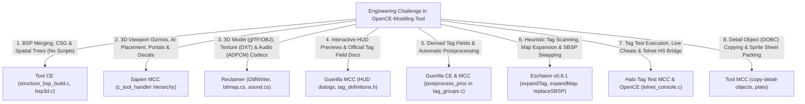
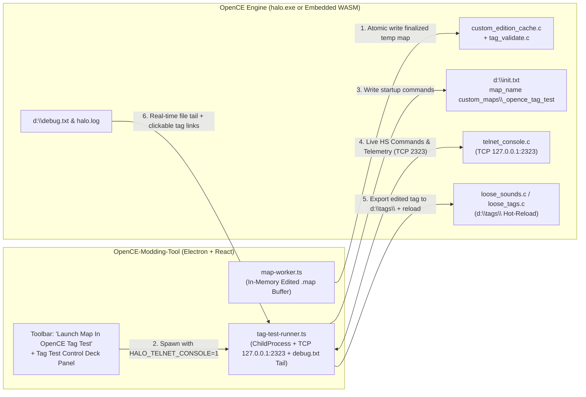

# OpenCE-Modding-Tool — Master Decompilation Synthesis, Feature Extraction & "OpenCE Tag Test" Integration Roadmap

> **Scope of this Document**  
> This document synthesizes:
> 1. The current architecture and milestone status of **[`OpenCE-Modding-Tool`](file:///C:/Users/levib/Desktop/OPEN%20CE/OpenCE-Modding-Tool/README.md)** (`core/` + `desktop/`).
> 2. The complete reverse-engineering and decompilation outputs of all **12 reference applications** in [`SAMPLE CODE/`](file:///C:/Users/levib/Desktop/OPEN%20CE/OpenCE-Modding-Tool/SAMPLE%20CODE):
>    - **[`Tool CE`](file:///C:/Users/levib/Desktop/OPEN%20CE/OpenCE-Modding-Tool/SAMPLE%20CODE/Tool%20CE/SUMMARY.md)** (`6,150` functions, `304` source units, `21` CLI commands)
>    - **[`Tool MCC`](file:///C:/Users/levib/Desktop/OPEN%20CE/OpenCE-Modding-Tool/SAMPLE%20CODE/Tool%20MCC/SUMMARY.md)** (`10,211` functions, `746` source units, `38` CLI commands)
>    - **[`Guerilla CE`](file:///C:/Users/levib/Desktop/OPEN%20CE/OpenCE-Modding-Tool/SAMPLE%20CODE/Guerilla%20CE/SUMMARY.md)** (`11,397` functions, `336` source units, `183` RTTI classes)
>    - **[`Guerilla MCC`](file:///C:/Users/levib/Desktop/OPEN%20CE/OpenCE-Modding-Tool/SAMPLE%20CODE/Guerilla%20MCC/SUMMARY.md)** (`6,725` functions, `555` source units, `283` RTTI classes)
>    - **[`Sapien CE`](file:///C:/Users/levib/Desktop/OPEN%20CE/OpenCE-Modding-Tool/SAMPLE%20CODE/Sapien%20CE/SUMMARY.md)** (`12,215` functions, `367` source units, `443` RTTI classes)
>    - **[`Sapien MCC`](file:///C:/Users/levib/Desktop/OPEN%20CE/OpenCE-Modding-Tool/SAMPLE%20CODE/Sapien%20MCC/SUMMARY.md)** (`10,492` functions, `701` source units, `632` RTTI classes)
>    - **[`Halo Tag Test MCC`](file:///C:/Users/levib/Desktop/OPEN%20CE/OpenCE-Modding-Tool/SAMPLE%20CODE/Halo%20Tag%20Test%20MCC/SUMMARY.md)** (`17,705` functions, `843` source units, `527` Halo Script functions)
>    - **[`Reclaimer`](file:///C:/Users/levib/Desktop/OPEN%20CE/OpenCE-Modding-Tool/SAMPLE%20CODE/Reclaimer/SUMMARY.md)** (`1,180` `.cs` files, `52` `.xaml` views, `28` `.resx` resources)
>    - **[`Eschaton v0.8.1`](file:///C:/Users/levib/Desktop/OPEN%20CE/OpenCE-Modding-Tool/SAMPLE%20CODE/Eschaton%20V0.8.1/SUMMARY.md)** (`2,300` functions, `161` classes, `6` tag plugin suites)
>    - **[`SparkEdit v3.02`](file:///C:/Users/levib/Desktop/OPEN%20CE/OpenCE-Modding-Tool/SAMPLE%20CODE/Sparkedit%20V3.02/README_INDEX.md)** (Classic C++ / OpenGL 3D BSP & Scenario placement editor)
>    - **[`HMT v3.5`](file:///C:/Users/levib/Desktop/OPEN%20CE/OpenCE-Modding-Tool/SAMPLE%20CODE/HMT%20V3.5)** (Halo Map Tools — C# / DirectX 9 tag & resource editor)
>    - **[`HHT v5`](file:///C:/Users/levib/Desktop/OPEN%20CE/OpenCE-Modding-Tool/SAMPLE%20CODE/HHT%20V5)** (Halo Hacker Tools — VB.NET / C# dependency swapper & memory poker)
> 3. The **[OpenCommunityEdition/OpenCE](https://github.com/OpenCommunityEdition/OpenCE)** engine source code (`C:\temp\OpenCE-src`), specifically its Custom Edition cache loader (`port/linux/game/custom_edition_cache.c`), tag validator (`port/linux/game/tag_validate.c`), loose tag hot-reloader (`port/linux/game/loose_sounds.c`), localhost TCP Telnet console (`source/networking/telnet_console.c`), and WebAssembly build target (`port/web/`).
> 4. A complete architectural blueprint for **"Launch Map In OpenCE Tag Test"** so `OpenCE-Modding-Tool` can launch, hot-reload, debug, and live-inspect maps with the full capabilities of `halo_tag_test.exe`.

---

## Part 1: Current State of `OpenCE-Modding-Tool`

### 1.1 Architectural Overview (`core/` + `desktop/`)
`OpenCE-Modding-Tool` is cleanly split into two workspaces:
- **[`core/`](file:///C:/Users/levib/Desktop/OPEN%20CE/OpenCE-Modding-Tool/core/src/index.ts)**: A pure TypeScript library with zero DOM, React, or Electron dependencies, tested by 50 Vitest suites (518 passing tests).
- **[`desktop/`](file:///C:/Users/levib/Desktop/OPEN%20CE/OpenCE-Modding-Tool/desktop/electron/main.ts)**: An Electron + React + Vite + Three.js GUI application, tested by 25 Vitest suites (193 passing tests), where [`map-worker.ts`](file:///C:/Users/levib/Desktop/OPEN%20CE/OpenCE-Modding-Tool/desktop/electron/map-worker.ts) runs in a dedicated Node.js `worker_threads` worker holding the active `.map` buffer in memory. Combined test coverage: **711 passing automated tests**.

### 1.2 Capabilities Already Built & Verified in `OpenCE-Modding-Tool`

| Subsystem | Key Files in `core/` & `desktop/` | Current Capability | Status |
|---|---|---|:---:|
| **Cache Header, Tag Index & Zstd Compression (M1–M3)** | [`header.ts`](file:///C:/Users/levib/Desktop/OPEN%20CE/OpenCE-Modding-Tool/core/src/map/header.ts), [`tag-index.ts`](file:///C:/Users/levib/Desktop/OPEN%20CE/OpenCE-Modding-Tool/core/src/map/tag-index.ts), [`open-map.ts`](file:///C:/Users/levib/Desktop/OPEN%20CE/OpenCE-Modding-Tool/core/src/map/open-map.ts), [`compression.ts`](file:///C:/Users/levib/Desktop/OPEN%20CE/OpenCE-Modding-Tool/core/src/map/compression.ts) | Parses 2048-byte CE `v609` headers, infers virtual base (`0x40440000` / BSP magic), handles Chimera zstd (`0x861A0261`) decompression/compression, atomic `File > Save` / `Save As` with backup prompt and CRC32 recalculation ([`cache-crc.ts`](file:///C:/Users/levib/Desktop/OPEN%20CE/OpenCE-Modding-Tool/core/src/map/cache-crc.ts), [`finalize-map.ts`](file:///C:/Users/levib/Desktop/OPEN%20CE/OpenCE-Modding-Tool/core/src/map/finalize-map.ts)). | ✅ Built & Verified |
| **Schema-Driven Tag Definition Engine (83 Groups)** | [`engine.ts`](file:///C:/Users/levib/Desktop/OPEN%20CE/OpenCE-Modding-Tool/core/src/map/definitions/engine.ts), [`codec.ts`](file:///C:/Users/levib/Desktop/OPEN%20CE/OpenCE-Modding-Tool/core/src/map/definitions/codec.ts), [`groups/*.json`](file:///C:/Users/levib/Desktop/OPEN%20CE/OpenCE-Modding-Tool/core/src/map/definitions/groups) | Runtime offset & struct size verification across all 83 Halo 1 tag classes. | ✅ Built & Verified |
| **Dependency Closure, `.ocetags` v5 Extraction & Batch Extract (M4)** | [`dependency-walker.ts`](file:///C:/Users/levib/Desktop/OPEN%20CE/OpenCE-Modding-Tool/core/src/map/dependency-walker.ts), [`tag-extractor.ts`](file:///C:/Users/levib/Desktop/OPEN%20CE/OpenCE-Modding-Tool/core/src/map/tag-extractor.ts), [`container.ts`](file:///C:/Users/levib/Desktop/OPEN%20CE/OpenCE-Modding-Tool/core/src/map/container.ts), [`BatchExtractDialog.tsx`](file:///C:/Users/levib/Desktop/OPEN%20CE/OpenCE-Modding-Tool/desktop/src/components/BatchExtractDialog.tsx) | Single-tag, multi-tag, and whole-map extraction into portable `.ocetags` v5 containers, including embedded pixel/sound payloads and `gbxmodel` vertex/triangle buffers ([`gbxmodel-geometry.ts`](file:///C:/Users/levib/Desktop/OPEN%20CE/OpenCE-Modding-Tool/core/src/map/gbxmodel-geometry.ts)). | ✅ Built & Verified |
| **In-Memory ADD & SWAP Tag Injection (M5)** | [`tag-injector.ts`](file:///C:/Users/levib/Desktop/OPEN%20CE/OpenCE-Modding-Tool/core/src/map/tag-injector.ts), [`pointer-rebase.ts`](file:///C:/Users/levib/Desktop/OPEN%20CE/OpenCE-Modding-Tool/core/src/map/pointer-rebase.ts), [`raw-data-region.ts`](file:///C:/Users/levib/Desktop/OPEN%20CE/OpenCE-Modding-Tool/core/src/map/raw-data-region.ts), [`InjectDialog.tsx`](file:///C:/Users/levib/Desktop/OPEN%20CE/OpenCE-Modding-Tool/desktop/src/components/InjectDialog.tsx) | Full schema-driven ADD (with tag-array growth pointer shifting across external sounds and BSP paths) and SWAP injection, `gbxmodel` geometry relocation, and embedded (`external=0`) bitmap/sound relocation. | ✅ Built & Verified |
| **Campaign Embedded Texture Extraction & Clean Injection** | [`tag-extractor.ts`](file:///C:/Users/levib/Desktop/OPEN%20CE/OpenCE-Modding-Tool/core/src/map/tag-extractor.ts), [`embedded-data-fields.ts`](file:///C:/Users/levib/Desktop/OPEN%20CE/OpenCE-Modding-Tool/core/src/map/embedded-data-fields.ts), [`tag-injector.ts`](file:///C:/Users/levib/Desktop/OPEN%20CE/OpenCE-Modding-Tool/core/src/map/tag-injector.ts) | Extracts campaign tags containing internal raw-data textures (e.g. `bridge` scenery and `misslehog` vehicle from `a10`/`c10`/`b30`) cleanly without false-alarm blocker modals, and safely relocates raw data partitions on injection. | ✅ Built & Verified |
| **Multi-Version Resource Maps & MCC Sounds Fallback (M6)** | [`IdentifyBitmapsDialog.tsx`](file:///C:/Users/levib/Desktop/OPEN%20CE/OpenCE-Modding-Tool/desktop/src/components/IdentifyBitmapsDialog.tsx), [`ConfigureResourcesPromptDialog.tsx`](file:///C:/Users/levib/Desktop/OPEN%20CE/OpenCE-Modding-Tool/desktop/src/components/ConfigureResourcesPromptDialog.tsx), [`externalize-in.ts`](file:///C:/Users/levib/Desktop/OPEN%20CE/OpenCE-Modding-Tool/core/src/map/convert/externalize-in.ts) | Detects, validates, and identifies `bitmaps.map` and `sounds.map` across all Halo CE editions (PC Retail, Mac Demo, Custom Edition, Halo MD, MCC). Automatically falls back to Custom Edition `sounds.map` for MCC maps, with helpful dialog notes on shared resource hashes. | ✅ Built & Verified |
| **Halo Demo (v6) & Retail/HaloMD (v7) $\rightarrow$ CE (v609) Converter** | [`retail-to-ce.ts`](file:///C:/Users/levib/Desktop/OPEN%20CE/OpenCE-Modding-Tool/core/src/map/convert/retail-to-ce.ts), [`demo-to-ce.ts`](file:///C:/Users/levib/Desktop/OPEN%20CE/OpenCE-Modding-Tool/core/src/map/convert/demo-to-ce.ts), [`align-tag-data.ts`](file:///C:/Users/levib/Desktop/OPEN%20CE/OpenCE-Modding-Tool/core/src/map/convert/align-tag-data.ts), [`ConvertDialog.tsx`](file:///C:/Users/levib/Desktop/OPEN%20CE/OpenCE-Modding-Tool/desktop/src/components/ConvertDialog.tsx) | Converts retail PC (`v7`), HaloMD, and Mac Demo (`v6`) maps to CE `v609`, internalizing external `bitmaps.map`/`sounds.map` ranges, 4-byte aligning tag blocks for OpenCE, repairing unaligned script syntax arrays, and running preflight OpenCE checks. | ✅ Built & Verified |
| **Recursive Tag Field Editor & Dependency Swapper (M7a/M7b)** | [`tag-field-editor.ts`](file:///C:/Users/levib/Desktop/OPEN%20CE/OpenCE-Modding-Tool/core/src/map/tag-field-editor.ts), [`tag-dependency-swapper.ts`](file:///C:/Users/levib/Desktop/OPEN%20CE/OpenCE-Modding-Tool/core/src/map/tag-dependency-swapper.ts), [`TagEditorDialog.tsx`](file:///C:/Users/levib/Desktop/OPEN%20CE/OpenCE-Modding-Tool/desktop/src/components/TagEditorDialog.tsx), [`TagFieldEditorPanel.tsx`](file:///C:/Users/levib/Desktop/OPEN%20CE/OpenCE-Modding-Tool/desktop/src/components/TagFieldEditorPanel.tsx) | Right-click Tag Editor modal decoding root fields + nested `TagReflexive` blocks up to depth 8 with dotted-path in-place mutation, plus HHT-style dependency swapping, `ustr` Unicode String List editing, reverse dependency lookup, and tag rename/duplication. | ✅ Built & Verified |
| **Automated BSP Swapper with Shader Harvesting & Stripping (M10.1)** | [`bsp-swapper.ts`](file:///C:/Users/levib/Desktop/OPEN%20CE/OpenCE-Modding-Tool/core/src/map/bsp-swapper.ts), [`BspSwapperDialog.tsx`](file:///C:/Users/levib/Desktop/OPEN%20CE/OpenCE-Modding-Tool/desktop/src/components/BspSwapperDialog.tsx) | 1-Click SP-to-MP BSP swapping that automatically harvests shaders, lightmaps, and bitmaps from donor maps to eliminate grey textures. Includes interactive toggles and lists for stripping Detail Objects (`DOBC`) and Runtime Decals, plus in-place scenario name renaming. | ✅ Built & Verified |
| **Interactive 3D Scenario Editor with Sapien/SparkEdit Parity (M9)** | [`ScenarioViewport.tsx`](file:///C:/Users/levib/Desktop/OPEN%20CE/OpenCE-Modding-Tool/desktop/src/components/viewport/ScenarioViewport.tsx), [`scenario-objects.ts`](file:///C:/Users/levib/Desktop/OPEN%20CE/OpenCE-Modding-Tool/core/src/render/scenario-objects.ts), [`bsp-geometry.ts`](file:///C:/Users/levib/Desktop/OPEN%20CE/OpenCE-Modding-Tool/core/src/render/bsp-geometry.ts), [`model-geometry.ts`](file:///C:/Users/levib/Desktop/OPEN%20CE/OpenCE-Modding-Tool/core/src/render/model-geometry.ts) | Complete 3D scenario editor with Three.js `TransformControls` (translation/rotation gizmos), ground terrain raycast snapping (<kbd>G</kbd>), AI encounters & squads (resolved to `gbxmodel` 3D meshes), A–Z firing positions, 3D trigger volume OBBs, cutscene cameras with FOV frustums, netgame flags, 10-layer toolbar, and category outliner. | ✅ Built & Verified |

---

## Part 2: Exhaustive Suitability Analysis & Technical Assessment of All 12 Decompiled Reference Codebases

This section presents a rigorous technical assessment of all **12 decompiled codebases and reverse-engineering repositories** in [`SAMPLE CODE/`](file:///C:/Users/levib/Desktop/OPEN%20CE/OpenCE-Modding-Tool/SAMPLE%20CODE). Each codebase has been analyzed for its architectural compatibility, algorithmic utility, conversion friction into TypeScript (`core/` library and `desktop/` Electron/React GUI), and long-term suitability for `OpenCE-Modding-Tool`.

---

### 2.1 Master Suitability & Harvest Matrix

| Application & Source | Binary / Language Stack | Codebase Scale | Suitability Tier | Target OpenCE Subsystem & Milestone | Portability to TS | Core Strengths & Primary Value |
|---|---|---|:---:|---|:---:|---|
| **[`Tool CE`](file:///C:/Users/levib/Desktop/OPEN%20CE/OpenCE-Modding-Tool/SAMPLE%20CODE/Tool%20CE/SUMMARY.md)** | 32-bit x86 C/C++ (`MSVC 7.1`, D3D9, Ogg) | 6,150 functions, 304 `.c` units, 21 commands | **Tier 1**<br/>(Essential Foundation) | `core/src/map/bsp-merger.ts`<br/>`bsp-geometry.ts` (M10, M11) | **High**<br/>(Algorithmic C) | **Canonical 2004 CE BSP & cache compiler**. Pure Bungie C implementation of BSP CSG tree generation (`structure_bsp_build.c`), leaf portals, PVS clustering, and collision BSP trees without external heavy SDK bloat. Essential blueprint for combining multiple BSPs into single MP BSPs without scripting. |
| **[`Tool MCC`](file:///C:/Users/levib/Desktop/OPEN%20CE/OpenCE-Modding-Tool/SAMPLE%20CODE/Tool%20MCC/SUMMARY.md)** | 32-bit x86 C/C++ (`MSVC 2017`, FBX SDK, D3DCompiler, FMOD) | 10,211 functions, 746 `.c` units, 38 commands | **Tier 1**<br/>(Essential Foundation) | `core/src/map/convert/`<br/>`bsp-swapper.ts`, `plate.ts` (M10, M13) | **High**<br/>(Selective utilities) | **Superset of Tool CE utilities**. Adds critical asset maintenance commands: `copy-detail-objects` (clean DOBC migration/stripping for BSP swaps), `plate` (automated sprite sheet packing), `export-structure-mesh-obj` (Wavefront OBJ BSP exporter), `export-tag-to-xml`, `check-map`, and `fix-tags`. |
| **[`Guerilla CE`](file:///C:/Users/levib/Desktop/OPEN%20CE/OpenCE-Modding-Tool/SAMPLE%20CODE/Guerilla%20CE/SUMMARY.md)** | 32-bit x86 C++ (`MSVC 7.1`, MFC 7.1, D3D9, DSOUND) | 11,397 functions, 336 `.c` units, 183 RTTI, 45 dialogs | **Tier 2**<br/>(High Utility Reference) | `core/src/map/tag-postprocess.ts`<br/>`definitions/groups/*.json` (M7a, M10) | **High**<br/>(Math & reflection) | **Canonical 2004 HEK reflection schemas & postprocess callbacks**. Contains exact `postprocess_proc` routines for all 83 tag groups (recalculating derived angles, velocities, ticks, and bounds on field edits) and `FUNCTION_VIEW` 2D periodic curve math. |
| **[`Guerilla MCC`](file:///C:/Users/LeviB/Desktop/OPEN%20CE/OpenCE-Modding-Tool/SAMPLE%20CODE/Guerilla%20MCC/SUMMARY.md)** | 32-bit x86 C++ (`MSVC 2017`, MFC 14, D3D9, FMOD) | 6,725 functions, 555 `.c` units, 283 RTTI, 44 dialogs | **Tier 1**<br/>(Essential Foundation) | `desktop/src/components/hud/`<br/>`TagFieldEditorPanel.tsx` (M7a, M13) | **High**<br/>(UI specifications & doc) | **Interactive WYSIWYG HUD layout previewers & schema documentation**. Strips dead AI bloat; provides interactive canvas layouts for `wphi`, `unhi`, `grhi` with 4:3 / 16:9 safe frames, `c_xml_tag_exporter`, and Bungie `#explanation` help paragraphs for every tag field. |
| **[`Sapien CE`](file:///C:/Users/levib/Desktop/OPEN%20CE/OpenCE-Modding-Tool/SAMPLE%20CODE/Sapien%20CE/SUMMARY.md)** | 32-bit x86 C++ (`MSVC 7.1`, WTL, D3D9, DSOUND, Miles) | 12,215 functions, 367 `.c` units, 443 RTTI, 62 dialogs | **Tier 2**<br/>(High Utility Reference) | `ScenarioViewport.tsx`<br/>`scenario-objects.ts` (M8, M9) | **Medium**<br/>(Legacy Win32 UI) | **Original 2004 scenario world editor**. Hierarchy tree structure, radiosity lightmap preview pipelines, 543 Halo Script runtime linkages, and D3D9 game window coordinates. |
| **[`Sapien MCC`](file:///C:/Users/levib/Desktop/OPEN%20CE/OpenCE-Modding-Tool/SAMPLE%20CODE/Sapien%20MCC/SUMMARY.md)** | 32-bit x86 C++ (`MSVC 2017`, WTL, D3D9, FMOD) | 10,492 functions, 701 `.c` units, 632 RTTI, 63 dialogs | **Tier 1**<br/>(Essential Foundation) | `ScenarioViewport.tsx`<br/>`desktop/src/components/viewport/` (M9) | **Very High**<br/>(Object-oriented design) | **Modern 3D level editor tool handler hierarchy**. Reconstructs the complete C++ `c_tool_handler` architecture (`c_object_placement_handler`, `c_encounters_tool_handler`, `c_firing_positions_tool_handler`, `c_portal_tool_handler`, `c_cluster_properties_tool_handler`, `c_trigger_volume_tool_handler`, `c_decal_tool_handler`). Maps directly into Three.js tool modes. |
| **[`Halo Tag Test MCC`](file:///C:/Users/levib/Desktop/OPEN%20CE/OpenCE-Modding-Tool/SAMPLE%20CODE/Halo%20Tag%20Test%20MCC/SUMMARY.md)** | 32-bit x86 C/C++ (`tag_test` build, D3D9, FMOD, Bink) | 17,705 functions, 843 `.c` units, 527 HS functions | **Tier 1**<br/>(Essential Foundation) | `desktop/electron/tag-test-runner.ts`<br/>`TagTestPanel.tsx` (M12) | **Very High**<br/>(Protocol & logging) | **Playable runtime debug engine & diagnostic test suite**. Direct reference for our "Launch Map In OpenCE Tag Test" milestone: provides complete HS function definitions (`halo_script_functions.json`), debug globals dictionary, and assertion logging schemas matching OpenCE's `debug.txt`. |
| **[`Reclaimer`](file:///C:/Users/levib/Desktop/OPEN%20CE/OpenCE-Modding-Tool/SAMPLE%20CODE/Reclaimer/SUMMARY.md)** | C# .NET Framework 4.8 (WPF, HelixToolkit, SharpDX, DirectXTex) | 1,180 `.cs` files, 52 `.xaml` views, 28 `.resx` files | **Tier 1**<br/>(Essential Foundation) | `core/src/render/`<br/>`gbxmodel.ts`, `bitmap.ts`, `sound.ts` (M8, M13) | **Highest**<br/>(C# to TS maps 1-to-1) | **Clean modern asset extraction & conversion suite**. Best-in-class, strongly-typed implementations for glTF 2.0 / OBJ / JMS model exports (`GltfWriter.cs`, `JmsWriter.cs`), dual-bone skeletal skinning matrix math (`gbxmodel.cs`), complete 18-format bitmap codec + Xbox Morton swizzle (`bitmap.cs`), Xbox ADPCM 36-byte block sound decoding/encoding (`sound.cs`), and skeletal keyframe animation track decoding (`model_animations.cs`). |
| **[`Eschaton v0.8.1`](file:///C:/Users/levib/Desktop/OPEN%20CE/OpenCE-Modding-Tool/SAMPLE%20CODE/Eschaton%20V0.8.1/SUMMARY.md)** | REALbasic 2007 + C/C++ Reconstructed Engine | 2,300 functions, 161 classes, 6 plugin sets | **Tier 1**<br/>(Essential Foundation) | `core/src/map/tag-injector.ts`<br/>`bsp-swapper.ts`, `container.ts` (M4, M5, M10) | **High**<br/>(Algorithmic logic) | **Pioneer of heuristic map expansion, tag relocation & BSP swapping**. Best real-world implementation of in-place tag scanning without plugins (`expandTag`), safe `.map` buffer rebuilding (`expandMap`), SBSP virtual memory relocation (`replaceSBSP`), and external asset internalization (`internalizeTag`). |
| **[`SparkEdit v3.02`](file:///C:/Users/levib/Desktop/OPEN%20CE/OpenCE-Modding-Tool/SAMPLE%20CODE/Sparkedit%20V3.02/README_INDEX.md)** | 32-bit x86 C++ (`MSVC 6.0`, MFC, OpenGL) | 88 classes, OpenGL 1.1 renderer | **Tier 3**<br/>(Specialized Reference) | `core/src/render/scenario-objects.ts`<br/>`bsp-geometry.ts` (M8, M9) | **Medium**<br/>(Legacy C++/OpenGL) | **Classic 3D BSP viewer & scenario object placer**. Useful for validating raw coordinate frame transformations between Blam! world coordinates `(X, Y, Z)` and camera coordinate spaces, and raw scenario object manipulation directly in compiled `.map` buffers. Superseded by Three.js and Sapien tool handlers. |
| **[`HMT v3.5`](file:///C:/Users/levib/Desktop/OPEN%20CE/OpenCE-Modding-Tool/SAMPLE%20CODE/HMT%20V3.5)** | C# .NET 1.1 (Windows Forms, Managed DirectX 9) | 14 projects, XML plugins | **Tier 4**<br/>(Historical Reference) | `core/src/map/definitions/`<br/>(Cross-check reference) | **Low**<br/>(Legacy .NET 1.1) | **Historic milestone in Halo PC/Xbox map modding**. Useful for cross-checking basic struct offsets in legacy `plugins/*.xml` and validating raw sound/bitmap extraction offsets. Fully superseded by `Reclaimer` and `Eschaton`. |
| **[`HHT v5`](file:///C:/Users/levib/Desktop/OPEN%20CE/OpenCE-Modding-Tool/SAMPLE%20CODE/HHT%20V5)** | Visual Basic .NET / C# (Windows Forms) | 8 modules, XML plugins | **Tier 4**<br/>(Historical Reference) | `core/src/map/tag-dependency-swapper.ts`<br/>(Cross-check reference) | **Low**<br/>(Legacy VB.NET) | **Historic dependency swapper & memory poker**. Provided the conceptual model for simple tag dependency swapping. Completely superseded by OpenCE-Modding-Tool's native recursive schema-driven dependency swapper and `TagEditorDialog`. |

---

### 2.2 In-Depth Individual Suitability Profiles

#### 1. Tool CE (`tool.exe` — Halo Custom Edition 2004 HEK)
- **Suitability Classification**: **Tier 1 (Essential Foundation)**
- **Decompilation Quality**: 6,150 functions extracted into structured C source files (`SAMPLE CODE/Tool CE/src/`). Clean 32-bit arithmetic, direct structs from Bungie's build tree.
- **Specific Utility for OpenCE-Modding-Tool**:
  1. **BSP Merging Without Scripting (`import_structure.c`, `structure_bsp_build.c`, `bsp3d.c`)**: Provides the mathematical blueprint for compiling 3D geometry submeshes into Bungie's spatial partitioning plane tree, leaf portals, and PVS clusters. This directly solves the challenge of combining multiple campaign BSPs into a single unified multiplayer map BSP without requiring custom engine scripts.
  2. **Collision Model Synthesis (`import_collision.c`, `collision_bsp.c`)**: Contains the exact binary algorithms for generating 3D collision node trees, surface flags, and edge-bsp structures.
  3. **Canonical Cache File Builder (`build_cache_file.c`)**: Demonstrates how Bungie laid out the 2048-byte header, tag index table, string table, and external reference tables for `v609` Custom Edition maps.
- **TypeScript Conversion Feasibility**: **High**. The C math routines in `src/math/` and spatial splitting in `src/structures/` do not require external libraries; they translate cleanly into pure TypeScript using `Float32Array` and typed array buffers in `core/src/map/`.

#### 2. Tool MCC (`tool.exe` — Halo Combat Evolved Editing Kit / HCEEK MCC)
- **Suitability Classification**: **Tier 1 (Essential Foundation)**
- **Decompilation Quality**: 10,211 functions across 746 source files (`SAMPLE CODE/Tool MCC/src/`). 38 CLI commands with modern MSVC 2017 calling conventions.
- **Specific Utility for OpenCE-Modding-Tool**:
  1. **Automated Detail Object Management (`copy-detail-objects`)**: Provides the official algorithm for extracting, transforming, and copying `DOBC` grass/pebble cells between BSPs, directly enhancing our BSP Swapper.
  2. **Automated Sprite Sheet Packing (`plate` at `0x0042D050`)**: Implements the automatic sprite sequence sheet packer with blue/magenta border registration, enabling drag-and-drop animated sprite imports in our Bitmap Editor.
  3. **Wavefront OBJ BSP Exporter (`export-structure-mesh-obj` at `0x0044F340`)**: Offers a clean C algorithm for dumping `.scenario_structure_bsp` geometry into standard `.obj` + `.mtl` formats with texture coordinates.
  4. **Diagnostic & Tag QA Suite (`fix-tags`, `check-map`, `check-shaders`)**: Outlines tag validation rules and corruption detection logic that can be integrated into preflight checks in `core/`.
- **TypeScript Conversion Feasibility**: **High for utilities, selective for heavy SDKs**. The utility algorithms (`plate`, `copy-detail-objects`, `export-structure-mesh-obj`) port cleanly to TypeScript. Commands relying on Autodesk FBX SDK (`libfbxsdk.dll`) or FMOD should use Three.js glTF/OBJ loaders and Web Audio instead.

#### 3. Guerilla CE (`guerilla.exe` — 2004 HEK)
- **Suitability Classification**: **Tier 2 (High Utility Reference)**
- **Decompilation Quality**: 11,397 functions, 336 source units, 183 RTTI classes, 83 tag group reflection tables (`SAMPLE CODE/Guerilla CE/extracted/tag_groups.json`).
- **Specific Utility for OpenCE-Modding-Tool**:
  1. **Canonical `postprocess_proc` Routines (`src/tag_files/tag_groups.c`)**: Documents the derived field recalculations that must occur whenever a tag field is modified (e.g. converting degrees to radians, seconds to 30-Hz game ticks, computing normalized vectors). Implementing these in `core/src/map/tag-postprocess.ts` ensures user edits behave correctly in-game.
  2. **2D Function Curve Graphing (`FUNCTION_VIEW` at Dialog ID 179)**: Provides the mathematical formulas for all periodic/transition curves (`linear`, `cosine`, `jitter`, `wander`, `spark`, etc.), directly informing our canvas curve visualizer.
- **TypeScript Conversion Feasibility**: **High**. Mathematical evaluation functions in `src/math/periodic_functions.c` map 1-to-1 to JavaScript `Math` operations.

#### 4. Guerilla MCC (`guerilla.exe` — HCEEK MCC)
- **Suitability Classification**: **Tier 1 (Essential Foundation)**
- **Decompilation Quality**: 6,725 functions, 555 source units, 283 RTTI classes, modern dialog definitions (`SAMPLE CODE/Guerilla MCC/resources/dialogs.json`).
- **Specific Utility for OpenCE-Modding-Tool**:
  1. **Interactive WYSIWYG HUD Interface Previewers (`WEAPON_HUD_INTERFACE_VIEW_CUSTOM_ID`, `GRENADE_HUD_INTERFACE_VIEW_CUSTOM_ID`, `UNIT_HUD_INTERFACE_VIEW_CUSTOM_ID`)**: Contains the layout definitions, anchor offsets, and safe-frame guides for 4:3, 16:9, and split-screen HUDs.
  2. **Bungie `#explanation` Field Documentation (`include/tag_definitions.h`)**: Contains official explanatory text and unit specifications for thousands of struct fields across all 83 tag classes, which can be injected directly into our tag definition schemas (`core/src/map/definitions/groups/*.json`).
  3. **XML Tag Serialization (`c_xml_tag_exporter`)**: Provides a standardized XML format for exchanging tag data outside binary containers.
- **TypeScript Conversion Feasibility**: **Very High**. HUD coordinate mapping and safe frames translate directly into React and HTML5 Canvas components in `desktop/src/components/hud/`.

#### 5. Sapien CE (`sapien.exe` — 2004 HEK)
- **Suitability Classification**: **Tier 2 (High Utility Reference)**
- **Decompilation Quality**: 12,215 functions, 367 source files, 443 RTTI classes.
- **Specific Utility for OpenCE-Modding-Tool**:
  1. **Scenario Hierarchy & Palette Layout**: Shows how scenario objects, netgame equipment, encounters, squads, and AI firing positions are organized hierarchically.
  2. **Halo Script Integration**: Exposes the 543 Halo Script runtime callbacks and trigger evaluation mechanisms.
- **TypeScript Conversion Feasibility**: **Medium**. The underlying MFC/WTL UI is obsolete, but the data schemas and coordinate transformations provide solid structural reference.

#### 6. Sapien MCC (`sapien.exe` — HCEEK MCC)
- **Suitability Classification**: **Tier 1 (Essential Foundation)**
- **Decompilation Quality**: 10,492 functions, 701 source files, 632 RTTI classes (`SAMPLE CODE/Sapien MCC/classes/`).
- **Specific Utility for OpenCE-Modding-Tool**:
  1. **3D Tool Handler State Machines (`c_tool_handler` Class Hierarchy)**:
     - `c_object_placement_handler`: Surface raycasting against `collision_bsp`, ground snapping, orientation alignment, and cluster index assignment.
     - `c_encounters_tool_handler` & `c_firing_positions_tool_handler`: Placing, grouping, and rendering AI squads and 3D firing points (`A`–`Z`).
     - `c_portal_tool_handler` & `c_cluster_properties_tool_handler`: Selecting BSP rooms/clusters and binding ambient sounds, reverb presets, and weather particle systems.
     - `c_trigger_volume_tool_handler`: Interactive 3D oriented bounding box (OBB) manipulation.
     - `c_decal_tool_handler`: Projecting decals onto BSP geometry.
- **TypeScript Conversion Feasibility**: **Very High**. The object-oriented C++ tool handler architecture translates directly into Three.js interaction controllers in `desktop/src/components/viewport/ScenarioViewport.tsx`.

#### 7. Halo Tag Test MCC (`halo_tag_test.exe` — HCEEK MCC)
- **Suitability Classification**: **Tier 1 (Essential Foundation)**
- **Decompilation Quality**: 17,705 functions, 843 source files, 527 registered Halo Script functions (`SAMPLE CODE/Halo Tag Test MCC/extracted/halo_script_functions.json`).
- **Specific Utility for OpenCE-Modding-Tool**:
  1. **Direct Blueprint for Milestone 12 ("Launch Map In OpenCE Tag Test")**: Unveils the inner architecture of Bungie's loose tag loader, developer console, and real-time diagnostic reporting.
  2. **Complete Halo Script (`hs`) Command Dictionary**: Detailed documentation of every debug global (`debug_objects`, `rasterizer_wireframe`, `cheat_deathless_player`, `ai_render`, etc.) and script function used by our live TCP Control Deck.
  3. **Assertion & Diagnostic Formatting**: Establishes the exact parsing grammar for error logs produced by OpenCE's `debug.txt`, enabling clickable links from the log console straight to affected tags in OpenCE-Modding-Tool.
- **TypeScript Conversion Feasibility**: **Very High**. Protocol handling and log stream parsing in `desktop/electron/tag-test-runner.ts` map directly to Node.js `net.Socket` and regex file-tailing.

#### 8. Reclaimer (Modern C# .NET 4.8 / HelixToolkit / SharpDX / DirectXTex)
- **Suitability Classification**: **Tier 1 (Essential Foundation)**
- **Decompilation Quality**: 1,180 clean, strongly-typed C# files, 52 XAML views (`SAMPLE CODE/Reclaimer/`).
- **Specific Utility for OpenCE-Modding-Tool**:
  1. **3D Model & Skeletal Export (`GltfWriter.cs`, `JmsWriter.cs`, `gbxmodel.cs`)**: Clean, robust matrix math for transforming Halo 1 node hierarchies, markers, and dual-bone weighted vertices into modern glTF 2.0 / GLB and JMS v8200 files.
  2. **18-Format Texture Pipeline & Swizzling (`bitmap.cs`)**: Complete decoder/encoder for all 18 Halo bitmap formats (DXT1–5, 16-bit, 32-bit, paletted), cubemap face ordering, and Xbox Morton unswizzling.
  3. **Audio Permutations & ADPCM (`sound.cs`)**: Clean decoding/encoding for Xbox 36-byte block IMA ADPCM audio streams and multi-permutation audio assembly.
  4. **Keyframe Animation Decoding (`model_animations.cs`)**: Unpacks compressed keyframe tracks from `antr` tags into bone translation/rotation splines.
- **TypeScript Conversion Feasibility**: **Highest of all repositories**. C# classes, memory buffers, and linear algebra map 1-to-1 into TypeScript `DataView`, `Float32Array`, and Three.js math utilities with minimal refactoring.

#### 9. Eschaton v0.8.1 (Altimit01 / REALbasic 2007 + C/C++ Reconstructed)
- **Suitability Classification**: **Tier 1 (Essential Foundation)**
- **Decompilation Quality**: 2,300 functions, 161 application classes, complete reconstructed C/C++ headers and source (`SAMPLE CODE/Eschaton V0.8.1/src/`).
- **Specific Utility for OpenCE-Modding-Tool**:
  1. **Heuristic Reflexive & Tag Scanning (`expandTag` at `VA 0x011239CE`)**: The industry's best heuristic scanner for identifying reflexives, tag references, and raw data blocks across unknown or unmapped tag structures without needing plugins.
  2. **In-Place Map Expansion & Rebuilding (`expandMap` at `VA 0x01145838`, `write` at `0x01165D45`)**: Robust architecture for disassembling `.map` buffers into expandable in-memory chunks and re-serializing them with updated virtual base addresses and tag indices.
  3. **Structure BSP Swapping (`replaceSBSP` at `VA 0x0118DE23`)**: Reliable logic for replacing `sbsp` tags and rebinding their dedicated BSP virtual memory regions.
  4. **Resource Internalization (`internalizeTag` at `VA 0x011859E3`)**: Copies external `bitmaps.map` / `sounds.map` payloads directly into the map file and clears the external flag.
- **TypeScript Conversion Feasibility**: **High**. Core pointer math and byte buffer manipulations translate directly into `DataView` operations in `core/src/map/`.

#### 10. SparkEdit v3.02 (Grenadiac / Visual C++ 6.0 / OpenGL)
- **Suitability Classification**: **Tier 3 (Specialized Reference)**
- **Decompilation Quality**: 88 classes, early OpenGL fixed-function rendering pipeline (`SAMPLE CODE/Sparkedit V3.02/`).
- **Specific Utility for OpenCE-Modding-Tool**:
  1. **Direct Scenario Placement in Compiled Maps**: Demonstrates historical methods for modifying object placements, spawns, and vehicle locations directly inside compiled `.map` buffers without rebuilding.
  2. **World-to-Camera Coordinate Systems**: Useful cross-reference for verifying coordinate frame transformations in early Blam! maps.
- **TypeScript Conversion Feasibility**: **Medium**. OpenGL 1.1 fixed-function calls are obsolete; modern Three.js shaders and scene graphs in `ScenarioViewport.tsx` are significantly superior.

#### 11. HMT v3.5 (Halo Map Tools — MonoxideC / C# .NET 1.1 / DirectX 9)
- **Suitability Classification**: **Tier 4 (Historical Reference)**
- **Decompilation Quality**: 14 projects in C# .NET 1.1, legacy Managed DirectX 9 (`SAMPLE CODE/HMT V3.5/`).
- **Specific Utility for OpenCE-Modding-Tool**:
  1. **Classic XML Plugin Tag Schemas (`plugins/*.xml`)**: Useful historical baseline for cross-checking basic struct offsets across core tag types (`weap`, `vehi`, `bipd`, `proj`).
  2. **Basic Sound/Bitmap Decoding**: Early reference for sound block parsing and DDS texture headers.
- **TypeScript Conversion Feasibility**: **Low / Superseded**. The legacy .NET 1.1 codebase and Managed DirectX bindings are outdated and completely superseded by `Reclaimer`.

#### 12. HHT v5 (Halo Hacker Tools — Iron_Freak / Visual Basic .NET / C#)
- **Suitability Classification**: **Tier 4 (Historical Reference)**
- **Decompilation Quality**: 8 modules in Visual Basic .NET / C# (`SAMPLE CODE/HHT V5/`).
- **Specific Utility for OpenCE-Modding-Tool**:
  1. **Concept of Tag Dependency Swapping**: Historical reference for redirecting 32-bit tag IDs to swap weapons, projectiles, and vehicles.
  2. **Raw Memory Offsets**: Secondary confirmation of tag datum layouts.
- **TypeScript Conversion Feasibility**: **Low / Superseded**. Completely superseded by OpenCE-Modding-Tool's native recursive schema-driven dependency swapper (`tag-dependency-swapper.ts`) and interactive `TagEditorDialog`.

---

### 2.3 Cross-Repository Engineering Blueprint: Which Codebase to Consult for What

To maximize development velocity and avoid redundant reverse-engineering, consult the decompiled codebases according to the following domain matrix:



---

## Part 3: High-Value Features & Algorithms to Harvest into `OpenCE-Modding-Tool`

Below is the comprehensive catalog of algorithms, data structures, and UI workflows from the decompiled codebases that directly unlock new milestones in `OpenCE-Modding-Tool`.

---

### 3.1 From `Guerilla CE` & `Guerilla MCC`: Advanced Tag Editing, Postprocessing & Visual Previewers

#### A. Automatic Postprocessing on Tag Save / Field Edit (`postprocess_proc`)
- **What Guerilla Does**:
  - In [`Guerilla CE/extracted/tag_groups.json`](file:///C:/Users/levib/Desktop/OPEN%20CE/OpenCE-Modding-Tool/SAMPLE%20CODE/Guerilla%20CE/extracted/tag_groups.json) and [`Guerilla MCC/extracted/tag_groups.json`](file:///C:/Users/levib/Desktop/OPEN%20CE/OpenCE-Modding-Tool/SAMPLE%20CODE/Guerilla%20MCC/extracted/tag_groups.json), almost every `tag_group` defines a `postprocess_proc` function pointer in [`src/tag_files/tag_groups.c`](file:///C:/Users/levib/Desktop/OPEN%20CE/OpenCE-Modding-Tool/SAMPLE%20CODE/Guerilla%20MCC/src/tag_files/tag_groups.c) (and per-domain files like `src/weapons/weapon_definitions.c`, `src/effects/particle_definitions.c`, `src/shaders/shader_definitions.c`, `src/interface/hud_definitions.c`).
  - When a modder edits an angle, rate of fire, velocity, fade distance, or color in Guerilla, the tag's `postprocess_proc` automatically recalculates derived runtime fields (e.g., converting degrees to radians, seconds to 30-Hz ticks, min/max bounds to deltas, normalizing vectors, or precomputing shader animation constants) that are marked `nonCached` or read-only (`*`) in the tag struct!
- **Why `OpenCE-Modding-Tool` Needs This**:
  - Currently, [`core/src/map/tag-field-editor.ts`](file:///C:/Users/levib/Desktop/OPEN%20CE/OpenCE-Modding-Tool/core/src/map/tag-field-editor.ts) writes the user's raw edited field directly into the `.map`'s already-postprocessed tag cache. If a user edits a field in a `.map` whose runtime behavior depends on a derived field calculated during `postprocess_proc`, the change won't take full effect unless the derived field is also updated!
  - By translating the decompiled `postprocess_proc` routines from `Guerilla MCC/src/` (and OpenCE's `source/*/*_definitions.c`) into a new `core/src/map/tag-postprocess.ts` module, editing any field in `TagEditorDialog.tsx` will automatically update all dependent runtime fields in the `.map`!

#### B. Interactive 2D Function Curve Editor (`FUNCTION_VIEW`)
- **Source Reference**:
  - Dialog `FUNCTION_VIEW` (`ID 179`) in [`Guerilla CE/resources/dialogs.json`](file:///C:/Users/levib/Desktop/OPEN%20CE/OpenCE-Modding-Tool/SAMPLE%20CODE/Guerilla%20CE/resources/dialogs.json) and function curve math in [`Guerilla MCC/src/math/periodic_functions.c`](file:///C:/Users/levib/Desktop/OPEN%20CE/OpenCE-Modding-Tool/SAMPLE%20CODE/Guerilla%20MCC/src/math/periodic_functions.c) (`periodic_function_evaluate` / `transition_function_evaluate`).
- **How It Works**:
  - Halo objects, weapons, lights, shaders, and effects define `A in` / `B in` / `C in` / `D in` and `functions` blocks (`function_type`: `linear`, `early`, `very_early`, `late`, `very_late`, `cosine`, `one`, `zero`; `periodic`: `one`, `zero`, `cosine`, `cosine_variable_period`, `diagonal_wave`, `diagonal_wave_variable_period`, `slide`, `slide_variable_period`, `noise`, `jitter`, `wander`, `spark`) with frequency, phase, exponent, and bounds.
  - Adding an inline HTML5 `<canvas>` curve plotter inside [`TagFieldEditorPanel.tsx`](file:///C:/Users/levib/Desktop/OPEN%20CE/OpenCE-Modding-Tool/desktop/src/components/TagFieldEditorPanel.tsx) whenever a user expands a `functions` reflexive block lets users visually see the exact oscillation/transition curve as they tweak period, phase, and function enum!

#### C. Live WYSIWYG HUD Interface Previewer (`wphi`, `unhi`, `grhi`)
- **Source Reference**:
  - Dialogs `WEAPON_HUD_INTERFACE_VIEW_CUSTOM_ID` (`299`), `GRENADE_HUD_INTERFACE_VIEW_CUSTOM_ID` (`350`), and `UNIT_HUD_INTERFACE_VIEW_CUSTOM_ID` (`351`) in [`Guerilla MCC/resources/dialogs.json`](file:///C:/Users/levib/Desktop/OPEN%20CE/OpenCE-Modding-Tool/SAMPLE%20CODE/Guerilla%20MCC/resources/dialogs.json) and [`Guerilla MCC/src/guerilla/`](file:///C:/Users/levib/Desktop/OPEN%20CE/OpenCE-Modding-Tool/SAMPLE%20CODE/Guerilla%20MCC/src/guerilla).
  - Also cross-referenced with OpenCE's [`port/linux/game/cache_file_formats.c`](file:///C:/temp/OpenCE-src/port/linux/game/cache_file_formats.c) (`hud_placement_block_convert` / `hud_meters_convert`) and [`port/linux/src/hud_hires.c`](file:///C:/temp/OpenCE-src/port/linux/src/hud_hires.c).
- **Feature to Unlock in `OpenCE-Modding-Tool`**:
  - When a user opens a `weapon_hud_interface` (`wphi`), `unit_hud_interface` (`unhi`), or `grenade_hud_interface` (`grhi`) tag in `TagEditorDialog.tsx`, render a live 2D `<canvas>` HUD preview with:
    - Aspect ratio radio toggles: **`4:3`**, **`16:9`**, and **`Split Screen`** (matching `Guerilla MCC` controls `3501`–`3503`).
    - **`Show Safe Frame`** toggle (`3505`).
    - Interactive drag-and-drop of HUD anchor coordinates (`anchor`: `top_left`, `top_right`, `bottom_left`, `bottom_right`, `center`), static element bitmaps, ammo meters, and crosshair reticles!

#### D. Complete Schema Documentation & Symbolic Padding/Macro Names
- **Source Reference**:
  - [`Guerilla MCC/include/tag_definitions.h`](file:///C:/Users/levib/Desktop/OPEN%20CE/OpenCE-Modding-Tool/SAMPLE%20CODE/Guerilla%20MCC/include/tag_definitions.h) and [`Guerilla MCC/extracted/tag_groups.json`](file:///C:/Users/levib/Desktop/OPEN%20CE/OpenCE-Modding-Tool/SAMPLE%20CODE/Guerilla%20MCC/extracted/tag_groups.json).
- **Feature to Unlock**:
  - `Guerilla MCC`'s 32-byte `tag_block_definition` and 16-byte `tag_field` tables contain Bungie's official `#explanation` help paragraphs (e.g., explaining exactly how AI perception, vehicle suspension, or shader stages work), unit suffixes (`world units`, `seconds`, `degrees`, `[0,1]`), and symbolic maximum block counts (`MAXIMUM_SCENARIO_NETGAME_EQUIPMENT_COUNT`).
  - We can enrich `core/src/map/definitions/groups/*.json` with these exact `#explanation` headers and field tooltips so `TagFieldEditorPanel.tsx` displays Bungie's official documentation inline!

---

### 3.2 From `Sapien CE` & `Sapien MCC`: Unlocking Full 3D Level Design in `ScenarioViewport.tsx`

[`Sapien MCC`](file:///C:/Users/levib/Desktop/OPEN%20CE/OpenCE-Modding-Tool/SAMPLE%20CODE/Sapien%20MCC/SUMMARY.md) exposes `632` RTTI classes in [`Sapien MCC/classes/`](file:///C:/Users/levib/Desktop/OPEN%20CE/OpenCE-Modding-Tool/SAMPLE%20CODE/Sapien%20MCC/classes) and `701` source files in [`Sapien MCC/src/`](file:///C:/Users/levib/Desktop/OPEN%20CE/OpenCE-Modding-Tool/SAMPLE%20CODE/Sapien%20MCC/src). We can bring Sapien's specialized 3D editing modes directly into `OpenCE-Modding-Tool`'s Three.js [`ScenarioViewport.tsx`](file:///C:/Users/levib/Desktop/OPEN%20CE/OpenCE-Modding-Tool/desktop/src/components/viewport/ScenarioViewport.tsx):

| Sapien Tool Handler (`Sapien MCC/src/sapien/`) | How It Works in Decompiled Sapien | How to Implement in `OpenCE-Modding-Tool` (`core/src/render/` + `ScenarioViewport.tsx`) |
|---|---|---|
| **1. Object Placement & Surface Snapping** (`c_create_tool_handler`, `c_object_placement_handler`) | Casts a ray from camera through mouse cursor against `sbsp.collision_bsp` (`src/physics/collision_bsp.c`), places or moves the selected `scnr` instance, aligns Z to surface height (or surface normal if `align to normal` is checked), and updates the instance's `bsp_index` and cluster index. | Extend `ScenarioViewport.tsx` with Three.js `TransformControls` + raycasting against the `sbsp` mesh. Right-clicking in 3D spawns a new instance from the active palette; pressing `G` snaps to ground. |
| **2. AI Encounters, Squads & 3D Firing Positions** (`c_encounters_tool_handler`, `c_firing_positions_tool_handler`, `src/ai/ai_scenario_definitions.c`) | Renders `scnr.encounters` (`0x42C`, 176-byte entries): squad spawn points (`squads` reflexive), platoons, and 3D `firing_positions` (24-byte entries with `position` `float[3]` and `group_index` `0..25` = `A..Z`), color-coded by group letter and linked to BSP cluster indices. | Add an **`AI Encounters`** layer toggle in `ScenarioViewport.tsx` that renders squad spawn markers (using their `actor_variant` -> `biped` -> `gbxmodel` mesh!) and `A`–`Z` firing position spheres, allowing modders to place/move AI squads and firing points in 3D on both singleplayer and multiplayer maps! |
| **3.BSP Cluster Properties & Portal Visualizer** (`c_cluster_properties_tool_handler`, `c_portal_tool_handler`, `src/structures/structure_bsp_definitions.c`) | Identifies which BSP cluster (`sbsp.clusters`, `0x68` bytes each) the camera is inside and lets the designer assign per-cluster palettes: **Sky index**, **Fog** (`scnr.planar_fog_palette`), **Background Sound** (`scnr.background_sound_palette`), **Sound Environment / Reverb** (`scnr.sound_environment_palette`), and **Weather Particle System** (`scnr.weather_palette`), while drawing semi-transparent portal planes (`sbsp.cluster_portals`). | Add a **"Cluster Inspector & Portal Overlay"** mode in `ScenarioViewport.tsx`: highlights the current BSP cluster boundary and portals in 3D and opens a floating panel to change that room's ambient sound, reverb, weather (rain/snow), and fog! |
| **4. 3D Detail Object Painter (`dobc`)** (`c_detail_object_tool_handler`, `Tool MCC` `copy-detail-objects` at `0x00414A40`) | Paints grass/pebbles/debris cells (`sbsp.detail_objects`) onto BSP triangles and samples the lightmap pixel at that UV to bake vertex lighting into the cell. `Tool MCC`'s `copy-detail-objects` copies these cells between BSPs. | Render `sbsp.detail_objects` sprites in `ScenarioViewport.tsx`, provide a 3D brush to paint/erase grass & rocks, and include a 1-click **"Copy Detail Objects"** / **"Strip Detail Objects"** button for BSP swaps! |
| **5. 3D Decal Painter (`deca`)** (`c_decal_tool_handler`, `src/effects/decals.c`) | Projects `scnr.decals` (`0x50` reflexive, 16-byte entries: `decal_type` palette index, `yaw`, `pitch`, `position` `float[3]`) onto BSP surfaces. | Render placed scenario decals in `ScenarioViewport.tsx` and allow click-to-stamp blood, blast marks, and Forerunner glyphs onto walls/floors. |
| **6. Trigger Volumes & Cutscene Camera Points** (`c_trigger_volume_tool_handler`, `src/cutscene/`) | Renders `scnr.trigger_volumes` (`0x360`, 96-byte entries with `name`, `forward`/`up` orientation vectors, `position`, and `extents`) as translucent 3D oriented bounding boxes (OBBs), and `scnr.cutscene_camera_points` (`0x4F8`, 104-byte entries) as camera frustums with spline path previews. | Add **`Trigger Volumes`** and **`Cutscene Cameras`** layer toggles in `ScenarioViewport.tsx` with box-extents resize handles and a **"Preview Camera Path"** button that flies the Three.js camera along the cutscene points! |

---

### 3.3 From `Tool CE` & `Tool MCC`: Asset Compilation, Mesh Diagnostics, & Halo Script (`hsc`) Tooling

[`Tool MCC`](file:///C:/Users/levib/Desktop/OPEN%20CE/OpenCE-Modding-Tool/SAMPLE%20CODE/Tool%20MCC/SUMMARY.md) (`38` CLI commands in [`extracted/tool_commands.json`](file:///C:/Users/levib/Desktop/OPEN%20CE/OpenCE-Modding-Tool/SAMPLE%20CODE/Tool%20MCC/extracted/tool_commands.json)) contains several standalone utilities whose decompiled C/C++ algorithms can be ported directly into TypeScript inside `core/`:

#### 1. Halo Script (`hsc`) Decompiler, Syntax Checker & Bytecode Compiler
- **Decompiled Sources**:
  - [`Tool MCC/extracted/halo_script_functions.json`](file:///C:/Users/levib/Desktop/OPEN%20CE/OpenCE-Modding-Tool/SAMPLE%20CODE/Tool%20MCC/extracted/halo_script_functions.json) (`527` functions) & [`Tool CE/extracted/halo_script_functions.json`](file:///C:/Users/levib/Desktop/OPEN%20CE/OpenCE-Modding-Tool/SAMPLE%20CODE/Tool%20CE/extracted/halo_script_functions.json) (`543` functions) — contains every function's exact opcode index, name, return type (`unparsed`, `special_form`, `function_name`, `passthrough`, `void`, `boolean`, `real`, `short`, `long`, `string`, `script`, `trigger_volume`, `cutscene_flag`, `cutscene_camera_point`, `cutscene_title`, `cutscene_recording`, `device_group`, `ai`, `ai_command_list`, `starting_profile`, `conversation`, `navpoint`, `hud_message`, `object_list`, `sound`, `effect`, `damage`, `looping_sound`, `animation_graph`, `actor_variant`, `damage_effect`, `object_definition`, `game_difficulty`, `team`, `ai_default_state`, `actor_type`, `hud_corner`, `object`, `unit`, `vehicle`, `weapon`, `device`, `scenery`, `object_name`), parameter type list, and help string!
  - [`Tool MCC/src/tool/export_scenario_script_data.c`](file:///C:/Users/levib/Desktop/OPEN%20CE/OpenCE-Modding-Tool/SAMPLE%20CODE/Tool%20MCC/src) (`export-scenario-script-data-to-debug-text` at `0x00422950`) and [`Tool MCC/src/hs/hs_compile.c`](file:///C:/Users/levib/Desktop/OPEN%20CE/OpenCE-Modding-Tool/SAMPLE%20CODE/Tool%20MCC/src/hs/hs_compile.c).
  - OpenCE's [`port/linux/game/custom_edition_scripts.c`](file:///C:/temp/OpenCE-src/port/linux/game/custom_edition_scripts.c) and [`source/hs/hs_compile.c`](file:///C:/temp/OpenCE-src/source/hs/hs_compile.c).
- **What This Unlocks in `OpenCE-Modding-Tool`**:
  - **Built-in `.hsc` Script Decompiler**: Every compiled `.map` stores its scripts as an AST of 20-byte `hs_syntax_node` structs inside `scnr.script_syntax_data` (`scnr + 0x480`) and string literals in `scnr.script_string_data` (`scnr + 0x46C`), plus script headers in `scnr.scripts` (`scnr + 0x444`, 92 bytes each) and globals in `scnr.globals` (`scnr + 0x450`, 92 bytes each). Walking the `first_expression_index` / `next_node_index` linked list reconstructs 100% of the map's `.hsc` Lisp source code!
  - **In-App Halo Script Editor & Compiler**: A dedicated **"Scripts (`hsc`)"** tab in `OpenCE-Modding-Tool` with syntax highlighting, autocomplete for all 543 Halo Script functions (powered by `halo_script_functions.json`), OpenCE allowlist & `begin_random` validation (already started in [`core/src/map/convert/script-run-check.ts`](file:///C:/Users/levib/Desktop/OPEN%20CE/OpenCE-Modding-Tool/core/src/map/convert/script-run-check.ts)), and one-click compilation back into the `.map`'s `script_syntax_data` and `script_string_data`!

#### 2. Structure BSP to Wavefront `.obj` Exporter & `.wrl` Error Visualizer
- **Decompiled Sources**:
  - `export-structure-mesh-obj` (`0x0044F340` in [`Tool MCC/src/tool/import_structure.c`](file:///C:/Users/levib/Desktop/OPEN%20CE/OpenCE-Modding-Tool/SAMPLE%20CODE/Tool%20MCC/src/tool/import_structure.c)).
  - `.wrl` VRML error writer in [`Tool MCC/src/structures/structure_bsp.c`](file:///C:/Users/levib/Desktop/OPEN%20CE/OpenCE-Modding-Tool/SAMPLE%20CODE/Tool%20MCC/src/structures) (detects open edges, degenerate triangles, overlapping coplanar surfaces, and portal leaks).
- **What This Unlocks in `OpenCE-Modding-Tool`**:
  - One-click **"Export BSP to `.obj` + `.mtl` (with textures)"** in `TagBrowser.tsx` and `ScenarioViewport.tsx`.
  - **3D `.wrl` Diagnostic Overlay**: Import any `.wrl` file generated by `tool.exe` or run geometry checks directly inside `ScenarioViewport.tsx` to highlight open edges (red lines), degenerate faces (yellow), and portal errors in 3D!

#### 3. Automated Colour-Plate Sheet Packer (`plate`) & `.font` Generator (`windows-font`)
- **Decompiled Sources**:
  - `plate` (`0x0042D050` in [`Tool MCC`](file:///C:/Users/levib/Desktop/OPEN%20CE/OpenCE-Modding-Tool/SAMPLE%20CODE/Tool%20MCC/SUMMARY.md)) — packs multiple loose sprite/texture frames into a single colour-plate sheet with exact blue/magenta border delimiters and sequence registration points so `bitm` sprite sequences work automatically.
  - `windows-font` (`0x00428A50` in [`Tool MCC`](file:///C:/Users/levib/Desktop/OPEN%20CE/OpenCE-Modding-Tool/SAMPLE%20CODE/Tool%20MCC/SUMMARY.md)) — rasterizes any TrueType/OpenType system font into a Halo `.font` (`font`) tag (`character_tables`, kerning pairs, and packed glyph pixel buffer).
- **What This Unlocks in `OpenCE-Modding-Tool`**:
  - **Sprite & Reticle Sheet Builder**: Modders drop multiple `.png` frames into the Bitmap Editor and `OpenCE-Modding-Tool` automatically packs the sprite sequence and updates `bitm.sequences`!
  - **TrueType `.font` Importer**: Modders pick any `.ttf`/`.otf` font file and `OpenCE-Modding-Tool` rasterizes the glyphs on an HTML5 `<canvas>` and injects the new `.font` tag directly into `ui.map` or any scenario map!

#### 4. Cross-Map Scenery Merger (`merge-scenery`) & Map/Tag Repair Suite (`fix-tags`, `check-map`)
- **Decompiled Sources**:
  - `merge-scenery` (`0x0043B2A0` in [`Tool MCC`](file:///C:/Users/levib/Desktop/OPEN%20CE/OpenCE-Modding-Tool/SAMPLE%20CODE/Tool%20MCC/SUMMARY.md)), `fix-tags` (`0x00423DA0`), `check-map` (`0x004105C0`), and `find-dialogue` (`0x0042A220`).
- **What This Unlocks in `OpenCE-Modding-Tool`**:
  - **"Merge Scenery / Objects from Another Map..."**: Import all placed scenery, vehicles, or netgame equipment (along with their palette tags and transitive dependencies!) from one `.map` into another in a single click.

---

### 3.4 From `Reclaimer`: Modern C# Asset Pipelines (`GLTF`, `FBX`, `JMS`, `JMA`, `DDS`, Audio)

[`SAMPLE CODE/Reclaimer`](file:///C:/Users/levib/Desktop/OPEN%20CE/OpenCE-Modding-Tool/SAMPLE%20CODE/Reclaimer/SUMMARY.md) provides clean, modern, strongly-typed C# implementations that map 1-to-1 to TypeScript:

1. **Multi-Format 3D Model & Skeletal Export/Import (`Reclaimer.Core/Geometry/` & `Reclaimer.Blam/Halo1/gbxmodel.cs`)**:
   - [`gbxmodel.cs`](file:///C:/Users/levib/Desktop/OPEN%20CE/OpenCE-Modding-Tool/SAMPLE%20CODE/Reclaimer/Reclaimer.Blam/Reclaimer/Blam/Halo1/gbxmodel.cs) + [`GltfWriter.cs`](file:///C:/Users/levib/Desktop/OPEN%20CE/OpenCE-Modding-Tool/SAMPLE%20CODE/Reclaimer/Reclaimer.Core/Reclaimer/Geometry/Compatibility) + [`JmsWriter.cs`](file:///C:/Users/levib/Desktop/OPEN%20CE/OpenCE-Modding-Tool/SAMPLE%20CODE/Reclaimer/Reclaimer.Core/Reclaimer/Geometry/Compatibility):
     - Shows the exact matrix math to convert Halo 1's `nodes` (`0x9C`-byte bone hierarchy with `default_translation`, `default_rotation` quaternion, and `4x3` inverse bind matrix), `markers` (`0x40` bytes), `regions`, `permutations`, and 68-byte dual-bone-weighted vertices (`node0_index`, `node1_index`, `node0_weight`, `node1_weight`) into **GLTF 2.0 / GLB**, **JMS (v8200)**, and **Wavefront OBJ**!
   - [`model_animations.cs`](file:///C:/Users/levib/Desktop/OPEN%20CE/OpenCE-Modding-Tool/SAMPLE%20CODE/Reclaimer/Reclaimer.Blam/Reclaimer/Blam/Halo1/model_animations.cs):
     - Decodes Halo 1 compressed and uncompressed keyframe animations (`antr`) into skeletal bone tracks for live 3D animation playback in Three.js or `.jma` export!
2. **Complete Texture & Cubemap/Swizzle Pipeline (`Reclaimer.Blam/Halo1/bitmap.cs`)**:
   - [`bitmap.cs`](file:///C:/Users/levib/Desktop/OPEN%20CE/OpenCE-Modding-Tool/SAMPLE%20CODE/Reclaimer/Reclaimer.Blam/Reclaimer/Blam/Halo1/bitmap.cs) handles all 18 Halo 1 bitmap formats (`A8`, `Y8`, `AY8`, `A8Y8`, `R5G6B5`, `A1R5G5B5`, `A4R4G4B4`, `X8R8G8B8`, `A8R8G8B8`, `DXT1`, `DXT3`, `DXT5`, `P8`), Xbox Morton unswizzling, and Halo 1 cubemap face interleaving (`+X, -X, +Y, -Y, +Z, -Z` stored per-face across mipmaps on PC vs. per-mipmap on Xbox).
3. **Xbox ADPCM & Sound Permutation Decoder (`Reclaimer.Blam/Halo1/sound.cs` + OpenCE `custom_edition_sounds.c`)**:
   - [`sound.cs`](file:///C:/Users/levib/Desktop/OPEN%20CE/OpenCE-Modding-Tool/SAMPLE%20CODE/Reclaimer/Reclaimer.Blam/Reclaimer/Blam/Halo1/sound.cs) paired with OpenCE's [`port/linux/game/custom_edition_sounds.c`](file:///C:/temp/OpenCE-src/port/linux/game/custom_edition_sounds.c) gives both the **decoder** and the **encoder** for Halo's 36-byte-block Xbox IMA ADPCM format (`64` samples per 36-byte block per channel) as well as chained split-permutation assembly (`next_permutation_index`).

---

## Part 4: Architectural Blueprint for `"Launch Map In OpenCE Tag Test"`

### 4.1 Understanding How `halo_tag_test.exe` Works vs. How `OpenCE` Works

In HCEEK, [`halo_tag_test.exe`](file:///C:/Users/levib/Desktop/OPEN%20CE/OpenCE-Modding-Tool/SAMPLE%20CODE/Halo%20Tag%20Test%20MCC/SUMMARY.md) (`17,705` functions) is a special build of the Halo 1 engine with four defining capabilities:
1. **Instant Playtesting Without Manual Map Copying**: Launches directly into the scenario being edited.
2. **Full Developer Console & Halo Script (`hs`) VM**: Every debug global (`debug_objects`, `debug_portals`, `ai_render`, `rasterizer_wireframe`, `cheat_deathless_player`, `cheat_infinite_ammo`, `cheat_bump_possession`, `camera_control`, `game_speed`) and all 527+ `hs` functions are unlocked.
3. **Live Diagnostic & Assertion Logging (`debug.txt`)**: Logs every tag validation warning, missing dependency, script halt, or out-of-range value with exact tag names and source file/line numbers.
4. **Loose Tag Loading / Hot-Reloading**: Reads modified tags without requiring a full rebuild from scratch.

Now look at what **[OpenCommunityEdition/OpenCE](https://github.com/OpenCommunityEdition/OpenCE)** (`C:\temp\OpenCE-src`) **already has built into its source code**:
1. **Native Custom Edition (`v609`) `.map` Cache Loader**: [`port/linux/game/custom_edition_cache.c`](file:///C:/temp/OpenCE-src/port/linux/game/custom_edition_cache.c) & [`cache_file_formats.c`](file:///C:/temp/OpenCE-src/port/linux/game/cache_file_formats.c) load `.map` files from `<data_root>\custom_maps\`, validate every tag block against [`tag_validate.c`](file:///C:/temp/OpenCE-src/port/linux/game/tag_validate.c) (`tag_schema_*.c`), and log every single correction or defect to `<data_root>\debug.txt`.
2. **Startup Script Execution (`init.txt`)**: At startup, OpenCE reads `<data_root>\init.txt` and executes its console commands (e.g., `map_name custom_maps\<map_name>` jumps straight into the map, skipping the main menu!).
3. **Built-in Localhost TCP Telnet Script Console (`source/networking/telnet_console.c`)**:
   - Enabled via environment variables **`HALO_TELNET_CONSOLE=1`** and **`HALO_TELNET_CONSOLE_PORT=2323`** (defined in [`port/linux/src/port_config.c`](file:///C:/temp/OpenCE-src/port/linux/src/port_config.c#L508-L515)).
   - Listens on `127.0.0.1:2323`, accepts any Halo Script (`hs`) expression or debug global assignment over TCP, executes it immediately on the next engine tick via `hs_compile_and_evaluate()`, and streams all console output and `error()` lines back over the TCP socket via `telnet_console_print()`!
4. **Loose Tag Hot-Reloading (`port/linux/game/loose_sounds.c`)**:
   - Enabled via **`HALO_LOOSE_SOUNDS=1`** (`audio.loose_sounds = true`).
   - Intercepts tags from `<data_root>\tags\` and hot-reloads them in-game when `loose_sounds_reload` is sent to the console!
5. **Dual Release & Debug Builds + WebAssembly Build (`ninja windows` & `ninja web`)**:
   - OpenCE ships both `halo-windows-release.zip` (continues past non-fatal asserts, logging `"EXCEPTION assert ... (release build)"`) and `halo-windows-debug.zip` (halts on the exact assertion with stack trace in `debug.txt`), plus a **WebAssembly + WebGL 2 build** (`ninja web` $\rightarrow$ `build/web/site/`).

---

### 4.2 Three-Tier Architecture for `"Launch Map In OpenCE Tag Test"`



---

#### Tier 1: Zero-Fork Integration with Stock OpenCE (`halo.exe` Release or Debug) — Ready to Build Immediately
This tier works out-of-the-box with the user's existing OpenCE installation (e.g., OpenCE Build 190 `halo.exe`) with **zero modifications to OpenCE required**:

1. **Settings Configuration (`desktop/electron/settings.ts` & `SettingsDialog.tsx`)**:
   - Add two paths to `settings.json`:
     - `openCeExecutablePath`: Path to OpenCE's `halo.exe` (e.g., `C:\Games\OpenCE\halo.exe`).
     - `openCeDebugExecutablePath` *(optional)*: Path to `halo-debug.exe` for strict assertion testing.
2. **One-Click Staging of the In-Memory Map (`desktop/electron/tag-test-runner.ts`)**:
   - When the user clicks **"Launch Map In OpenCE Tag Test"** (in `Toolbar.tsx` or `MenuBar.tsx` `Tools > Launch Map In OpenCE Tag Test (F5)`):
     - Even if the user has unsaved in-memory edits (tag field tweaks, dependency swaps, injected `.ocetags`, moved 3D spawns/vehicles), `map-worker.ts` calls `finalizeForSave()` on a scratch copy and writes `<openCeDataRoot>\custom_maps\_opence_tag_test.map` atomically.
     - Note: Because OpenCE's `custom_edition_cache.c` supports loading any `.map` in `custom_maps\` regardless of whether it is a solo (`campaign`) or `multiplayer` scenario, both singleplayer and multiplayer maps work seamlessly!
3. **Automatic `init.txt` & Environment Variable Injection**:
   - `tag-test-runner.ts` backs up any existing `<openCeDataRoot>\init.txt` and `debug.txt`, then writes a tailored `init.txt`:
     ```txt
     game_console_log all
     display_framerate true
     map_name custom_maps\_opence_tag_test
     ```
   - Spawns `halo.exe` with environment overrides (`port/linux/src/port_config.c`):
     - `HALO_TELNET_CONSOLE = "true"`
     - `HALO_TELNET_CONSOLE_PORT = "2323"`
     - `HALO_LOOSE_SOUNDS = "true"`
     - `HALO_CONSOLE_LOG = "all"`
     - `HALO_DISPLAY_MODE = "windowed"` (or user's choice: `"windowed"` `"1280x720"` so it sits side-by-side with `OpenCE-Modding-Tool`!).
     - `HALO_UPDATE_ANSWER = "no"` (skips the startup update prompt during testing).
4. **Live Bidirectional TCP Bridge (`127.0.0.1:2323`) & "Tag Test Control Deck" UI (`TagTestPanel.tsx`)**:
   - As soon as `halo.exe` opens port `2323` (`"Would you like to play a game?\r\n"`), `tag-test-runner.ts` connects a persistent Node.js `net.Socket`.
   - Inside `OpenCE-Modding-Tool`, a dockable **Tag Test Control Deck** panel activates with:
     - **Live Cheat & Debug Checkboxes** (each toggle immediately sends the corresponding `hs` command over TCP `2323`):
       - `[x] Deathless Player (God Mode)` $\rightarrow$ `cheat_deathless_player true`
       - `[x] Infinite Ammo` $\rightarrow$ `cheat_infinite_ammo true`
       - `[x] Bottomless Clip` $\rightarrow$ `cheat_bottomless_clip true`
       - `[x] Bump Possession (Possess Any Biped)` $\rightarrow$ `cheat_bump_possession true`
       - `[x] Super Jump / Jet Pack` $\rightarrow$ `cheat_super_jump true` / `cheat_jetpack true`
       - `[x] Wireframe Overlay` $\rightarrow$ `rasterizer_wireframe true`
       - `[x] Collision / Object Bounding Debug` $\rightarrow$ `debug_objects true`
       - `[x] BSP Portals & Clusters Debug` $\rightarrow$ `debug_portals true`
       - `[x] AI Perception & Pathfinding Debug` $\rightarrow$ `ai_render true`
       - `[x] Frustum / Structure Debug` $\rightarrow$ `debug_frustum true`
     - **One-Click Action Buttons**:
       - **`[Spawn All Weapons]`** (`cheat_all_weapons`), **`[Spawn All Vehicles]`** (`cheat_all_vehicles`), **`[Spawn Warthog]`** (`cheat_spawn_warthog`), **`[Teleport to Camera]`** (`cheat_teleport_to_camera`).
       - **`[Hot-Reload Map in OpenCE]`**: Re-writes `_opence_tag_test.map` from `map-worker.ts` and sends `map_reset` or `map_name custom_maps\_opence_tag_test` over TCP `2323` — reloading the edited map in `<1 second` without even closing `halo.exe`!
       - **`[Hot-Reload Loose Sounds]`**: Exports the currently edited `.sound` tag to `<openCeDataRoot>\tags\<path>.sound` and sends `loose_sounds_reload` over TCP `2323`!
       - **Game Speed Slider (`0.0x` Pause – `1.0x` Normal – `4.0x` Fast-Forward)**: Sends `game_speed <value>` live over TCP `2323`.
     - **Live Interactive `hs` Console & `debug.txt` Diagnostic Parser**:
       - Tails `<openCeDataRoot>\debug.txt` and TCP `2323` output in real time.
       - Automatically parses OpenCE validation messages from `port/linux/game/tag_validate.c` and `custom_edition_cache.c` (e.g., `"the map '...' is corrected: weapons\assault rifle\assault rifle names XXXXXXXX..."` or `"custom edition: part P of geometry G of the model '...' names a node..."`) and turns every tag path or tag index in the log into a **clickable link** that opens that exact tag in `OpenCE-Modding-Tool`'s `TagEditorDialog` or `PropertiesPalette`!

---

#### Tier 2: Custom `opence-tag-test.exe` Build from `OpenCommunityEdition/OpenCE` (`loose_tags.c` Live Tag Hot-Reloading)
Because we have the full source of **[OpenCommunityEdition/OpenCE](https://github.com/OpenCommunityEdition/OpenCE)** (`C:\temp\OpenCE-src`) and the decompiled source of **[`Halo Tag Test MCC`](file:///C:/Users/levib/Desktop/OPEN%20CE/OpenCE-Modding-Tool/SAMPLE%20CODE/Halo%20Tag%20Test%20MCC/SUMMARY.md)** (`src/tag_files/`), we can extend OpenCE's existing [`port/linux/game/loose_sounds.c`](file:///C:/temp/OpenCE-src/port/linux/game/loose_sounds.c) (`1,112` lines) into a universal **`port/linux/game/loose_tags.c`** hot-reloader:

1. **How `loose_sounds.c` Already Works in OpenCE**:
   - When `audio.loose_sounds` is enabled, `loose_sounds.c` checks `d:\tags\<tag_name>.sound`. It reads the big-endian HEK tag file, converts fields to little-endian in memory, runs the class's postprocess defaults, and overwrites the loaded tag datum in the `0x40440000` tag cache in-place (`loose_sounds_reload`).
2. **Extending This to All Gameplay & Visual Tags (`loose_tags_reload`)**:
   - Using OpenCE's existing big-endian-to-little-endian schema tables in [`port/linux/game/tag_schema_groups.c`](file:///C:/temp/OpenCE-src/port/linux/game/tag_schema_groups.c), [`tag_schema_objects.c`](file:///C:/temp/OpenCE-src/port/linux/game/tag_schema_objects.c), [`tag_schema_models.c`](file:///C:/temp/OpenCE-src/port/linux/game/tag_schema_models.c), [`tag_schema_render.c`](file:///C:/temp/OpenCE-src/port/linux/game/tag_schema_render.c), and [`tag_schema_effects.c`](file:///C:/temp/OpenCE-src/port/linux/game/tag_schema_effects.c):
   - Add a new console command in OpenCE: `tag_poke <tag_index> <offset> <uint32_hex>` and `loose_tags_reload [tag_index]`:
     - Whenever a user changes a field in `OpenCE-Modding-Tool`'s `TagFieldEditorPanel.tsx` (for example, changing a weapon's `rounds per second`, projectile `initial velocity`, damage effect `radius`, vehicle `maximum forward speed`, or shader color), `OpenCE-Modding-Tool` not only writes the change to its in-memory `.map` buffer, but **immediately streams the mutated bytes over the TCP `2323` socket to the running `opence-tag-test.exe` process** (at `0x40440000 + tagDataOffset`)!
     - **Result**: The user can tweak weapon fire rate, projectile speed, vehicle physics, jump height, or HUD colors in `OpenCE-Modding-Tool` and feel the change in-game on the **very next frame (33 ms latency)** without even reloading the map!

---

#### Tier 3: Embedded In-Window WebAssembly Tag Test (`ninja web` inside Electron)
- OpenCE's `ninja web` target ([`port/web/README.md`](file:///C:/temp/OpenCE-src/README.md#L69)) compiles the entire OpenCE engine via Emscripten to WebAssembly (`halo.js` + `halo.wasm`) using **WebGL 2** and **SDL3**.
- Because `OpenCE-Modding-Tool` is an Electron desktop app powered by Chromium (with full WebGL 2, SharedArrayBuffer, and Web Audio support), we can embed the compiled OpenCE WebAssembly runtime directly as a second tab inside [`CenterWorkspace.tsx`](file:///C:/Users/levib/Desktop/OPEN%20CE/OpenCE-Modding-Tool/desktop/src/components/CenterWorkspace.tsx):
  - **Tab 1**: `3D Scenario Editor (Three.js)`
  - **Tab 2**: `Live OpenCE Tag Test (Embedded Engine)`
- Clicking **"Launch Map In OpenCE Tag Test (Embedded)"** passes the worker's `Uint8Array` `.map` buffer directly into the Emscripten virtual filesystem (`FS.writeFile('/maps/custom_maps/_test.map', mapBuffer)`) via zero-copy `SharedArrayBuffer`, booting the playable game right inside the modding tool window!

---

## Part 5: Master Prioritized Implementation Roadmap for `OpenCE-Modding-Tool`

### 5.1 Milestone Status Overview

| Phase | Milestone | Focus Area | Status | Deliverables & Progress |
|---|---|---|:---:|---|
| **Phase 1** | **M1–M8** | Core Engine, Schema Codec, `.ocetags` Container, In-Memory ADD/SWAP, Multi-Version Converter, Recursive Tag Editor & 3D Viewport | **✅ Completed** | 100% verified across 711 passing tests. Full tag walking, injection, conversion for PC/Mac/Demo/HaloMD/MCC maps, in-place tag field mutations, and basic 3D BSP/mesh rendering. |
| **Phase 2A** | **M9** | **Interactive 3D Scenario Editor** (Sapien / SparkEdit Parity) | **✅ Completed** | Full Three.js `TransformControls` (translate/rotate gizmos), ground raycast snapping (<kbd>G</kbd>), AI encounters & squads (resolved to `gbxmodel` 3D meshes), A–Z firing positions, 3D trigger volume OBBs, cutscene cameras with FOV frustums, netgame flags, 10-layer toolbar, and outliner search chips. |
| **Phase 2B** | **M10.1** | **Automated BSP Swapper, Shader Harvesting & Stripping** | **✅ Completed** | Automated SP-to-MP BSP Swapper with automatic shader, lightmap, and bitmap harvesting from donor maps (preventing grey textures), interactive toggles and lists for stripping Detail Objects (`DOBC`) and Runtime Decals, and in-place scenario name renaming. |
| **Phase 2C** | **M10.2** | **Multi-BSP Combining / Merging into Single Multiplayer BSP** | **🚀 Up Next** | Merging multiple single-player campaign BSPs (e.g. `b30`'s exterior island + underground cartographer interior) into a single cohesive multiplayer map BSP without requiring custom engine scripts. Includes 3D multi-BSP render preview in swapper dialog. Reference: `Tool CE` (`structure_bsp_build.c`, `bsp3d.c`, `import_structure.c`). |
| **Phase 2D** | **M12** | **"Launch Map In OpenCE Tag Test" (Tier 1 & Live Control Deck)** | **Planned** | 1. `desktop/electron/tag-test-runner.ts` (stages in-memory `.map` to `custom_maps\_opence_tag_test.map`, writes `init.txt`, spawns `halo.exe` with `HALO_TELNET_CONSOLE=1`).<br/>2. `desktop/src/components/TagTestPanel.tsx` (live TCP `127.0.0.1:2323` cheat/debug toggles, game speed slider, 1-click hot-reload in <1s, interactive HS console, and live `debug.txt` parser with clickable tag links). |
| **Phase 2E** | **M13** | **Built-In Asset Editors (Bitmaps, Sounds, 3D Models, Curves & HUD)** | **Planned** | 1. **Bitmap Editor**: PNG/DDS/TIF export & import, DXT1/3/5 & RGBA encoder, cubemap/3D slice viewer, `plate` sprite sheet packer, and internal `.map` embedding.<br/>2. **Sound Editor**: Web Audio player, WAV/OGG export & import, Xbox ADPCM 36-byte block encoder (`custom_edition_sounds.c`), and internal `.map` embedding.<br/>3. **3D Model & BSP Editor**: GLTF/OBJ/JMS export & import, `.wrl` geometry error overlay, and `gbxmodel` injection (`Reclaimer`).<br/>4. **Guerilla Curve Graph & WYSIWYG HUD Previewer** inside `TagEditorDialog.tsx`. |
| **Phase 2F** | **M14** | **Halo Script (`hsc`) Decompiler, IDE & Bytecode Compiler** | **Planned** | 1. `core/src/map/hs-decompiler.ts`: Reconstructs full `.hsc` source code from any `.map`'s `scnr.script_syntax_data` and `script_string_data`.<br/>2. `core/src/map/hs-compiler.ts` & `ScriptEditorPanel.tsx`: Autocomplete for all 543 HS functions, OpenCE compatibility linter (`begin_random` & allowlist check), and in-map bytecode compilation. |
| **Phase 2G** | **M15** | **Xbox Single Player & Multiplayer Map Support** | **Planned** | Transparent uncompression (`inflate`) upon opening and recompression (`deflate`) upon saving Xbox `.map` files; automatic tag index and virtual memory rebasing (`0x80000000` Xbox vs `0x40440000` PC); endianness conversions where applicable. |
| **Phase 2H** | **M16** | **OpenCE Mod Packager & UI Modernization** | **Planned** | 1. Export any tag or edited asset as an **OpenCE Mod (`mod.toml` + HEK binary `.tag`)** or XML (`c_xml_tag_exporter`).<br/>2. Responsive UI modernization based on custom ergonomic layout designs, keeping current dark cyberpunk styling while streamlining button placement. |

---

### 5.2 Upcoming Focus: Game Plan for Multi-BSP Combining (M10.2)

Combining multiple campaign BSPs (e.g. `b30` / The Silent Cartographer's exterior island and underground interior) into a single unified multiplayer map BSP without scripting:

1. **Simultaneous Multi-BSP 3D Preview in Swapper Dialog**:
   - The BSP Swapper dialog renders an interactive 3D Three.js viewport showing all BSPs selected with toggles, allowing users to visually see their spatial relationship, seam alignment, and bounds before merging.
2. **Unified Geometry & Collision Synthesis (`Tool CE` blueprint)**:
   - Combine submesh clusters, vertices, indices, and lightmaps into a single merged `sbsp` tag.
   - Offset and concatenate collision BSP nodes, surfaces, 3D planes, and leaves into a single unified collision tree.
3. **Automated Shader & Bitmap Union**:
   - Merge shader references and lightmaps across both source BSPs into the target map's palette with zero duplicate textures.
4. **All-in-One Conversion & Merging**:
   - Perform the multi-BSP merge and SP $\rightarrow$ MP conversion (DOBC/decal stripping, spawn setup, and scenario renaming) in a single unified workflow.

---

## Appendix: Quick Reference Index to All 12 Decompiled Repositories in `SAMPLE CODE/`

- **[`SAMPLE CODE/Tool CE/SUMMARY.md`](file:///C:/Users/levib/Desktop/OPEN%20CE/OpenCE-Modding-Tool/SAMPLE%20CODE/Tool%20CE/SUMMARY.md)** — 2004 HEK CLI Asset Compiler (`6,150` functions, `21` CLI commands in [`extracted/tool_commands.json`](file:///C:/Users/levib/Desktop/OPEN%20CE/OpenCE-Modding-Tool/SAMPLE%20CODE/Tool%20CE/extracted/tool_commands.json)).
- **[`SAMPLE CODE/Tool MCC/SUMMARY.md`](file:///C:/Users/levib/Desktop/OPEN%20CE/OpenCE-Modding-Tool/SAMPLE%20CODE/Tool%20MCC/SUMMARY.md)** — HCEEK CLI Asset Compiler (`10,211` functions, `38` CLI commands in [`extracted/tool_commands.json`](file:///C:/Users/levib/Desktop/OPEN%20CE/OpenCE-Modding-Tool/SAMPLE%20CODE/Tool%20MCC/extracted/tool_commands.json)).
- **[`SAMPLE CODE/Guerilla CE/SUMMARY.md`](file:///C:/Users/levib/Desktop/OPEN%20CE/OpenCE-Modding-Tool/SAMPLE%20CODE/Guerilla%20CE/SUMMARY.md)** — 2004 HEK Tag Editor (`11,397` functions, [`include/tag_definitions.h`](file:///C:/Users/levib/Desktop/OPEN%20CE/OpenCE-Modding-Tool/SAMPLE%20CODE/Guerilla%20CE/include/tag_definitions.h)).
- **[`SAMPLE CODE/Guerilla MCC/SUMMARY.md`](file:///C:/Users/levib/Desktop/OPEN%20CE/OpenCE-Modding-Tool/SAMPLE%20CODE/Guerilla%20MCC/SUMMARY.md)** — HCEEK Tag Editor (`6,725` functions, WYSIWYG HUD dialogs, XML exporter, [`include/tag_definitions.h`](file:///C:/Users/levib/Desktop/OPEN%20CE/OpenCE-Modding-Tool/SAMPLE%20CODE/Guerilla%20MCC/include/tag_definitions.h)).
- **[`SAMPLE CODE/Sapien CE/SUMMARY.md`](file:///C:/Users/levib/Desktop/OPEN%20CE/OpenCE-Modding-Tool/SAMPLE%20CODE/Sapien%20CE/SUMMARY.md)** — 2004 HEK 3D Scenario Editor (`12,215` functions, `543` HS functions).
- **[`SAMPLE CODE/Sapien MCC/SUMMARY.md`](file:///C:/Users/levib/Desktop/OPEN%20CE/OpenCE-Modding-Tool/SAMPLE%20CODE/Sapien%20MCC/SUMMARY.md)** — HCEEK 3D Scenario Editor (`10,492` functions, `632` RTTI tool handler/UI classes in [`classes/`](file:///C:/Users/levib/Desktop/OPEN%20CE/OpenCE-Modding-Tool/SAMPLE%20CODE/Sapien%20MCC/classes)).
- **[`SAMPLE CODE/Halo Tag Test MCC/SUMMARY.md`](file:///C:/Users/levib/Desktop/OPEN%20CE/OpenCE-Modding-Tool/SAMPLE%20CODE/Halo%20Tag%20Test%20MCC/SUMMARY.md)** — HCEEK Playable Debug/Tag-Test Engine (`17,705` functions across `843` source files).
- **[`SAMPLE CODE/Reclaimer/SUMMARY.md`](file:///C:/Users/levib/Desktop/OPEN%20CE/OpenCE-Modding-Tool/SAMPLE%20CODE/Reclaimer/SUMMARY.md)** — Modern `.NET` C# Halo 1–Reach/MCC extractor, 3D viewer, and model/bitmap/sound converter (`1,180` `.cs` files).
- **[`SAMPLE CODE/Eschaton V0.8.1/SUMMARY.md`](file:///C:/Users/levib/Desktop/OPEN%20CE/OpenCE-Modding-Tool/SAMPLE%20CODE/Eschaton%20V0.8.1/SUMMARY.md)** — REALbasic / C++ Map Expander, Rebuilder, SBSP Swapper & Tag Injector (`2,300` functions, `161` classes).
- **[`SAMPLE CODE/Sparkedit V3.02/README_INDEX.md`](file:///C:/Users/levib/Desktop/OPEN%20CE/OpenCE-Modding-Tool/SAMPLE%20CODE/Sparkedit%20V3.02/README_INDEX.md)** — Classic C++ / OpenGL 3D BSP viewer & scenario placement editor (`88` classes).
- **[`SAMPLE CODE/HMT V3.5/`](file:///C:/Users/levib/Desktop/OPEN%20CE/OpenCE-Modding-Tool/SAMPLE%20CODE/HMT%20V3.5)** — Classic C# / DirectX 9 Halo Map Tools (`plugins/*.xml`, `BitmLib`, `sndLib`, `ModeLib`).
- **[`SAMPLE CODE/HHT V5/`](file:///C:/Users/levib/Desktop/OPEN%20CE/OpenCE-Modding-Tool/SAMPLE%20CODE/HHT%20V5)** — Classic VB.NET / C# Halo Hacker Tools (`plugins/*.xml`, dependency swapper, raw memory poker).
