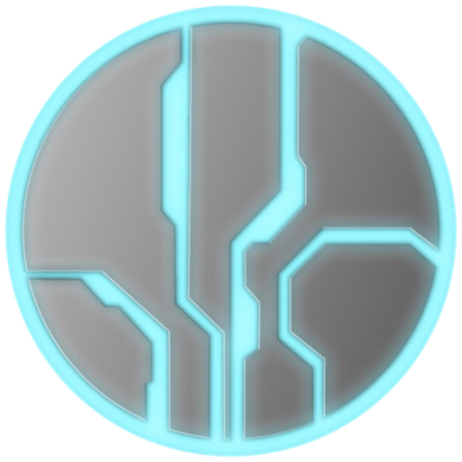

<p align="center">
  
</p>

<h1 align="center">OpenCE Mantle</h1>

<p align="center">
  <strong>A modern, all-in-one GUI desktop modding suite for Halo: Custom Edition (PC, v609) maps and <a href="https://github.com/OpenCommunityEdition/OpenCE">OpenCE</a>.</strong>
</p>

<p align="center">
  <a href="https://github.com/SutlabSol/OpenCE-Mantle/releases/latest"><strong>⬇️ Download Latest Release (Installer &amp; Portable Standalone .EXE)</strong></a>
</p>

---

## Overview

**OpenCE Mantle** (v0.6.8) is a free, non-commercial desktop application built with Electron, React, Three.js, and a pure TypeScript map/tag engine (`core/`). It brings together capabilities that historically required juggling half a dozen separate legacy tools (*SparkEdit*, *Guerilla*, *Tool.exe*, *Sapien*, *HMT*, *HHT*, *Eschaton*, *Mozzarilla*, and *Refinery*) into a single cohesive, non-destructive workspace designed for **[OpenCE](https://github.com/OpenCommunityEdition/OpenCE)** and Halo: Custom Edition.

With **OpenCE Mantle**, you can inspect and edit any Halo `.map` cache file in memory, build procedural multi-map worlds with interconnecting tunnels, caves, 6-style bridges, and QuickForge terrain/cities, sculpt 3D BSPs and `gbxmodel` meshes, paint 3D textures in place, author campaign/multiplayer HaloScript events visually in 3D, compile TrueType `.ttf` fonts into Halo `.font` tags, and hot-reload maps in `<1s`.

> **GUI-First & Non-Destructive by Design:** All map modifications (tag edits, injections, scenario object transforms, BSP swaps, procedural geometry generation, and script compilation) happen safely in memory inside a dedicated background worker thread. Source files on disk are never touched until you explicitly run **File > Save** (backed by an automatic `.map.bak` backup and atomic write) or **File > Save As**.

---

## Key Features & Overview

### 1. Simplified Tag Browser & Recursive Tag Field Editor
- **Fast Virtualized Tag Browser**: Browse thousands of tags grouped by Halo tag class (`bipd`, `weap`, `vehi`, `scnr`, `sbsp`, `bitm`, `snd!`, `font`, etc.) or virtual folder hierarchy with instant search filtering.
- **`✨ Simple View` vs. `🔧 Advanced View`**: Simple View (enabled by default) hides uneditable read-only fields, raw byte offsets (`TagDataOffset`), compiler cache checksums, hex addresses, and bulk JSON buttons so you only see clean, editable gameplay properties. Toggle to Advanced View anytime for raw struct offsets and `.block.json` import/export tools.
- **Plain-English Field Descriptions & Engineering Units**: Every field and reflexive block includes a clear plain-English explanation of what it controls alongside engineering unit badges (`wu`, `wu/s`, `sec`, `°`, `shots/s`, `pts`).
- **Interactive 3D Coordinate, RGB Color Swatch & Cross-Reflexive Editors**: Edit 3D points/vectors (`X / Y / Z`), Euler angles (`Yaw / Pitch / Roll`), and shader/sky colors with native RGB color pickers, plus dynamic dropdowns for cross-reflexive block indices (such as Scenario `Object Names`, `Palettes`, and `Trigger Volumes`).
- **HHT-Style Dependency Swapper & Reverse Reference Lookup**: Swap any outgoing tag reference (`TagDependency`) or inspect every tag in the map that references the active tag.

### 2. Interactive 3D Scenario & Structure BSP Viewport
- **Real-Time 3D Level Rendering**: Renders lightmapped `scenario_structure_bsp` geometry, skyboxes, directional/ambient lighting, distance fog, and textured 3D `gbxmodel` placements using Three.js.
- **Interactive Object Manipulation**: Select, translate, rotate, duplicate, swap, add, or delete Scenario placements (`Vehicles`, `Weapons`, `Scenery`, `Bipeds`, `Equipment`, `Machines/Doors`, `Controls`, `Netgame Flags`, `Netgame Equipment`, `Player Starting Locations`) with 3D gizmos and ground-snapping.
- **Bone-Aligned 3D Collision Hitbox Overlay (`🛡 Hitbox (coll)`)**: Toggle real-time green 3D collision wireframes transformed via each bone node's inverse bind-pose matrix (`ModelNode` -> `CollisionBSP`) and synced live with the 3D transform gizmo.
- **Coupled Object & Vehicle Physics Scaling (`⚖️ Coupled Scale`)**: Scale any object or vehicle uniformly while automatically scaling its rendered `gbxmodel` (`mod2`), bone translations, 3D `model_collision_geometry` (`coll`), and `physics` (`phys`) mass points and suspension radius together.

### 3. Procedural Tunnels, Caves, 6-Style Bridges & QuickForge World Studio
- **Multi-Path Tunnel & Subterranean Cave Network Generator**:
  - Connect two worlds or map bases with **1–5 main tunnel pathways** and **1–10 interconnecting cross-tunnels** across any custom **world separation distance**.
  - Embed **1–10 subterranean caves** along the tunnel network with per-cave radius, ceiling height, and style controls (*Natural Cavern*, *Forerunner Vault*, *Flood Hive*).
- **6-Style Procedural Bridge Builder**:
  - Generate multi-span bridges (1–5 parallel spans with optional cross-walkways) across 6 styles:
    1. **Forerunner Hardlight / Metal Span** (angled struts & glowing pylons)
    2. **Suspension Bridge** (twin towers, parabolic main cables & vertical suspenders)
    3. **Arch Bridge (Under-Deck)** (structural parabolic arch supporting the deck from below)
    4. **Arch-Suspension (Through-Arch)** (overhead arch rib with tensioned drop hangers)
    5. **Natural Rocky Land Bridge** (weathered canyon rock arch with organic strata)
    6. **Natural Dirt / Grass Land Bridge** (sloped earthen causeway with boulder embankments)
- **Halo Default Auto-Shader System**: Automatically bind or synthesize Halo `shader_environment` (`senv`) and `shader_model` (`soso`) presets (*Forerunner Brushed Metal*, *Forerunner Glowing Panel*, *Canyon Rock*, *Blood Gulch Dirt/Grass*, *UNSC Concrete*) onto generated geometry.
- **QuickForge BSP World, Terrain & City Builder**:
  - Sculpt deformable terrain heightmaps (hills, valleys, craters, plateaus, canyon walls) and populate worlds with procedural **Nature** (Halo CE pine trees, boulders, ridges), **Forerunner** (monoliths, spires, control rooms), and **Human City / Street** (urban road grids, sidewalks, multi-story UNSC buildings, streetlamps, barriers) kits with compiled 3D collision.

### 4. Visual 3D Script Event Builder & HaloScript (`.hsc`) IDE
- **Interactive 3D Event & Waypoint Builder**: Visually author campaign and multiplayer scripted events in 3D without writing boilerplate code:
  - **Triggered Pelican / Covenant Dropship Drops**: Separate inbound/outbound 3D flight paths (`@flight_path`) from ground-only `ai_command_list` patrol routes (`🥾 + Patrol Point`) so dropships land cleanly at the LZ, unload vehicles (Scorpion/Warthog/Ghost) and passengers, and fly away while unloaded squads march along their ground patrol route.
  - **1-Click 3D AI Migration Arrows (`🔀 + AI Migration Arrow (ai_migrate)`)**: Drop a draggable target waypoint with a glowing emerald-green 3D arched arrow to dynamically migrate AI squads into new encounter zones after landing or combat.
  - **3D Cutscene Camera Flythroughs, Interactive Doors/Bridges (`device_machine`), AI Ambush Waves & 3D OBB Trigger Volumes**.
- **Full HaloScript Decompiler & Bytecode Compiler**: Decompile compiled `scnr` script syntax trees back into readable `.hsc`, edit with syntax highlighting and function autocomplete, and recompile directly into the open map.

### 5. Modding Studio: TrueType Font Compiler, HUD Meters & Universal Tag Converter
- **TrueType (`.ttf`) & System Font to Halo `.font` Compiler**: Preview and rasterize any `.ttf`/`.otf` or system font on an interactive glyph atlas canvas and compile it directly into `ui\large_ui`, `ui\small_ui`, or `ui\ticker` (with automatic `loc.map` resource internalization).
- **HUD Stencil Meter (`metr`) Gradient Editor & Authentic 16:9 / 4:3 HUD Previewer (`wphi`, `unhi`, `grhi`, `hudg`)**: Edit shield/health/heat meter gradients and preview weapon crosshairs and ammo counters live.
- **In-Map Unicode (`ustr`) & HUD Message (`hmt `) Compiler**: Edit localized pickup prompts, seat labels, and campaign objective messages in place.
- **Universal Tag Class Converter & Legacy HEK Tag Importer**: Convert between any of the 11 Halo object classes (`scenery`, `vehicle`, `weapon`, `biped`, `equipment`, `device_machine`, etc.) with non-overlapping struct reallocation, or import standalone Guerilla/HEK tag files directly into a map.
- **2-Map Variant Diffing & Comparison Dialog**: Compare two `.map` files side by side to inspect added/modified tags, changed field values, and scenario placement diffs.

### 6. GIMP-Style 3D Bitmap Paint Studio & Blender-Style 3D Model Studio
- **Synchronized 3D Model + 2D UV Split Paint Canvas**: Paint directly onto any 3D `gbxmodel` or 2D UV unwrap using a multi-layer stack (`Normal`, `Multiply`, `Overlay`, `Screen`, `Color Tint`), custom texture stamps, and Auto-HD `1024px` upscaling.
- **Blender-Style 3D Mesh Editor, 3 UV Unwrap Modes & `.WRL` Diagnostics**: Edit vertices/faces, apply **Box / Triplanar**, **Cylindrical**, or **Spherical** UV projection, inspect open/degenerate edges via `.wrl` diagnostics, auto-seal watertight manifolds, and compile 1:1 exact `model_collision_geometry` up to `32,760` faces.

### 7. Multi-BSP Swapper/Combiner, `.ocetags` Packaging, Map Converter & Live Control Deck
- **1-Click SP-to-MP & Multi-BSP Swapper / Combiner**: Transplant Singleplayer BSPs into Multiplayer maps or fuse multiple BSPs into one combined BSP with automated dependency harvesting and `switch_bsp` scripts.
- **`.ocetags` Dependency Extraction & ADD/SWAP Injection**: Extract self-contained tag closures or whole maps and inject them into any target map.
- **Multi-Edition Map Converter**: Convert Halo PC Retail (`v7`), HaloMD (`v7`), Halo Mac Demo (`v6`), and Halo Xbox (`v5`) maps to Custom Edition (`v609`), plus Chimera Zstd compression and 1-click **Halo MCC** deployment.
- **Live OpenCE Tag Test Runner (`F5`) & `<1s` Hot-Reload TCP Control Deck**: Launch maps in OpenCE and toggle cheats, AI debug overlays, game speed, and `<1s` hot-reloads in real time.

---

## Project Layout

```text
core/      Pure TypeScript map/tag library (no Electron/React/DOM). Unit tested with Vitest.
desktop/   Electron main process + worker thread + preload + React (Vite) renderer GUI.
memory/    PRD.md (milestone status + approved decisions) and RULES.md (standing dev rules).
```

---

## Installation & Development

Requires **Node.js 22 LTS** (`>=20 <23`) and **Yarn 1**.

```bash
cd core && yarn install
cd ../desktop && yarn install

# Run in development:
cd desktop
yarn dev:renderer               # terminal 1: Vite dev server (http://localhost:5173)
yarn dev:electron               # terminal 2: compiles main/preload/worker and launches Electron
```

## Building & Packaging for Windows

```bash
cd desktop
node build-dist.js              # builds core + renderer + electron and packages both:
                                # 1) desktop/release/OpenCE Mantle Setup 0.6.8.exe (NSIS Installer)
                                # 2) desktop/release/OpenCE Mantle 0.6.8.exe (Portable Standalone)
```

---

## Licensing & Attribution

Invader, Reclaimer, Refinery, Mozzarilla, supyr_struct, and Chimera (all GPL-licensed) were used strictly as **format references** while writing `core`'s struct parsers (see citations in code comments and [`core/README.md`](core/README.md)). No Bungie or Microsoft assets are bundled; **OpenCE Mantle** operates exclusively on map files you supply yourself.

The tag definition schemas in `core/src/map/definitions/groups/*.json` are generated by `core/scripts/generate-definitions.mjs` from Invader's tag definition JSON (and `ui_widget_collection` from Reclaimer), both licensed under **GPL-3.0-only** (see `core/src/map/definitions/SOURCES.md`). Under GPL-3.0's derivative work provisions, distributing this project places the combined distribution under **GPL-3.0**.
