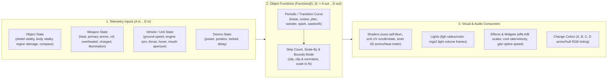

# 03 — Object Functions (`A in..D out`), Effects (`effe`), Lights (`ligh`), Weapons (`weap`), Shaders & HUD Meters

> **Purpose**: Complete technical reference and **OpenCE Mantle** workflow guide for Halo CE's Object Function Pipeline (`A in..D in` $\rightarrow$ `A out..D out`), Effects (`effe`, `part`, `pctl`, `cont`, `mgs2`, `glw!`), Lights & Lens Flares (`ligh`, `lens`), Weapons & Damage (`weap`, `proj`, `jpt!`), all 9 Shader classes (`soso`, `senv`, `schi`, `scex`, `sotr`, `sgla`, `swat`, `spla`, `smet`), Bitmaps (`bitm` color plates & multipurpose channels), and HUD/Meter alpha encoding (`wphi`, `unhi`, `grhi`, `hudg`, `metr`).

---

## 1. The Object Function & Change-Color Pipeline (`A in..D in` $\rightarrow$ `A out..D out`)

One of the most powerful — yet least understood — systems in Halo 1 is how dynamic gameplay telemetry drives glowing shaders, pulsing lights, spinning barrels, heat meters, and particle velocities without scripts.

### 1.1 How It Works Step-by-Step
1. **Bind Telemetry to `A in` .. `D in`**:
   - In the root `object` block (`0x000`–`0x17B`) or subclass block (`unit`, `weapon`, `vehicle`, `device`, `projectile`), pick what gameplay variable feeds into slots `A in`, `B in`, `C in`, and `D in` (for example, on the Plasma Rifle, `weapon_a_in = heat` and `weapon_b_in = primary_ammunition`).
2. **Transform via `functions` Reflexive (`0x140`, max 4 entries: `A out`, `B out`, `C out`, `D out`, `360` bytes each)**:
   - Each function can scale its input by another function (`scale_by`), apply a periodic wave (`WaveFunction`), quantize into discrete steps (`step_count`, used for stepped ammo counters!), or add/multiply with another function.
3. **Consume `A out` .. `D out` in Shaders, Widgets, and Attachments**:
   - In `object.attachments` (`0x11C`, `72` bytes each: attaches `ligh`, `effe`, `cont`, `pctl`, `snd!`, or `lsnd` to a `marker`), set `primary_scale` and `secondary_scale` to `A out`..`D out`.
   - In `shader_model` (`soso`), set `self_illumination.animation_function` to `A out` so the weapon glows brighter as `heat` rises!
   - In `shader_transparent_meter` (`smet`), set `meter_value_source` to `B out` so the 3D display on the gun shows remaining battery/ammo!

---

## 2. How Effects (`effe`), Particles (`part`, `pctl`), Contrails (`cont`), Light Volumes (`mgs2`) & Glow (`glw!`) Are Made

### 2.1 Effects (`effe`, `64`-byte Header)
An `effect` tag is a sequenced timeline of **`events`** (`0x2C`, max 32, `68` bytes each) bound to model **`locations`** (`0x20`, max 32, `32`-byte `marker_name` strings):
- Each **`EffectEvent`** waits `delay_bounds` seconds (`0x08`), runs for `duration_bounds` seconds (`0x10`), and spawns:
  1. **`parts` (`0x28`, max 32, `104` bytes each)**: Spawns discrete tags at `location`:
     - Can spawn **`jpt!`** (`damage_effect`), **`pctl`** (`particle_system`), **`snd!`** (`sound`), **`deca`** (`decal`), **`ligh`** (`light`), or any **`obje`** (`proj`, `scen`, `garb`, `eqip`, `weap`, `vehi`, `bipd` — used to eject shell casings or spawn debris!).
     - **CRITICAL Compile/Save Rule**: Offset `0x14` (`type_class`) in `EffectPart` **must** be populated with the 4-byte FourCC of the referenced `type` tag (or `obje` if it's an object subclass), otherwise `halo.exe` ignores the part!
  2. **`particles` (`0x34`, max 32, `232` bytes each)**: Emits `count` (`0x6C` min/max) sprites of a **`part` (`particle`)** tag at `location` + `relative_offset` along `relative_direction` (`0x18` yaw/pitch).
     - **CRITICAL Compile/Save Rule**: Offset `0x20` (`relative_direction_vector` `Vector3D`) **must** be precalculated from `relative_direction` `(yaw, pitch)` as $(\cos\text{yaw}\cos\text{pitch}, \sin\text{yaw}\cos\text{pitch}, \sin\text{pitch})$!

### 2.2 Particles (`part`, `356` bytes) vs. Particle Systems (`pctl`, `104` bytes)
- **`part` (`Particle`)**: Lightweight sprite billboard spawned by `effe.events[i].particles`.
  - **CRITICAL Engine Lockup Bug**: Offset `0x88` (`contact_deterioration`) **must remain `0.0`** — any non-zero value freezes the game when a particle collides!
  - **Required Derived Fields**: Offset `0xA4` (`sprite_size`) must be calculated from the referenced `bitmap` sequence dimensions, and offset `0xCE` (`make_it_actually_work`) **must be set to `1`**!
- **`pctl` (`ParticleSystem`)**: Complex stateful emitter (`particle_types` $\rightarrow$ system `states` + per-particle `particle_states`), used for persistent fire, smoke plumes, and the flamethrower (`particle_creation_physics = 2 (jet)`).

### 2.3 Glow (`glw!`, `340` bytes) — How Energy Sword Splines Work & How to Avoid Crashes
- Attached via `object.widgets` (`0x128`).
- Finds up to **5 markers sharing `attachment_marker` (`0x00`)** on the model and chains them into a 3D spline by sorting markers along the previous marker's local `+X` forward vector.
- **Two Mandatory Crash/Freeze Guards for Mantle**:
  1. **Closed Loop Freeze**: If the last marker's `+X` vector points back toward an earlier marker, the spline builder enters an infinite loop and freezes Halo!
  2. **Zero Multiplier Crash**: If an attachment function (`A out`..`D out`) is selected on `effect_translational_velocity` (`0x78`) or `lifetime_of_trailing_particles` (`0xEA`), the `low_multiplier` **must be `> 0.0`**, otherwise the engine crashes with `bounds->x0 <= bounds->x1`!

---

## 3. How Lights (`ligh`) & Lens Flares (`lens`) Are Made

### 3.1 Lights (`ligh`, `352` bytes)
- **Dynamic vs. Static Radiosity Lights**:
  - Checking `flags.dynamic` (`Bit 0` at `0x00`) makes the light illuminate BSP surfaces and objects in real time (e.g., Warthog headlights, Master Chief's flashlight, Plasma Grenades).
  - Setting Radiosity `intensity` (`0xF0`) and `color` (`0xF4`) on a `ligh` attached to a `scenery` or `device_light_fixture` causes `tool lightmaps` to bake static lighting into the BSP lightmap!
- **Spotlight Frustum & Gel Cubemaps**:
  - `falloff_angle` (`0x10`) and `cutoff_angle` (`0x14`) define the inner full-bright cone and outer cutoff cone.
  - **CRITICAL Precalculated Fields (`objs/ligh.py`)**:
    - `0x1C` (`specular_radius_multiplier`): **MUST be set to `2.0`** (if `0.0`, first-person flashlights fail to render!).
    - `0x20` (`cos_falloff_angle`) = $\cos(\text{falloff\_angle})$
    - `0x24` (`cos_cutoff_angle`) = $\cos(\text{cutoff\_angle})$
    - `0x2C` (`sin_cutoff_angle`) = $\sin(\text{cutoff\_angle})$
  - `primary_cube_map` (`0x64`) projects a 2D/cubemap pattern ("gel") along the spotlight cone (such as the rings of the Cyborg flashlight).

### 3.2 Lens Flares (`lens`, `240` bytes) & "Ray of Buddha" God-Rays
- Renders up to **32 screen-space `reflections`** (`0xC4`, `128` bytes each) along the vector from the light's screen projection (`position = 0.0`) through the screen center (`position = 0.5`) to the opposite corner (`position = 1.0`).
- **Enabling God-Rays ("Ray of Buddha")**: Checking `flags.sun` (`Bit 0` at `0x30`) **or** setting `occlusion_radius == 50.0` (`0x10`) activates Halo's screen-space radial crepuscular rays around silhouette edges!

---

## 4. How Weapons (`weap`), Projectiles (`proj`) & Damage Effects (`jpt!`) Are Made

### 4.1 Critical Weapon (`weap`, `1288` bytes) Setup Rules
1. **Weapon `label` (`0x30C` `String32`)**:
   - Must match an animation weapon label inside the carrying biped's `model_animations.units[i].weapons` block (`ar`, `hp`, `pr`, `pp`, `rl`, `sg`, `sr`, `ft`, `fr`, `ne`, `fb`, `cg`). If the biped lacks animations for that `label`, the biped **cannot pick up or hold the weapon**!
2. **First-Person Model LOD Rule (`0x35C` `first_person_model`)**:
   - Halo always renders `first_person_model` using the **lowest defined LOD** in the `gbxmodel`! Therefore, FP weapon models must only define a single `superhigh` LOD (`low`/`superlow` slots left empty).
3. **Required Weapon Markers (`#` in `gbxmodel`)**:
   - `#primary trigger` (Barrel 0 muzzle), `#secondary trigger` (Barrel 1 muzzle), `#primary ejection`, `#flashlight`, `#ground point`.

### 4.2 Projectiles (`proj`, `588` bytes) & Damage Effects (`jpt!`, `672` bytes)
- **Projectile Velocity Tick Scaling**:
  - In `proj`, `initial_velocity` (`0x1CC`) and `final_velocity` (`0x1D0`) are displayed in world units/sec in Guerilla, but **stored in world units per tick (`wu/s / 30.0`)** in compiled cache/tag postprocessing!
- **Damage Effects (`jpt!`) — Knockback, Headshots & Shield Bleedthrough**:
  - `damage_instantaneous_acceleration` (`0x1F0`): Controls explosive knockback / grenade-jump impulse.
  - `damage_aoe_core_radius` (`0x1C8`): Radius within which explosive damage **ignores walls/BSP cover**!
  - **Shield Bleedthrough Rule (`0x200`–`0x280` 33 Material Multipliers)**:
    - If `cyborg_energy_shield` (or `elite_energy_shield`) multiplier is **`1.0`**, excess damage that pops a unit's shield does **NOT** bleed through into health!
    - If the shield multiplier is **`!= 1.0`** (e.g., Sniper Rifle or Melee), excess damage after popping shields bleeds straight into health!

---

## 5. Shaders, Multipurpose Channels, Sprite Color Plates & HUD Alpha Meters

### 5.1 `shader_model` (`soso`) Multipurpose Map Channel Order (PC/CE vs. Original Xbox)
Gearbox swapped the RGBA channels of `multipurpose_map` when porting Halo to PC:

| Channel | **PC / Custom Edition / OpenCE / H1A Default** | **Original Xbox (`multipurpose_map_uses_og_xbox_channel_order`)** |
| :--- | :--- | :--- |
| **Red (R)** | **Detail / Auxiliary Mask** *(mislabeled "multipurpose map alpha" in Guerilla!)* | **Specular Reflection Mask** |
| **Green (G)** | **Self-Illumination Mask** (glows in the dark; can be animated by `A out..D out`) | **Self-Illumination Mask** |
| **Blue (B)** | **Specular Reflection Mask** (modulates cubemap reflections & dynamic specular) | **Color Change / Armor Tint Mask** |
| **Alpha (A)** | **Color Change / Armor Tint Mask** (tinted by multiplayer team color or `actv` color) | **Detail / Auxiliary Mask** |

- **Conversion Permutation (`MEK/mek_lib/mozzarilla/windows/tools/bitmap_converter_window.py`)**:
  - `PC_ARGB_TO_XBOX_ARGB = (1, 3, 2, 0)`
  - `XBOX_ARGB_TO_PC_ARGB = (3, 0, 2, 1)`

### 5.2 Key Shader Rules Across the Other 8 Shader Classes
- **`shader_environment` (`senv`)**: Only renders on `sbsp` BSP geometry! If a `gbxmodel` (`mod2`) references an `senv`, it renders untextured/broken — Mantle (via MEK's `Mod2_Senv_Replacer.py`) automatically synthesizes a matching `shader_model` (`soso`) tag! Also note: when `alpha_tested` is enabled on `senv`, the 1-bit cutout mask comes from **`bump_map` Alpha**, NOT `base_map` Alpha!
- **`shader_transparent_chicago` (`schi`) & `extended` (`scex`)**: Default `u_animation_function` and `v_animation_function` are set to `1 (one)`, which shifts UVs by `+1.0` and breaks `u_clamped`/`v_clamped` and `rotation_animation_center`. Always set `u/v_animation_function = 0 (zero)` when clamping or rotating textures!
- **`shader_transparent_generic` (`sotr`)**: Xbox 8-stage register-combiner shader. Does not render in legacy PC/CE (must be converted to `scex`/`schi` via MEK's `Sbsp_Sotr_Replacer.py`), but **renders natively in H1A MCC and OpenCE**!

### 5.3 Sprite Sheets (`bitm` Color Plates) & HUD Alpha Meters (`wphi`, `unhi`, `metr`)
1. **Sprite Sheet Color Plate Rules (`Tool MCC` `plate`)**:
   - Top-left 3 pixels of a sprite sheet `.tif`/`.png` define:
     - `(0, 0)` = Background / Border (`#0000FF` Blue)
     - `(1, 0)` = Sequence Row Divider (`#FF00FF` Magenta)
     - `(2, 0)` = Dummy Registration Padding (`#00FFFF` Cyan)
   - Every sprite requires a **4-pixel mipmap padding border** on the texture page.
2. **How HUD Meters (`wphi`, `unhi`, `metr`) Encode Both Stencil Shape & Fill Gradient in Alpha**:
   - In Halo 1, a HUD health/shield/heat bar or bullet counter bitmap uses **RGB for the bar texture** and **Alpha for BOTH the cutout shape AND the 0%–100% progression order**:
     - `Alpha == 0`: Transparent background outside the bar.
     - `Alpha 1..255`: Defines the fill threshold from empty (`1`) to full (`255`)!
     - For discrete bullet counters (Assault Rifle 60 bullets, Pistol 12 bullets), each bullet icon is given a stepped greyscale alpha value (`divide_by_ammo_count`).
3. **How Mantle Automates This**:
   - Mantle's **HUD Previewer & Meter Studio** can take any plain silhouette PNG + a chosen fill direction (Left-to-Right, Bottom-to-Top, Radial Arc, or N-Bullet Grid) and automatically compute the exact stepped/gradient Alpha channel!
