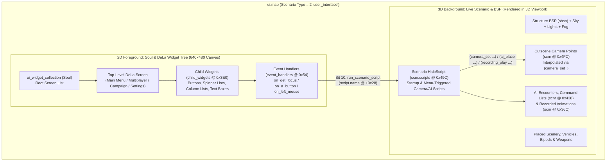

# 04 — Custom `ui.map` Studio, 3D Cutscene Cameras, AI Choreography (`command_lists`) & Triggers

> **Purpose**: Complete technical specification and **OpenCE Mantle** design blueprint for building an interactive **Custom `ui.map` & 3D Cutscene/Scenario Studio** — combining a 2D WYSIWYG `DeLa` (`ui_widget_definition`) Menu Editor with our 3D Viewport (`ScenarioViewport.tsx`) to place custom BSPs, scenery, vehicles, bipeds, NPCs executing `command_lists`, trigger volumes, and keyframed `cutscene_camera_points`.

---

## 1. How `ui.map` Actually Works Under the Hood

Many modders think `ui.map` is just a flat menu file. In reality, **`ui.map` is a full 3D Halo scenario (`scnr`) running simultaneously behind a 2D widget tree (`Soul` $\rightarrow$ `DeLa`)**:



### 1.1 The 3 Pillars of `ui.map`
1. **`scnr` (`Scenario`, `type = 2 user_interface` at offset `0x3C`)**:
   - References a real 3D `scenario_structure_bsp` (`structure_bsps` at `0x5A4`) — you can swap **any** MP or SP BSP (or custom `.obj` BSP!) into `ui.map` using Mantle's BSP Swapper!
   - Supports placed `scenery`, `vehicles`, `bipeds`, `weapons`, `equipment`, `machines` (moving doors/platforms), `light_fixtures`, `sound_scenery`, `ai_encounters`, `command_lists`, `recorded_animations`, `cutscene_camera_points`, and compiled `scripts`!
2. **`Soul` (`ui_widget_collection`, FourCC `Soul`, `12` bytes)**:
   - Contains a single reflexive `ui_widget_definitions` (`0x00`, max 32 entries of `16` bytes each) listing the root `DeLa` widget definitions loaded for the main menu.
3. **`DeLa` (`ui_widget_definition`, FourCC `DeLa`, `1004` bytes, Version 1)**:
   - Recursive 2D UI tree rendered on a **640×480 virtual coordinate canvas** (`top, left, bottom, right` at `0x24`).
   - **The Magic Bridge Between 2D Menus and the 3D Scene (`event_handlers` at `0x54`)**:
     - Each `DeLa` widget has up to 32 `event_handlers` (`72` bytes each).
     - When `flags` (`0x00`) has **Bit 10 (`run_scenario_script`)** set, triggering that UI event (e.g., `event_type = 26 get_focus` when hovering a menu button, or `0 a_button` / `28 left_mouse` when clicking it!) immediately executes the HaloScript function named in `script` (`String32` at `+0x28`) inside `ui.map`'s `scnr`!
     - **What This Means**: Hovering over *"Campaign"* can smoothly fly the 3D camera over to Master Chief inspecting weapons beside a Pelican; hovering over *"Multiplayer"* can pan the 3D camera over to Red vs. Blue Spartans battling in Warthogs; hovering over *"Settings"* can pan to a Forerunner control terminal!

---

## 2. Byte-Level Reference for `DeLa` (`ui_widget_definition`, `1004` Bytes)

| Offset | Type | Field Name | Details & Modding Behavior |
| :--- | :--- | :--- | :--- |
| `0x00` | `Enum16` | `widget_type` | `0 = container`, `1 = text_box`, `2 = spinner_list`, `3 = column_list` |
| `0x02` | `Enum16` | `controller_index` | `0 = player_1 .. 3 = player_4`, `4 = any_player` |
| `0x04` | `String32` | `name` | Internal widget identifier |
| `0x24` | `Rect2D` | `bounds` | `int16 top, left, bottom, right` on the `640×480` virtual screen |
| `0x2C` | `Bitmask32` | `flags` | `pass_unhandled_events_to_focused_child`, `pause_game_time`, `flash_background_bitmap`, `dpad_up_down_tabs_thru_children`, `dpad_left_right_tabs_thru_children`, `dont_focus_a_specific_child_widget`, `return_to_main_menu_if_no_history`, `force_handle_mouse`, etc. |
| `0x30` | `int32` | `milliseconds_to_auto_close` | Auto-close timer (`0` = never) |
| `0x34` | `int32` | `milliseconds_auto_close_fade_time` | Fade-out duration in ms |
| `0x38` | `Dependency` | `background_bitmap` | `bitm` sprite plate (sequences represent unfocused, focused, clicked, and disabled states) |
| `0x48` | `Reflexive` | `game_data_inputs` | Max 64 (`36` B each): binds C engine data functions (`21 = main_menu_fake_animate`, `28 = mp_level_select_update`, `37 = network_game_server_list_update`, etc.) |
| `0x54` | `Reflexive` | `event_handlers` | Max 32 (`72` B each): `flags` (`open_widget`, `close_current_widget`, `replace_self_w_widget`, `go_back_to_previous_widget`, `run_function`, **`run_scenario_script` [Bit 10]**), `event_type` (`0=a_button`, `5=back_button`, `24=created`, `26=get_focus`, `28=left_mouse`), `function` (190 C callbacks), `widget_tag` (`DeLa`), `sound_effect` (`snd!`), `script` (`String32` at `+0x28`) |
| `0x60` | `Reflexive` | `search_and_replace_functions` | Dynamic string token replacements |
| `0xEC` | `Dependency` | `text_label_unicode_strings_list` | `ustr` tag providing text for `text_box` / list items |
| `0xFC` | `Dependency` | `text_font` | `font` tag used to render text |
| `0x10C` | `ColorARGB` | `text_color` | Float ARGB color `(a, r, g, b)` |
| `0x11C` | `Enum16` | `justification` | `0 = left`, `1 = right`, `2 = center` |
| `0x126` | `int16` | `string_list_index` | Zero-based index into `text_label_unicode_strings_list` (`ustr`) |
| `0x128` | `int16[2]` | `horiz_offset`, `vert_offset` | Pixel offset for text rendering inside `bounds` |
| `0x288` | `Reflexive` | `conditional_widgets` | Max 32 (`80` B each): conditionally swapped widgets |
| `0x3E0` | `Reflexive` | `child_widgets` | Max 32 (`80` B each): `widget_tag` (`DeLa` at `+0x00`), `name` (`+0x10`), `flags` (`+0x30`), `vertical_offset` (`int16` at `+0x36`), `horizontal_offset` (`int16` at `+0x38`) |

---

## 3. How 3D Cutscene Cameras (`cutscene_camera_points`) Work in `scnr` & `ui.map`

### 3.1 `cutscene_camera_points` (`scnr + 0x4FC`, Max 512, `104` Bytes Each)
- `0x04`: `name` (`String32`, e.g. `cam_main_menu`, `cam_campaign`, `cam_multiplayer`, `cam_pelican_flyby`)
- `0x24`: `position` (`Point3D` `x, y, z` in world units)
- `0x30`: `orientation` (`Euler3D` `yaw, pitch, roll` in radians)
- `0x3C`: `field_of_view` (`Angle` in radians; `0` = default `70°` = `1.2217 rad`)

### 3.2 Scripting Smooth Camera Movement & Cuts in `ui.map` or SP/MP Cutscenes
In the scenario's HaloScript (`scnr.scripts`):
```lisp
(script startup ui_background_director
  (camera_control true)
  ;; Loop smoothly through 3D camera points in the background:
  (camera_set cam_overview_1 0)          ;; Instant cut (0 ticks) to starting camera point
  (camera_set cam_overview_2 180)        ;; Smoothly pan/interpolate over 180 ticks (6 seconds)
  (sleep 90)
  (camera_set cam_warthog_orbit 150)     ;; Smoothly pan over 5 seconds
)

;; Called when user hovers "Campaign" button via DeLa event_handler (Bit 10: run_scenario_script):
(script static void on_focus_campaign
  (camera_control true)
  (camera_set cam_chief_briefing 45)     ;; 1.5-second smooth camera glide to Master Chief!
)

;; Called when user hovers "Multiplayer" button:
(script static void on_focus_multiplayer
  (camera_control true)
  (camera_set cam_red_vs_blue_arena 45)  ;; 1.5-second smooth camera glide to MP arena!
)
```

> [!IMPORTANT]
> **Disabling the Default Hardcoded `ui.map` Camera**:
> Stock `ui.map`'s root `DeLa` widget includes a `game_data_inputs` entry with `function = 21 (main_menu_fake_animate)`, which overrides the camera with a hardcoded circular orbit. When building a custom scripted 3D camera in `ui.map`, Mantle can automatically remove or zero out `function = 21` on the root `DeLa` widget so your `(camera_set ...)` points have full control!

---

## 4. Making NPCs, Bipeds & Vehicles Perform Actions (`command_lists` & `recorded_animations`)

To make Marines patrol, Pelicans land, Warthogs drive along roads, Elites duel, or Spartans wave/animate in the background of `ui.map` (or in any campaign/custom map), Halo CE provides **two complementary systems** in `scnr`:

### 4.1 System 1: AI Command Lists (`scnr + 0x438`, Max 256, `96` Bytes Each)
A `command_list` is a sequence of up to **64 atomic commands** (`commands` reflexive at `+0x30`, `32` bytes each) referencing 3D waypoints (`points` reflexive at `+0x3C`, `20` bytes each: `Point3D position` + `int32 surface_index`).
- You can assign a `command_list` directly to any AI squad's `starting_locations[i].command_list` (`+0x18`) **with zero HaloScript required**, OR trigger it via `(ai_command_list <encounter/squad> <command_list_name>)`!
- Checking `allow_initiative` (`Bit 0` at `+0x20`) lets the AI engage enemies once the command list finishes; unchecking it forces the NPC to strictly act out your choreography!

#### Complete Table of All 28 Command List `atom_type` Actions (`+0x02` `Enum16`)

| `atom_type` | Action Name | Parameters Used in `32`-Byte Command Struct | What the NPC / Biped Does in the 3D Scene |
| :---: | :--- | :--- | :--- |
| **`0`** | **`pause`** | `parameter1` (`float` seconds at `+0x08`) | Pauses execution for `parameter1` seconds. |
| **`1`** | **`go_to`** | `point1` (`+0x12`), `atom_modifier` (`0=non-blocking, 1=blocking`) | Walks or runs to 3D waypoint `points[point1]`. |
| **`2`** | **`go_to_and_face`** | `point1` (`+0x12` dest), `point2` (`+0x14` look target) | Moves to `point1` while facing toward `point2`. |
| **`3`** | **`move_in_direction`** | `parameter1` (distance), `angle` (`+0x10` heading) | Moves `parameter1` world units along `angle`. |
| **`4`** | **`look`** | `angle` (`+0x10`), `point1` (`+0x12`) | Turns head/aim toward `point1` or `angle`. |
| **`5`** | **`animation_mode`** | `atom_modifier`: `0=none, 1=asleep, 2=idle, 3=alert, 4=combat, 5=flee, 6=flaming, 7=crouch, 8=panic` | Switches the NPC's posture/locomotion stance! |
| **`6`** | **`crouch`** | `atom_modifier`: `0=stand, 1=crouch, 2=allow_movement` | Kneels/crouches or stands back up. |
| **`7`** | **`shoot`** | `atom_modifier`: `0=stop, 1=at_target, 2=at_point`, `point1` | Fires weapon at `points[point1]` (great for background firefights!). |
| **`8`** | **`grenade`** | `point1` (`+0x12` target point) | Throws a grenade at `points[point1]`. |
| **`9`** | **`vehicle`** | `atom_modifier`: `0=any_seat, 1=driver, 2=gunner, 3=passenger, 4=exit`, `object_name` (`+0x1A` index) | Climbs into or exits the named vehicle (`scnr.object_names`)! |
| **`10`** | **`running_jump`** | None | Performs a forward running jump. |
| **`11`** | **`targeted_jump`** | `parameter1` (horiz vel), `parameter2` (vert vel) | Jumps with specified horizontal/vertical velocity across a gap. |
| **`12`** | **`script`** | `script` (`+0x18` index into `scnr.scripts`) | Triggers a HaloScript function when the NPC reaches this step! |
| **`13`** | **`animate`** | `animation` (`+0x16` index into `scnr.ai_animation_references` at `0x444`) | Plays any custom animation from the biped's `antr` tag (waving, typing on a console, cheering, taunting)! |
| **`14`** | **`recording`** | `recording` (`+0x18` index into `scnr.ai_recording_references` at `0x45C`) | Plays a deterministic `recorded_animation` input stream! |
| **`15`** | **`action`** | `atom_modifier`: `1=sleep, 2=berserk, 3=evade_left, 4=evade_right, 5=dive_forward, 9=track_target` | Performs an immediate combat dodge, dive, or berserk charge. |
| **`16`** | **`vocalize`** | `atom_modifier` (dialogue vocalization enum) | Speaks a combat/status dialogue line. |
| **`17`** | **`targeting`** | `atom_modifier`: `0=normal, 1=head, 2=body, 3=scripted_only` | Restricts AI targeting behavior. |
| **`18`** | **`initiative`** | `atom_modifier`: `0=false, 1=true` | Enables or disables autonomous AI combat decisions mid-list. |
| **`19`** | **`wait`** | `parameter1` (seconds) | Waits before advancing. |
| **`20`** | **`loop`** | `command` (`+0x16` target command index) | **Jumps back to command `index` — creating an infinite patrol or animation loop for `ui.map` backgrounds!** |
| **`21`** | **`die`** | None | Kills the actor immediately. |
| **`22`** | **`move_immediate`** | `point1` (`+0x12`) | Moves immediately to `point1` ignoring cover. |
| **`23`** | **`look_random`** | None | Looks around randomly (natural idle sentry behavior). |
| **`24`** | **`look_player`** | None | Tracks and looks directly at the player. |
| **`25`** | **`look_object`** | `object_name` (`+0x1A` index into `scnr.object_names`) | Tracks and looks at a specific named vehicle/biped/scenery object! |
| **`26`** | **`set_radius`** | `parameter1` (world units) | Sets waypoint arrival tolerance radius. |
| **`27`** | **`teleport`** | `point1` (`+0x12` position), `point2` (`+0x14` facing) | Teleports the NPC back to a starting point (ideal before `loop`!). |

### 4.2 System 2: Recorded Animations (`scnr + 0x36C`, Max 1024, `64` Bytes Each)
- Captures a 30 Hz input stream (`recorded_animation_event_stream`) of unit movement, aiming, throttle, and firing.
- Played back on any named unit (`bipd` or `vehi`) via `(recording_play <unit_name> <recording_name>)` or `(recording_play_and_hover <vehicle_name> <recording_name>)`.

---

## 5. Blueprint: How OpenCE Mantle Will Deliver the Ultimate `ui.map` & 3D Cutscene Studio

We already have [`ScenarioViewport.tsx`](file:///c:/Users/LeviB/Projects/OpenCE-Mantle/desktop/src/components/viewport/ScenarioViewport.tsx) rendering 3D BSPs, scenery, vehicles, bipeds, AI encounters/squads, firing positions, trigger volumes, and cutscene camera frustums! Here is how we expand it into a complete **1-Stop `ui.map` & Cutscene Choreography Studio**:

### 5.1 Composite 3D Viewport + 2D `DeLa` Menu Overlay Mode
1. **Live 640×480 `DeLa` Widget Overlay on Top of the 3D Viewport**:
   - When a user opens `ui.map` (or any map containing `Soul` / `DeLa` tags), add a **"UI Menu Overlay (`DeLa`)"** toggle in the 3D Viewport toolbar.
   - Renders the active `DeLa` screen (`main_menu`, `multiplayer_type_select`, `pause_game`, etc.) directly over the 3D scene using its authentic `background_bitmap` sprite sequences, `font` glyphs, and `ustr` strings.
2. **Drag-and-Drop 2D Widget Bounds & Event Wiring**:
   - Click any menu button (`child_widgets`) on the 2D overlay to drag its position (`horizontal_offset, vertical_offset`) or resize its `bounds` (`top, left, bottom, right`).
   - In the right-hand Inspector, provide a **"When Button Focused / Clicked"** dropdown:
     - **Option A (`Move 3D Background Camera To...`)**: Pick any `cutscene_camera_point` in the 3D scene (e.g. `cam_campaign_chief`) and transition duration (e.g. `1.5s`). Mantle automatically sets `Bit 10 (run_scenario_script)` on the button's `get_focus` event handler, writes `(script static void <btn>_focus (camera_control true) (camera_set <cam> 45))`, and compiles it into `ui.map`'s `scnr`!
     - **Option B (`Open Child Screen / Run Function`)**: Pick any target `DeLa` screen or engine function from a searchable dropdown.

### 5.2 First-Person "Pilot Camera & Press `K` to Keyframe" Cutscene Editor
1. **"Pilot Camera" Button in 3D Viewport**:
   - Fly the 3D Viewport camera anywhere in the map using `WASD` + mouse look, scroll the mouse wheel to set FOV, and press <kbd>K</kbd> (**Add Camera Keyframe**).
   - Mantle creates a `cutscene_camera_point` at your exact viewport camera position, orientation (`yaw, pitch, roll`), and FOV, connects consecutive camera points with a visible **3D spline curve** in the viewport, and lets you click **Preview Camera Path** to watch the interpolated `(camera_set ...)` camera fly through your scene in real time!

### 5.3 Visual 3D NPC Command-List Choreographer ("Click-to-Patrol / Drive / Shoot / Animate")
1. **Select Any AI Squad or Placed Biped/Vehicle in the 3D Viewport**:
   - Click **"Choreograph NPC Path (`command_list`)"** in the floating toolbar.
2. **Click Directly on the 3D Terrain to Drop Waypoints**:
   - Each click on the BSP floor drops a numbered 3D waypoint (`command_lists.points[i]`) connected by glowing directional arrows.
   - Clicking any waypoint opens a compact radial/popover menu to attach actions at that point:
     - `Walk / Run Here` (`go_to`)
     - `Enter / Exit Vehicle` (`vehicle` $\rightarrow$ pick any vehicle in the 3D scene!)
     - `Play Animation` (`animate` $\rightarrow$ pick from the biped's `antr` animations!)
     - `Shoot at Target Point` (`shoot`)
     - `Pause / Wait N Seconds` (`pause`)
     - `Loop Back to Start` (`loop` $\rightarrow$ creates an infinite background loop for `ui.map`!)
   - Mantle automatically writes the `command_list`, links it to the AI squad's `starting_location`, and ensures `(ai_place <encounter>)` runs in the scenario's `startup` script!
