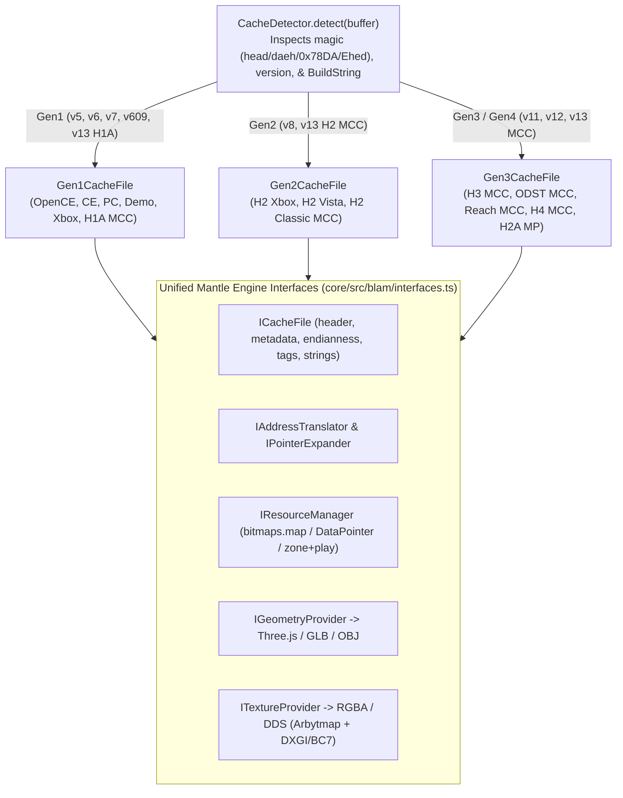

# 05 — Multi-Engine Halo Architecture: Supporting OpenCE, CE, CE MCC, Halo 2 MCC, Halo 3 MCC, ODST MCC, Reach MCC & Halo 4 MCC

> **Purpose**: Complete binary format reference, pointer/string/resource translation formulas, and **OpenCE Mantle** architectural blueprint for expanding Mantle into a universal multi-generation Blam! modding suite across **Halo OpenCE**, **Halo Custom Edition (`v609`)**, **Halo CE MCC (`h1a`)**, **Halo 2 Vista / Halo 2 MCC (`Classic` & `H2A MP`)**, **Halo 3 MCC**, **Halo 3: ODST MCC**, **Halo: Reach MCC**, and **Halo 4 MCC** — synthesized from [`SAMPLE CODE/Reclaimer`](file:///c:/Users/LeviB/Projects/OpenCE-Mantle/SAMPLE%20CODE/Reclaimer/SUMMARY.md), [`SAMPLE CODE/MEK`](file:///c:/Users/LeviB/Projects/OpenCE-Mantle/SAMPLE%20CODE/MEK/SUMMARY.md), and [`SAMPLE CODE/c20`](file:///c:/Users/LeviB/Projects/OpenCE-Mantle/SAMPLE%20CODE/c20).

---

## 1. Master Comparison of All Target Halo Map Formats

| Engine / Edition | Cache Version (`+0x04`) | Endianness | Header Size | Tag Index Entry Size | `TagBlock` (Reflexive) | `TagReference` (Dependency) | External / Shared Resource System |
| :--- | :---: | :---: | :---: | :---: | :---: | :---: | :--- |
| **Halo OpenCE / Custom Edition (`CE`)** | `609` (or `0x861A0261` Zstd) | Little-Endian | `2048 B` (`0x800`) | `32 B` | `12 B` | `16 B` | `bitmaps.map`, `sounds.map`, `loc.map` (by resource index / tag name) |
| **Halo 1 PC Retail / Mac Demo / Xbox** | `7` (PC), `6` (Demo), `5` (Xbox) | Little-Endian | `2048 B` (`0x800`) | `32 B` | `12 B` | `16 B` | `bitmaps.map`, `sounds.map` (by raw file offset in PC `v7`); Xbox `v5` Deflate at `0x802` |
| **Halo CE MCC (`H1A` / Anniversary)** | `609` (Early) / `13` (Updated H1A) | Little-Endian (`360` is BE `v7`) | `2048 B` (`0x800`) | `32 B` | `12 B` | `16 B` | `bitmaps.map` / `sounds.map` + Saber3D `.s3dpak` & `.ipak` (BC7/DXGI textures, FMOD `.fsb`) |
| **Halo 2 Xbox & Halo 2 Vista** | `8` (`+0x24 == 0` Xbox, `-1` Vista) | Little-Endian | `2048 B` (`0x800`) | `16 B` | `8 B` | `8 B` | 2-bit `DataLocation` (`0=Local, 1=mainmenu.map, 2=shared.map, 3=sp_shared.map`) \| 30-bit offset |
| **Halo 2 Classic MCC (`MccHalo2U1`)** | `13` (`+0x40..0x60 == 0`) | Little-Endian | `896 B` (`0x380`) | `16 B` | `8 B` | `8 B` | Chunk-compressed `.map` after `0x380` + external `textures.dat` chunked ZLib stream |
| **Halo 3 & ODST (Xbox 360)** | `11` (`BuildString` at `0x11C`) | **Big-Endian** | `12288 B` (`0x3000`) | `8 B` | `12 B` | `16 B` | `zone` (`cache_file_resource_gestalt`) + `play` (`cache_file_resource_layout_table`) LZX/Deflate pages |
| **Halo 3 MCC & ODST MCC (64-Bit)** | `11` (Era 1) / `13` (Era 2) | Little-Endian | `16384 B` (`0x4000`) | `8 B` | `12 B` | `16 B` | `zone` + `play` (Section `1` Resource pages, variable-int framed `0x20000` Deflate chunks) |
| **Halo: Reach & Halo 4 (Xbox 360)** | `12` (`BuildString` at `0x11C`) | **Big-Endian** | `40960 B` (`Reach`) / `122880 B` (`H4`) | `8 B` | `12 B` | `16 B` | `zone` + embedded `play` + AES-128-CBC encrypted `StringId` / `FileTable` / `Locale` tables |
| **Halo: Reach MCC, Halo 4 MCC & H2A MP (`Halo2X`)** | `12` (Era 1) / `13` (Era 2) | Little-Endian | `16384 B` (`0x4000`) (`69632 B` `H2X`) | `8 B` | `12 B` | `16 B` | `zone` + embedded `play` + 32-to-64-bit `PointerExpander` + AES-128-CBC string tables |

---

## 2. Exact Header & Section Layouts Across Generations

### 2.1 Halo CE MCC (`H1A`) Enhancements Over Legacy CE (`v609`)
From [`SAMPLE CODE/c20/src/content/h1/h1a/`](file:///c:/Users/LeviB/Projects/OpenCE-Mantle/SAMPLE%20CODE/c20/src/content/h1/h1a) and [`SAMPLE CODE/Tool MCC`](file:///c:/Users/LeviB/Projects/OpenCE-Mantle/SAMPLE%20CODE/Tool%20MCC/SUMMARY.md):
- **Header Version & Limits**:
  - Updated H1A maps use cache version **`13`** with `h1a_flags`, **2 GiB** maximum map file size, and **64 MiB** dedicated tag space (up from 23 MiB in legacy CE).
  - Scenario palette limits raised from `100` to **`256`**; placed vehicles raised from `80` to **`256`**; `gbxmodel` bones raised from `48` to **`63`**; `model_animations.units` raised from `64` to **`512`**; HaloScript syntax nodes raised from `19,001` to **`32,767`**.
- **New H1A Formats & Saber3D Containers (`Reclaimer.Saber3D.Halo1X`)**:
  - `bitmap` adds format **`high-quality_compression` (`BC7_UNORM`)** and restores Xbox `monochrome` and `p8_bump`.
  - Anniversary remastered assets live in `.s3dpak` and `.ipak` containers (`PakStream.cs` `0x8000`-byte zlib chunks).

---

### 2.2 Gen2 — Halo 2 Vista vs. Halo 2 Classic MCC (`MccHalo2U1`)
Derived from `SAMPLE CODE/Reclaimer/Reclaimer.Blam/Blam/Halo2/`:

| Header Field | Halo 2 Xbox (`v8`, `2048 B`) | Halo 2 Vista (`v8`, `2048 B`) | Halo 2 Classic MCC (`v13`, `896 B`) |
| :--- | :---: | :---: | :---: |
| `FileSize` (`int32`) | `0x008` | `0x008` | `0x008` |
| `IndexAddress` (`int32`) | `0x010` | `0x010` | `0x010` |
| `MetadataOffset` (`int32`) | `0x014` | `0x014` | `0x2D4` |
| `MetadataSize` (`int32`) | `0x018` | `0x018` | `0x2D8` |
| `MetadataAddressMask` (`uint32`) | — | `0x020` | `0x2D0` |
| `Flags` (`uint16`, Bit `Compressed`) | — | — | `0x01C` |
| `BuildString` (`char[32]`) | `0x120` | `0x12C` | `0x090` |
| `StringCount` / `StringTableAddress` | `0x164` / `0x170` | `0x170` / `0x17C` | `0x030` / `0x034` |
| `FileCount` / `FileTableAddress` | `0x2C0` / `0x2C4` | `0x2CC` / `0x2D0` | `0x020` / `0x024` |
| `RawTableAddress` / `RawTableSize` | `0x2D8` / `0x2DC` | `0x2E8` / `0x2EC` | `0x2F0` / `0x2F4` |
| `CompressedDataChunkSize` / `Offset` / `Table` / `Count` | — | — | `0x308` / `0x30C` / `0x310` / `0x314` |

- **How to Decompress Halo 2 Classic MCC Maps (`MccCompressedCacheStream.cs`)**:
  - The first `896` (`0x380`) bytes are the uncompressed header.
  - Read `CompressedChunkCount` (`0x314`) entries of `(int32 CompressedSize, int32 FileOffset)` at `CompressedChunkTableAddress` (`0x310`).
  - Each chunk decompresses to `CompressedDataChunkSize` (`0x308`) bytes: if `CompressedSize < 0`, read `-CompressedSize` raw uncompressed bytes at `FileOffset + 2`; if `CompressedSize > 0`, inflate `CompressedSize` bytes at `FileOffset` using `ZLibStream`.

---

### 2.3 Gen3 & Gen4 — Halo 3, ODST, Reach, Halo 4 & H2A MP (`Halo2X`) in MCC
All Gen3/Gen4 `.map` files divide the file into **4 Sections** (`0 = Debug`, `1 = Resource`, `2 = Tag`, `3 = Locale`) and **6 Memory Partitions**:
- `SectionOffsetTable`: `int32[4]`
- `SectionTable`: `(int32 Address, int32 Size)[4]`
- **True File Offset of Section $i$**:
  $$\text{SectionFileOffset}[i] = \text{SectionTable}[i].\text{Address} + \text{SectionOffsetTable}[i]$$

#### Era 1 (Pre-2021 MCC `v11`/`v12`) vs. Era 2 (Current MCC `v13`) Header Offsets (`Reclaimer.Blam`)

| Field | Era 1: `MccHalo3` / `ODST` / `Reach` (`U0..U2`) | Era 1: `MccHalo4` / `MccHalo2X` | **Era 2 (Current): `MccHalo3U6+` / `ODSTU3+` / `ReachU8+`** | **Era 2 (Current): `MccHalo4U4+` / `MccHalo2XU8+`** |
| :--- | :---: | :---: | :---: | :---: |
| `FileSize` | `0x008` (`int64`) | `0x008` (`int64`) | `0x008` (`int32`) | `0x008` (`int32`) |
| `IndexPointer` (`Pointer64`) | `0x010` | `0x010` | **`0x2E8`** | **`0x2E0`** |
| `TagDataAddress` / `VirtualSize` | `0x018` / `0x01C` | `0x018` / `0x01C` | **`0x010` / `0x014`** | **`0x010` / `0x014`** |
| `FileCount` / `FileTablePointer` / `Size` / `IndexPtr` | `0x2B8`..`0x2C4` | `0x2B8`..`0x2C4` | **`0x020` / `0x024` / `0x028` / `0x02C`** | **`0x020` / `0x024` / `0x028` / `0x02C`** |
| `StringCount` / `TablePtr` / `Size` / `IndexPtr` | `0x15C`..`0x168` | `0x15C`..`0x168` | **`0x030` / `0x034` / `0x038` / `0x03C`** | **`0x030` / `0x034` / `0x038` / `0x03C`** |
| `StringNamespaceCount` / `TablePointer` | — | — | **`0x040` / `0x044`** | **`0x040` / `0x044`** |
| `BuildString` (`char[32]`) | `0x120` | `0x120` | **`0x0A0`** | **`0x098`** |
| `ScenarioName` (`char[256]`) | `0x1B4` | `0x1B4` | **`0x0E0`** | **`0x0D8`** |
| `VirtualBaseAddress` (`int64`) | `0x2F8` | `0x300` | **`0x2E0`** | **`0x2D8`** |
| `PartitionTable64` (`6×16 B`) | `0x308` | `0x310` | **`0x300`** | **`0x2F8`** |
| `SectionOffsetTable` (`4×4 B`) | `0x4B4` | `0x4BC` | **`0x4AC`** (`U6..U9`) or **`0x4CC`** (`U10+`) | **`0x4C4`** |
| `SectionTable` (`4×8 B`) | `0x4C4` | `0x4CC` | **`0x4BC`** (`U6..U9`) or **`0x4DC`** (`U10+`) | **`0x4D4`** |

---

## 3. Virtual Pointer Translation & MCC 64-Bit `PointerExpander` Math

### 3.1 The Crucial MCC 64-Bit `PointerExpander` Formula
In 64-bit MCC Gen3/Gen4 maps (`Halo 3`, `ODST`, `Reach`, `Halo 4`, `H2A MP`), `Header.VirtualBaseAddress` is a 64-bit integer, **but all pointers inside tag structs (`TagBlock`, `TagIndex`, etc.) remain 32-bit integers (`int32`)** so tag struct sizes and field offsets don't change from Xbox 360!
- Before converting a 32-bit tag pointer $p$ to a file offset, it **must** be expanded to 64 bits via:
  $$\text{Expand}(p) = (\text{int64}(p) \ll 2) + \text{ExpanderMagic}$$
- Then the file offset in the `.map` is:
  $$\text{FileOffset}(p) = \text{Expand}(p) - (\text{VirtualBaseAddress} - \text{SectionFileOffset}[2])$$

| MCC Engine | `ExpanderMagic` (Hex) | `ExpanderMagic` (Decimal) | Source Reference in `SAMPLE CODE/Reclaimer` |
| :--- | :---: | :---: | :--- |
| **Halo 3 MCC & ODST MCC** | `0x00000000` | `0` | `Blam/MccHalo3/PointerExpander.cs` |
| **Halo: Reach MCC (Retail)** | `0x50000000` | `1,342,177,280` | `Blam/MccHaloReach/PointerExpander.cs` (`0x10000000` on June/July 2019 flights) |
| **Halo 4 MCC** | `0x4FFF0000` | `1,342,111,744` | `Blam/MccHalo4/PointerExpander.cs` |
| **Halo 2 Anniversary MP (`Halo2X`)** | `0x7AC00000` | `2,059,403,264` | `Blam/MccHalo2X/PointerExpander.cs` |

---

## 4. `StringId` Bit-Packing & AES-128-CBC String Table Decryption (Reach & Halo 4)

### 4.1 AES-128-CBC Decryption (`AesHelper.cs` & `MEK/meta/halo_map.py`)
In **Halo: Reach** and **Halo 4** (both Xbox 360 and MCC), the `StringId` table, Tag `FileTable`, and `Locale` string blobs are padded to 16-byte alignment and encrypted with **AES-128-CBC** (`PaddingMode.Zeros`):
- Given an ASCII key string $K$ of length 16:
  - $\text{Key}[i] = K[i] \oplus \text{0xA5}$
  - $\text{IV}[i] = \text{Key}[i] \oplus \text{0x3C}$
- **Standard Key Strings**:
  - **StringId Table**: `"ILikeSafeStrings"`
  - **Tag File Name Table**: `"LetsAllPlayNice!"`
  - **Locale Strings**: `"BungieHaloReach!"`

### 4.2 `StringId` Bitfields & Dynamic Header Namespace Table
A 32-bit `StringId` packs `(Length, Namespace, Index)`:
- **Current MCC (`U13` H3/Reach, `U8` ODST, all H4 & H2X)**: `IndexBits = 19`, `NamespaceBits = 8`, `LengthBits = 5`.
- **Dynamic Namespace Resolution (`StringIndexU6.cs`)**:
  - Read `int32 namespaces[StringNamespaceCount]` at `Header.StringNamespaceTablePointer` (in Section `0`).
  - Let `globalMin = namespaces[0]`. If `ns > 0` and `index >= globalMin`, then `resolvedIndex = (index - globalMin) + namespaces[ns]`; else `resolvedIndex = index`.

---

## 5. Unified Multi-Engine Architecture for OpenCE Mantle (`core/src/blam/`)

To let Mantle open, inspect, extract, render in 3D, and edit maps across all 8 Halo engines without cluttering our existing Halo 1 code in `core/src/map/`, we can introduce a clean provider layer in `core/src/blam/`:

### 5.1 Phased Multi-Engine Rollout Plan for Mantle
1. **Phase A — Halo CE MCC (`H1A` `v13`) & Halo 1 Xbox (`v5`) / OpenSauce (`.yelo`)**:
   - Add H1A `v13` header support, 64 MiB tag ceiling, expanded scenario palette limits (`256`), `BC7` texture decoding, and `.s3dpak`/`.ipak` inspection alongside Xbox `v5` Deflate decompression (`0x802`) and `mode` $\leftrightarrow$ `mod2` vertex conversion.
2. **Phase B — Halo 2 Vista & Halo 2 Classic MCC (`MccHalo2U1`)**:
   - Implement `Gen2CacheFile`, `MccCompressedCacheStream` (`0x380` chunked ZLib), 2-bit `DataPointer` routing (`mainmenu.map`, `shared.map`, `single_player_shared.map`), and `textures.dat` decompression.
3. **Phase C — Halo 3 MCC, ODST MCC, Reach MCC, Halo 4 MCC & H2A MP (`Gen3/Gen4`)**:
   - Implement `Gen3CacheFile` with Era 1 / Era 2 header table auto-detection, `PointerExpander` (`<< 2 + ExpanderMagic`), AES-128-CBC string decryption, `StringNamespaceTable` resolution, and `zone` + `play` paged resource extraction for 3D BSP/model viewing, texture editing, and tag editing!
