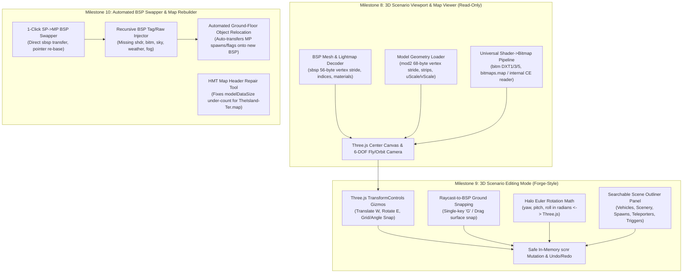

# Decompiled Sample Code Reference (SparkEdit v3.02, HMT v3.5, HHT v5)

This document preserves our reverse-engineering and architectural analysis of the three classic Halo modding tools in `SAMPLE CODE/`:
1. **SparkEdit v3.02** (`SAMPLE CODE/Sparkedit V3.02/src/`) — 3D BSP & Scenario Viewer/Editor (C++ / MFC / OpenGL)
2. **Halo Map Tools (HMT) v3.5** (`SAMPLE CODE/HMT V3.5/`) — Map Rebuilder, BSP Extractor, Model De-Crapper, Bitmap/Sound Libraries (C# / VB.NET)
3. **Halo Hacker Tools (HHT) v5** (`SAMPLE CODE/HHT V5/`) — Dependency Swapper, `.meta`/`.data` Reflexive/Pointer Sidecar Architecture, In-Place Map/BSP Rebuilder (C#)

---

## Part 1: SparkEdit v3.02 — 3D Rendering, Bitmaps & Scenario Editor

### 1.1 Source File Map (`SAMPLE CODE/Sparkedit V3.02/src/`)
| File | Key Responsibilities & Functions |
| :--- | :--- |
| `01_BspMesh_and_Collision.cpp` | `CBspMesh` (`0x401000`), Camera `lookAt` / strafe / walk (`0x401a40`–`0x4021c0`), Collision BSP parser (`0x402340`), AI Encounter/Squad spawns (`0x4027d0`), 6-plane Frustum extraction (`0x402c30`) & AABB culling (`0x403140`) |
| `02_BitmapTag_and_Textures.cpp` | `bitm` format stride calculator (`0x4037c0`), DXT1 (`0x4033d0`), DXT2/3 (`0x405190`), DXT4/5 (`0x405470`), 16/32-bit/P8/AY8 decoders (`0x4038a0`), and Xbox Morton unswizzling |
| `03_HaloMapFile_and_Zlib.cpp` | Map header (`0x800` bytes) & tag index parser (`0x405b20`), Xbox (`version == 5`) vs PC (`version == 7`) magic calculation, tag registration for `bitm`, `scnr`, `mod2`, `mode` |
| `04_HaloModel_and_MeshIO.cpp` | Wavefront `.obj` import/export and Duplicate Scenery/Vehicle Palette dialog (`0x407000`–`0x4072c0`) |
| `05_MainFrame.cpp` | Base 3D model loader (`0x409150`), model shader/region/geometry headers (`0x4095c0`), wireframe/solid AABB renderer (`0x409250`, `0x409400`) |
| `06_OpenGLWnd.cpp` | OpenGL context initialization (`0x40a420`), `gluPerspective(45.0, aspect, 0.1, farClip)` |
| `07_OutputPane_and_Dialogs.cpp` | PC `gbxmodel` (`mod2`) loader (`0x40b230`), part/strip/vertex (`0x44` = 68 bytes) reader (`0x40b490`, `0x40b6a0`), `GL_TRIANGLE_STRIP` renderer (`0x40b390`) |
| `08_Perspective_and_Settings.cpp` | Viewport input loop (`0x40be20`), `sparkedit.dat` settings (`0x40c710`), PC BSP submesh renderer (`0x40cf50`, 56-byte stride), Xbox BSP submesh renderer (`0x40d260`, 32-byte stride), 5 render modes |
| `09_Scenario_and_Spawns.cpp` | `CScenario` parser (`0x40dcf0`), in-place save (`0x40eda0`), slack-space allocator (`0x410f80`), object cloning (`0x410ca0`), object deletion (`0x411a40`), scenario object rendering & Euler rotation (`0x412550`), 3D axis gizmo (`0x412f50`), `glRenderMode(GL_SELECT)` picking (`0x4137a0`), Trigger Volumes (`0x413af0`) |
| `10_Shader_and_BitmapsMap.cpp` | `CShaderManager` (`0x4140a0`), `bitm` tag header (`0x6C` bytes) + sequences (`0x40` bytes) + bitmap data block (`0x30` bytes) loader (`0x4141d0`), external `bitmaps.map` reader (`0x4143f0`), `glTexImage2D` upload (`0x414830`) |
| `13_TagManager_and_Inspector.cpp` | Tag hierarchy builder (`0x4154f0` resolves `itmc`/`vehc` -> `weap`/`vehi` -> `mod2`) and universal shader-to-bitmap scanner (`0x415710`, `0x415990`) |
| `14_ToolSheet_and_Tabs.cpp` | UI sidebar tabs (`Navigate`, `Edit`, `Models`, `Multiplayer`) |
| `15_Submesh_OBJExport_and_Math.cpp` | Xbox 11-11-10 bit compressed normal decoder (`0x4186f0`), BSP header/lightmaps/materials loader (`0x418ad0`–`0x4194c0`), BSP `.obj` exporter (`0x419a20`), Xbox `mode` (`0x20`-byte vertex) loader (`0x41a490`) |

---

### 1.2 Structure BSP (`sbsp`) Mesh, Lightmaps & Render Modes

#### Scenario `structure bsps` Reflexive (`scnr + 0x5A4`)
Each entry is **32 (`0x20`) bytes** (`09_Scenario_and_Spawns.cpp` `FUN_0040e5c0`):
- `+0x00` (`uint32`): `bspOffset` — raw file offset of the `sbsp` section in the `.map` file.
- `+0x04` (`uint32`): `bspSize` — byte length of the `sbsp` section.
- `+0x08` (`uint32`): `bspMagic` — virtual base address of the BSP in Halo memory.
  - **Pointer conversion formula**: `fileOffset = virtualPtr - (bspMagic - bspOffset)` (SparkEdit stores `bspRealMagic = bspMagic - bspOffset`).
- `+0x1C` (`uint32`): `sbspTagId`

#### `sbsp` Header & Sub-Reflexives (`15_Submesh_OBJExport_and_Math.cpp` `FUN_00418ad0`)
1. **BSP Pointer Header (`bspOffset`, `0x18` = 24 bytes)**:
   - `+0x00` (`uint32`): `sbspHeaderVirtualPtr` -> subtract `bspRealMagic` to get `sbspMetaOffset` (typically `bspOffset + 0x18`).
2. **Main `sbsp` Structure (`0x288` = 648 bytes at `sbspMetaOffset`)**:
   - `+0x00`: `lightmapsBitmapTagRef` (`0x10` bytes — tag reference to the lightmap `bitm` plate for this BSP).
   - `+0xAC`: `collisionBsp` reflexive (`count`, `offset` -> `0x60`-byte collision header with 8 reflexives: `bsp3dNodes` `0x0C`, `planes` `0x10`, `leaves` `0x08`, `bsp2dReferences` `0x08`, `bsp2dNodes` `0x14`, `surfaces` `0x0C`, `edges` `0x18`, `vertices` `0x10` where each collision vertex is `float pos[3]` + `uint32 firstEdge`).
   - `+0xFC`: `surfaces` (render triangle indices) reflexive (`count`, `offset` -> each surface is **6 bytes**: `uint16 v0, v1, v2`).
   - `+0x108`: `lightmaps` reflexive (`count`, `offset` -> each entry is **`0x20` = 32 bytes**):
     - `+0x00` (`int16`): `lightmapBitmapIndex` (sub-bitmap index inside the BSP's lightmap `bitm` tag; `-1` if unlit).
     - `+0x14` (`uint32`): `materialsCount`
     - `+0x18` (`uint32`): `materialsVirtualPtr`
   - `+0x138`: `clusters` reflexive (`0x68` bytes each, contains cluster sky index, portals, and predicted resources).
   - `+0x1B8`: `fogPlanes` / weather polyhedra.

#### BSP Material / Submesh (`0x100` = 256 bytes each, `FUN_00419010` & `FUN_004191e0`)
Each lightmap entry contains an array of `0x100`-byte `Material` blocks (submeshes):
- `+0x00` (`0x10` bytes): `shader` tag reference (`+0x00` classFourCC, `+0x0C` `shaderTagId`).
- `+0x10` (`int16`): `shaderPermutation`
- `+0x14` (`uint32`): `surfaceIndexStart` — starting triangle index in the BSP `surfaces` array (`byteOffset = surfacesFileOffset + surfaceIndexStart * 6`).
- `+0x18` (`uint32`): `surfaceCount` — number of triangles in this submesh (`indexCount = surfaceCount * 3`).
- `+0x2C` (`float[3]`): `centroid` (`x, y, z`)
- `+0xB4` (`uint32`): `vertexCount` — number of render vertices in this submesh.
- `+0xC0` (`uint32`): `uncompressedVerticesVirtualPtr` -> subtract `bspRealMagic` to get file offset of the vertex buffer.
- `+0xD4` (`uint32`): `compressedVerticesVirtualPtr`

#### BSP Vertex Formats (`08_Perspective_and_Settings.cpp` `FUN_0040cbb0` & `FUN_0040cf50`)
- **PC / Custom Edition Uncompressed BSP Vertex (`0x38` = 56 bytes per vertex)**:
  - `+0x00` (`float[3]`): `position` (`x, y, z`)
  - `+0x0C` (`float[3]`): `normal` (`nx, ny, nz`)
  - `+0x18` (`float[3]`): `binormal` (`bx, by, bz`)
  - `+0x24` (`float[3]`): `tangent` (`tx, ty, tz`)
  - `+0x30` (`float[2]`): `uv` (`u, v` base shader texture coordinates)
  - **Lightmap Vertex Stream (20 bytes per vertex)**: Immediately follows the `vertexCount * 56` byte uncompressed vertex array at `uncompressedVerticesFileOffset + vertexCount * 0x38`:
    - `+0x00` (`float[3]`): `lightmapNormal`
    - `+0x0C` (`float[2]`): `lightmapUV` (`u, v` into the lightmap bitmap plate at `lightmapBitmapIndex`)
- **Xbox Compressed BSP Vertex (`0x20` = 32 bytes per vertex)**:
  - `+0x00` (`float[3]`): `position` (`x, y, z`)
  - `+0x0C` (`uint32[3]`): `compressedNormal, compressedBinormal, compressedTangent` (11-11-10 bit signed bitfields decoded via `FUN_004186f0`)
  - `+0x18` (`float[2]`): `uv` (`u, v`)

#### 5 BSP Render Modes (`FUN_0040cf50`)
SparkEdit supports 5 viewport render modes (`this + 0xB8`):
- `0`: **Vertex Points** (`GL_POINTS`)
- `1`: **Wireframe** (`GL_LINES` with per-submesh color cycling)
- `2`: **Flat Shaded + Wireframe Overlay** (`GL_TRIANGLES` in neutral gray + `GL_LINES` overlay)
- `3`: **Textured** (`GL_TRIANGLES` with base bitmap texture bound via `glBindTexture`)
- `4`: **Textured + Wireframe Overlay** (SparkEdit's default mode)

---

### 1.3 Shader-to-Bitmap Skinning & `bitmaps.map` Pipeline

#### Universal Shader-to-Bitmap Heuristic (`13_TagManager_and_Inspector.cpp` `FUN_00415710` & `FUN_00415990`)
Halo has 9 shader tag classes (`senv`, `soso`, `schi`, `scex`, `sgla`, `swat`, `smet`, `spla`, `shdr`), all of which have `'shdr'` (`0x72646873`) as their parent class (`classB` at `+0x04` in the 32-byte tag index entry).
- **How SparkEdit resolves textures without per-shader-class hardcoding**:
  - In `FUN_00415990`, for any tag whose parent class is `'shdr'`, SparkEdit scans the shader tag's metadata buffer at 4-byte aligned steps (`0x00` to `metaSize - 0x10`) looking for 16-byte Tag Dependency blocks where:
    1. `tagClass == 'bitm'` (`0x6D746962`)
    2. `tagId` is a valid tag ID in the map (`(tagId & 0xFFFF) < tagCount`)
    3. `namePtr` is within the map's virtual address range.
  - The **first `'bitm'` reference** found in the shader metadata is stored at `tagNode + 0x24` as the **Base Texture** (`BaseTextureTagId`), and up to 5 subsequent `'bitm'` references are stored at `+0x28..+0x38` as detail/multitexture maps!
  - **Why this is useful for OpenCE-Modding-Tool**:
    - We can combine **exact shader offsets** (`senv` base map at `+0x88`, `soso` base map at `+0xAC`, `schi` first stage map at `mapsOffset + 0x68`, `scex` first 4-stage or 2-stage map at `+0x68`) with **SparkEdit's `'bitm'` scan fallback** for `swat`, `sgla`, `smet`, and `spla` so 100% of BSP and model shaders skin automatically!

#### Bitmap (`bitm`) Tag Layout (`10_Shader_and_BitmapsMap.cpp` `FUN_004141d0` & `FUN_00414830`)
1. **Main `bitm` Tag Header (`0x6C` = 108 bytes)**:
   - `+0x54`: `sequences` reflexive (`count`, `offset` -> `0x40` bytes each)
   - `+0x60`: `bitmaps` (image data blocks) reflexive (`count`, `offset` -> **`0x30` = 48 bytes each**)
2. **Bitmap Data Block (`0x30` = 48 bytes)**:
   - `+0x00` (`uint32`): `'bitm'` signature (`0x6D746962`)
   - `+0x04` (`uint16`): `width` (pixels)
   - `+0x06` (`uint16`): `height` (pixels)
   - `+0x08` (`uint16`): `depth` (1 for 2D textures / cubemaps)
   - `+0x0A` (`uint16`): `type` (`0` = 2D texture, `1` = 3D texture, `2` = Cube map, `3` = White)
   - `+0x0C` (`uint16`): `format`:
     - `0` = `A8`, `1` = `Y8`, `2` = `AY8`, `3` = `A8Y8`
     - `6` = `R5G6B5`, `8` = `A1R5G5B5`, `9` = `A4R4G4B4`
     - `10` (`0x0A`) = `X8R8G8B8`, `11` (`0x0B`) = `A8R8G8B8`
     - `14` (`0x0E`) = **DXT1** (`FUN_004033d0`, 8 bytes per 4x4 block)
     - `15` (`0x0F`) = **DXT2/DXT3** (`FUN_00405190`, 16 bytes per 4x4 block, explicit 4-bit alpha)
     - `16` (`0x10`) = **DXT4/DXT5** (`FUN_00405470`, 16 bytes per 4x4 block, interpolated alpha)
     - `17` (`0x11`) = `P8` palettized
   - `+0x0E` (`uint16`): `flags`:
     - Bit 3 (`0x08`): Power-of-two / compressed
     - Bit 4 (`0x10`): Linear / unswizzled (if `(flags & 0x10) == 0` on Xbox `version == 5`, pixels are Morton-swizzled and decoded via `FUN_004038a0`)
     - Bit 8 (`0x100`): **External `bitmaps.map` flag in Halo Custom Edition (`version == 609`)**!
       - In **Halo PC (`version == 7`)**, all `bitm` pixel data is stored in `bitmaps.map` at `pixelsOffset`.
       - In **Halo Custom Edition (`version == 609`)**, if `(flags & 0x100) != 0`, pixel data is read from external `bitmaps.map` at `pixelsOffset`; if `(flags & 0x100) == 0`, pixel data is embedded directly inside the `.map` file at `pixelsOffset`!
   - `+0x14` (`uint16`): `mipmapCount`
   - `+0x18` (`uint32`): `pixelsOffset` — raw byte offset in `bitmaps.map` (or `.map` when internal on CE).
   - `+0x1C` (`uint32`): `pixelsSize` — total byte size of all mipmaps/faces.

---

### 1.4 3D Models: `gbxmodel` (`mod2`) & `model` (`mode`) (`07_OutputPane_and_Dialogs.cpp`, `15_Submesh_OBJExport_and_Math.cpp`)

#### Model Tag Header (`0xE8` = 232 bytes, `FUN_0040b230` & `FUN_0041a490`)
- `+0x00` (`uint32`): `flags`
- `+0x30` (`float`): **`uScale`** — UV horizontal scale factor (defaults to `1.0` if `0.0`).
- `+0x34` (`float`): **`vScale`** — UV vertical scale factor (defaults to `1.0` if `0.0`).
  - *Crucial detail*: Every vertex's raw `(u, v)` in a `mod2`/`mode` part **must be multiplied by `(uScale, vScale)`** (`FUN_0040b6a0` lines 165–166), otherwise model textures tile improperly!
- `+0xAC`: `markers` reflexive (`0x40` = 64 bytes each — attachment points like `primary trigger`, `driver`, `ground point`).
- `+0xB8`: `nodes` (bones) reflexive (`0x9C` = 156 bytes each — bone name, `nextSiblingNodeIndex`, `firstChildNodeIndex`, `parentNodeIndex`, default translation `float[3]`, rotation quaternion `float[4]`, scale `float`, and `float[4][3]` inverse bind transform).
- `+0xC4`: `regions` reflexive (`0x4C` = 76 bytes each):
  - `+0x00` (`char[32]`): `regionName` (e.g., `hull`, `tire`, `turret`)
  - `+0x40`: `permutations` reflexive (`0x58` = 88 bytes each):
    - `+0x00` (`char[32]`): `permutationName` (e.g., `base`, `~damaged`)
    - `+0x20` (`uint32`): `flags` (bit 0 = cannot be chosen randomly; SparkEdit filters for permutations where `(flags & 1) == 0` for base rendering)
    - `+0x40` (`int16[5]`): `lodGeometryIndex[5]` — indices into the model's `geometries` reflexive for:
      - `[0]` (`+0x40`): Super Low LOD
      - `[1]` (`+0x42`): Low LOD
      - `[2]` (`+0x44`): Medium LOD
      - `[3]` (`+0x46`): High LOD
      - `[4]` (`+0x48`): **Super High LOD** (used for close-up rendering)
- `+0xD0`: `geometries` reflexive (`0x30` = 48 bytes each):
  - `+0x24`: `parts` reflexive (`0x84` = 132 bytes each on PC `mod2`)
- `+0xDC`: `shaders` reflexive (`0x20` = 32 bytes each):
  - `+0x00`: `shaderTagRef` (`0x10` bytes, `shaderTagId` at `+0x0C`)

#### PC `gbxmodel` (`mod2`) Part (`0x84` = 132 bytes, `FUN_0040b490` & `FUN_0040b6a0`)
- `+0x00` (`uint32`): `flags`
- `+0x04` (`int16`): `shaderIndex` (index into model's `shaders` reflexive)
- `+0x48` (`uint32`): `stripIndexCount` — number of `uint16` indices in the triangle strip (`triangleCount = stripIndexCount - 2`).
- `+0x4C` (`uint32`): `stripIndexOffset` — byte offset relative to the Map Header's **Model Index Data Section** (`mapHeader.vertexDataOffset + mapHeader.indexDataOffset`, stored at `mapHeader + 0x20` + `mapHeader + 0x24`).
  - Note: SparkEdit reads `stripIndexCount` `uint16` values starting at `modelIndicesFileOffset + part.stripIndexOffset`.
- `+0x58` (`uint32`): `vertexCount` — number of 68-byte uncompressed vertices.
- `+0x64` (`uint32`): `vertexOffset` — byte offset relative to the Map Header's **Model Vertex Data Section** (`mapHeader.vertexDataOffset` at `mapHeader + 0x20`).
- **PC `mod2` Uncompressed Vertex (`0x44` = 68 bytes)**:
  - `+0x00` (`float[3]`): `position` (`x, y, z`)
  - `+0x0C` (`float[3]`): `normal` (`nx, ny, nz`)
  - `+0x18` (`float[3]`): `binormal` (`bx, by, bz`)
  - `+0x24` (`float[3]`): `tangent` (`tx, ty, tz`)
  - `+0x30` (`float`): `u` (multiply by `model.uScale`)
  - `+0x34` (`float`): `v` (multiply by `model.vScale`)
  - `+0x38` (`int16`): `node0Index`
  - `+0x3A` (`int16`): `node1Index`
  - `+0x3C` (`float`): `node0Weight`
  - `+0x40` (`float`): `node1Weight`

---

### 1.5 Scenario (`scnr`) Object Palettes, Instances & Euler Rotation Math

#### `scnr` Reflexive Table (`09_Scenario_and_Spawns.cpp` `FUN_0040dcf0`)
The `scnr` main metadata header is `0x5B0` (1456 bytes). Below are the exact offsets (relative to `scnr` metadata start) and block sizes parsed by SparkEdit:

| Category | Instances Reflexive Offset | Instance Stride | Palette Reflexive Offset | Palette Stride | SparkEdit Type ID |
| :--- | :--- | :--- | :--- | :--- | :--- |
| **Object Names** | `0x204` | `0x24` (36 B) | — | — | — |
| **Scenery** | `0x210` | `0x48` (72 B) | `0x21C` | `0x30` (48 B) | `3` |
| **Bipeds** | `0x228` | `0x78` (120 B) | `0x234` | `0x30` (48 B) | `10` |
| **Vehicles** | `0x240` | `0x78` (120 B) | `0x24C` | `0x30` (48 B) | `2` |
| **Equipment** | `0x258` | `0x28` (40 B) | `0x264` | `0x30` (48 B) | `8` |
| **Weapons** | `0x270` | `0x5C` (92 B) | `0x27C` | `0x30` (48 B) | `4` |
| **Device Groups** | `0x288` | `0x34` (52 B) | — | — | — |
| **Machines** | `0x294` | `0x40` (64 B) | `0x2A0` | `0x30` (48 B) | `9` |
| **Controls** | `0x2AC` | `0x40` (64 B) | `0x2B8` | `0x30` (48 B) | — |
| **Light Fixtures** | `0x2C4` | `0x58` (88 B) | `0x2D0` | `0x30` (48 B) | — |
| **Sound Scenery** | `0x2DC` | `0x28` (40 B) | `0x2E8` | `0x30` (48 B) | — |
| **Player Starting Profile** | `0x348` | `0x68` (104 B) | — | — | — |
| **Player Starting Locations** | `0x354` | `0x34` (52 B) | — | — | `6` |
| **Trigger Volumes** | `0x360` | `0x60` (96 B) | — | — | — |
| **Recorded Animations** | `0x36C` | `0x40` (64 B) | — | — | — |
| **Netgame Flags** | `0x378` | `0x94` (148 B) | — | — | `5` (Flags) / `11` (Teleporters) |
| **Netgame Equipment** | `0x384` | `0x90` (144 B) | — | — | `7` |
| **Starting Equipment** | `0x390` | `0xCC` (204 B) | — | — | — |
| **AI Encounters** | `0x42C` | `0xB0` (176 B) | — | — | `12` (Squad Spawn Points) |
| **Cutscene Flags** | `0x4EC` | `0x5C` (92 B) | — | — | — |
| **Cutscene Camera Points** | `0x4F8` | `0x68` (104 B) | — | — | — |
| **Structure BSPs** | `0x5A4` | `0x20` (32 B) | — | — | — |

#### Instance Field Layouts (`FUN_0040ebe0` & `FUN_00412550`)
1. **Standard Object Instances (Scenery, Bipeds, Vehicles, Equipment, Weapons, Machines)**:
   - `+0x00` (`int16`): `paletteIndex` (index into corresponding `* Palette` reflexive; `-1` if unassigned)
   - `+0x02` (`int16`): `nameIndex` (index into `Object Names` at `scnr + 0x204`; `-1` if unnamed)
   - `+0x04` (`uint16`): `notPlacedFlags`
   - `+0x06` (`int16`): `desiredPermutation`
   - `+0x08` (`float[3]`): `position` (`x, y, z`)
   - `+0x14` (`float[3]`): `rotation` (`yaw, pitch, roll` in **radians**)
2. **Palette Entry (`0x30` = 48 bytes)**:
   - `+0x00` (`0x10` bytes): `objectTagRef` (`+0x00` classFourCC, `+0x0C` `tagId` of the `scen`/`vehi`/`bipd`/`eqip`/`weap`/`mach` tag).
   - `+0x10` (`0x20` bytes): 32 bytes of zero padding.
   - **How Object -> Model Resolution Works (`13_TagManager_and_Inspector.cpp` `FUN_004154f0`)**:
     - Every `obje` subclass (`scen`, `vehi`, `bipd`, `eqip`, `weap`, `mach`) stores its `mod2`/`mode` Tag Reference at **`objectMeta + 0x28`** (meaning the `mod2` `tagId` is at `objectMeta + 0x34`)!
3. **Player Starting Locations (`scnr + 0x354`, `0x34` = 52 bytes)**:
   - `+0x00` (`float[3]`): `position` (`x, y, z`)
   - `+0x0C` (`float`): `facing` (yaw in **radians**; pitch & roll are 0)
   - `+0x10` (`int16`): `teamIndex` (`0` = Red, `1` = Blue)
   - `+0x12` (`int16`): `bspIndex`
   - `+0x14` (`int16[4]`): `type0, type1, type2, type3` (`0`=None, `1`=CTF, `2`=Slayer, `3`=Oddball, `4`=King, `5`=Race, `12`=All Games, `13`=All Except CTF, `14`=All Except Race & CTF)
4. **Netgame Flags (`scnr + 0x378`, `0x94` = 148 bytes)**:
   - `+0x00` (`float[3]`): `position` (`x, y, z`)
   - `+0x0C` (`float`): `facing` (yaw in **radians**)
   - `+0x10` (`int16`): `type`:
     - `0` = CTF Flag, `1` = CTF Vehicle, `2` = Oddball Ball Spawn, `3` = Race Track, `4` = Race Vehicle, `5` = Vegas Bank, `6` = **Teleport From (Origin)**, `7` = **Teleport To (Destination)**, `8` = Hill Flag
   - `+0x12` (`int16`): `teamIndex` (or `teleportChannel` matching `Teleport From` and `Teleport To` pairs!)
   - `+0x14` (`0x10` bytes): `weaponGroup` tag reference
5. **Netgame Equipment (`scnr + 0x384`, `0x90` = 144 bytes)**:
   - `+0x00` (`uint32`): `flags` (bit 0 = levitate)
   - `+0x04` (`int16[4]`): `type0..type3` (gametype filters)
   - `+0x0C` (`int16`): `teamIndex`
   - `+0x0E` (`int16`): `spawnTime` (seconds; `0` = default 30s)
   - `+0x40` (`float[3]`): `position` (`x, y, z`)
   - `+0x4C` (`float`): `facing` (yaw in **radians**)
   - `+0x50` (`0x10` bytes): `itemCollection` tag reference (`itmc` or `vehc`, `tagId` at `+0x5C`).
   - **How `itmc`/`vehc` Resolves to a 3D Model (`FUN_004154f0` lines 162–188)**:
     - At `itmcMeta + 0x00` is the `permutations` reflexive (`count` at `+0x00`, `offset` at `+0x04`, stride `0x54` = 84 bytes).
     - Inside the first permutation (`permOffset`), at **`permOffset + 0x24`** is the 16-byte Tag Reference to the spawned item (`weap`, `eqip`, or `vehi`, with its `tagId` at `permOffset + 0x30`), which in turn points to its `mod2` at `itemMeta + 0x28`!
6. **Trigger Volumes (`scnr + 0x360`, `0x60` = 96 bytes, `FUN_00413af0`)**:
   - `+0x04` (`char[32]`): `name`
   - `+0x3C` (`float[6]`): orientation vectors
   - `+0x48` (`float[3]`): `position` (`x, y, z` minimum corner)
   - `+0x54` (`float[3]`): `extents` (`dx, dy, dz` box dimensions)
7. **AI Encounters & Squad Spawn Points (`scnr + 0x42C`, `01_BspMesh_and_Collision.cpp` `FUN_004027d0`)**:
   - Each Encounter is `0xB0` (176) bytes -> at `encounter + 0x80` is the `squads` reflexive (`0xE8` = 232 bytes each) -> at `squad + 0xD0` is the `startingLocations` reflexive (`0x1C` = 28 bytes each: `+0x00` `float pos[3]`, `+0x0C` `float yaw` radians).

#### Exact Halo 3D Euler Rotation Order (`09_Scenario_and_Spawns.cpp` `FUN_00412550`)
In `FUN_00412550` (lines 3125–3128), SparkEdit transforms each object instance from `[x, y, z, yaw, pitch, roll]` (where `yaw`, `pitch`, `roll` are in **radians**, `180 / pi = 57.29578f`) using:
```cpp
glTranslatef(x, y, z);
glRotatef(roll  * 57.29578f, 1.0f, 0.0f, 0.0f); // 1. Roll around +X
glRotatef(-pitch * 57.29578f, 0.0f, 1.0f, 0.0f); // 2. Negated Pitch around +Y
glRotatef(yaw   * 57.29578f, 0.0f, 0.0f, 1.0f); // 3. Yaw around +Z
```
Because OpenGL post-multiplies matrices (`M = T * R_x(roll) * R_y(-pitch) * R_z(yaw)`), in Three.js (`Object3D.rotation`), this corresponds directly to an **intrinsic `XYZ` Euler angle** with `(roll, -pitch, yaw)` in Halo's Z-up right-handed coordinate system!

---

### 1.6 SparkEdit Limitations & Our QoL Improvements for Phase 2

Reviewing `01_BspMesh_and_Collision.cpp`, `08_Perspective_and_Settings.cpp`, and `09_Scenario_and_Spawns.cpp` reveals why SparkEdit feels clunky in modern workflows and exactly how we can surpass it:

| Area | How SparkEdit v3.02 Works | Planned OpenCE-Modding-Tool QoL Upgrade |
| :--- | :--- | :--- |
| **Camera Navigation** | `WASD` only moves horizontally (`FUN_00401e60` zeroes out Z movement even when looking straight down!), requiring `Space`/`Shift` for vertical movement and an awkward frame-counter ramp (`FUN_0040be20`). | **True 6-DOF Unreal/Unity Fly Camera**: Right-click + `WASD` flies directly along the camera look vector; `Q`/`E` or `Space`/`Ctrl` moves vertically; `Scroll Wheel` dynamically adjusts fly speed or zooms; `F` frames/focuses the currently selected object; `Alt + Left-Drag` orbits around selection. |
| **Object Manipulation** | Keyboard arrow keys (`Left/Right/Up/Down/PgUp/PgDn`) move objects strictly along world X/Y/Z axes, or a single mode button (`FUN_00414040`) cycles `Translate -> Rotate -> Select` with crude 2D mouse delta projection (`FUN_00412be0`). | **3D Interactive Transform Gizmo (`TransformControls`)**: Full 3-axis arrows, 2-axis planar drag handles, and 3-axis rotation rings (`W` = Move, `E` = Rotate, `Space` = Toggle World/Local space, `Ctrl` = Snap to grid or 15°/45° angle increments). |
| **Terrain / Floor Placement** | Moving an object across uneven terrain requires manually adjusting Z height (`PgUp`/`PgDn`) while squinting at the ground. | **Raycast-to-BSP Ground Snapping (`G` / Drag Modifier)**: Downward `-Z` raycast against the BSP mesh to snap objects directly onto the floor/terrain height (plus optional surface-normal alignment for sloped rocks/scenery/vehicles). |
| **Selection & History** | Legacy `glRenderMode(GL_SELECT)` (`FUN_004137a0`) supports only **1 selected object at a time** (`this + 0x2C`), no box selection, and **zero Undo/Redo (`Ctrl+Z`)**. | **Multi-Select, Marquee Box Select & Full Undo/Redo Stack**: `Shift+Click` or box-drag to select, move, rotate, duplicate, or delete groups of objects together, with a full `Ctrl+Z` / `Ctrl+Y` command stack. |
| **Adding / Duplicating Objects** | SparkEdit's `AllocSlackSpace` (`FUN_00410f80`) pre-shifts `scnr` memory by hardcoded limits (`200` vehicles, `100` vehicle palette, `500` scenery palette) and blindly appends `1000` bytes to the file if `scnr` is at the end (`FUN_00410b80`), **corrupting maps if `scnr` is not the final tag**! | **Safe Scenario Reflexive Reallocation**: Use our tag/map builder awareness to safely resize or append `scnr` reflexive blocks and palette entries without corrupting adjacent tags. |
| **Scene Outliner & Filtering** | No searchable list of placed objects; finding a specific spawn or teleporter pair requires flying around the map. | **Searchable Scene Outliner & Teleporter Pair Visualizer**: Tree view of all placed Scenery, Vehicles, Weapons, Player Spawns, CTF/Oddball Flags, Teleporter pairs (with connecting lines between Origin & Destination matching `teamIndex`), and Trigger Volumes, with one-click visibility toggles and camera focus. |

---

## Part 2: HMT v3.5 — Map Rebuilding, BSP Swapping & Model De-Crapper

### 2.1 Source File Map (`SAMPLE CODE/HMT V3.5/`)
| File | Key Responsibilities |
| :--- | :--- |
| `HaloMap/Map.cs` | Core `.map` parser, tag index reader, recursive `.meta` + `.xml` sidecar extractor (`ExtractMeta`) |
| `HaloMap/MapBuilder.cs` | Complete C# Map Rebuilder (`Build` method) — compiles `.meta` + `.xml` sidecars, appends new raw models/bitmaps/sounds, relocates BSPs, and writes a fresh `.map` |
| `HaloMap/BSPExtract.cs` | Extracts `sbsp` chunks and performs the **SP-to-MP BSP Conversion** (`ConvertBSP` — re-points lightmap/shader/weather tag IDs and patches `sbsp` internal magic offsets) |
| `HaloMap/UpdateMod2.cs` | **Model De-Crapper & Raw Injector** — strips shared vertices/indices or appends new `.vertices.new`/`.indices.new` buffers and updates every `mod2` part's offsets |
| `BitmLib/BitmTag.cs` | Reads/injects DDS textures (`bitm` header + `0x30`-byte image blocks) |
| `sndLib/SndTag.cs` | Reads/injects `.wav` / Xbox ADPCM / Ogg sound permutations |

---

### 2.2 Why `TheIsland-Ter.map` Failed Invader Preflight (And How to Fix It)

#### The Error
When converting `sample_maps/TheIsland-Ter.map` (rebuilt over `bloodgulch.map` using `b30a` BSP via HMT v3.5) to Halo Custom Edition, `invader-build` / `opence-core` fails with:
> `The model data (8415232 + 7899000) is not directly followed by the tag data (17010044); this file layout is not supported.`

#### Root Cause in HMT v3.5 (`UpdateMod2.cs` & `MapBuilder.cs`)
1. During the HMT v3.5 Model De-Crapper / Rebuild step (`UpdateMod2.cs` lines 318–453), HMT writes two temporary files in the build folder:
   - `bloodgulch.vertices.new` (`694,812` bytes of newly injected model vertices)
   - `bloodgulch.indices.new` (`121,672` bytes of newly injected model indices)
2. When `MapBuilder.cs` (`Build`, lines 465–534) assembles the rebuilt `.map` file:
   - At lines 476–494, it writes the base `Vertices` block followed by `vertices.new` (`694,812` bytes).
   - At lines 500–524, it writes the base `Indices` block followed by `indices.new` (`121,672` bytes).
   - **THE BUG (Line 497)**: When updating the map header's `Model Raw Data Size` (`header + 0x28`, `intTotalRawChunkSize`), HMT adds `fiVertNew.Length` **a second time** after `intVertexSize` had already been incremented by `fiVertNew.Length`!
   - As a result, `header.modelDataSize` (`0x28`) is under-reported by `694,812` bytes (`17,010,044 - (8,415,232 + 7,899,000) = 695,812` bytes — i.e., `694,812` bytes of `vertices.new` + `1,000` bytes of alignment padding!).
3. **How We Can Fix & Support HMT-Rebuilt Maps Automatically**:
   - All model vertex offsets (`mod2` part `+0x64`) are relative to `header.vertexDataOffset` (`+0x20`), and all model index offsets (`mod2` part `+0x4C`) are relative to `header.vertexDataOffset + header.indexDataOffset` (`+0x20` + `+0x24`). Neither halo.exe nor tag parsers ever use `header.modelDataSize` (`+0x28`) to locate vertices or indices—only strict preflight checks compare `vertexDataOffset + modelDataSize == tagIndexOffset`!
   - Therefore, in our converter/sanitizer (or a one-click "Repair HMT Map Header" step), when `vertexDataOffset + modelDataSize < tagIndexOffset` and `indexDataOffset < tagIndexOffset - vertexDataOffset`, setting `modelDataSize = tagIndexOffset - vertexDataOffset` (and zero-padding any slack gap after indices) makes HMT-rebuilt maps 100% compliant with strict CE tools!

---

### 2.3 How HMT's SP-to-MP BSP Swap Works (And How We Can Automate It)

#### What the Manual HMT v3.5 Tutorial Required (15+ Manual Steps)
In `SAMPLE CODE/HMT V3.5/Tutorial/sp-mp1.htm` through `sp-mp4.htm` (and `sample_maps/CONVERT/`):
1. Batch-extract the target MP map (`bloodgulch.map`) to a folder.
2. Open the source SP map (`b30.map`), recursively extract its `sbsp` (`levels\b30\b30a`) and sky/weather tags into the same folder.
3. Extract the raw `b30a.sbsp` binary section using `BSPExtract.cs`.
4. Run HMT's **Convert BSP** (`BSPExtract.ConvertBSP`), which reads `b30a.sbsp.xml`, appends all missing BSP dependency tags (`shdr`, `bitm`, `weat`, `lens`, `ligh`, `fog `, `lsnd`) into `bloodgulch`, and patches `b30a.sbsp` in-place.
5. Manually edit `scnr` (`bloodgulch.scnr.meta`) with a hex editor to paste the 32-byte `structure bsps` reflexive block from `b30.scnr.meta` into `bloodgulch.scnr.meta` at `0x5A4`.
6. Run `MapBuilder.Build` and manually type the new BSP size/offset, then open the map in SparkEdit and manually drag every single MP spawn point, flag, vehicle, and weapon from `bloodgulch`'s old coordinates (`Z ~ 0`) to `b30a`'s coordinates (`Z ~ -20`) so players don't spawn in the void!

#### How We Can Automate Single-Click BSP Swapping in OpenCE-Modding-Tool
Because we now have the exact `sbsp`, `scnr`, and `MapBuilder` mechanics from both HMT v3.5 and SparkEdit v3.02, we can eventually build a **1-Click "Swap Scenario BSP" Wizard**:
1. **Direct Tag & Raw Transfer (No Intermediate Disk Dump Required)**:
   - Read the chosen source `sbsp` section (`bspOffset`, `bspSize`, `bspMagic`) from the source `.map` (PC or CE).
   - Walk the `sbsp`'s dependency graph (lightmap `bitm`, material `shdr` -> `bitm`, cluster skies/fog/weather/sound environments) and recursively copy any missing tags + raw bitmap/sound data into the target map.
2. **Automatic `sbsp` Pointer Re-Basing (`BSPExtract.cs` `ConvertBSP`)**:
   - Place the new `sbsp` block at the standard BSP offset (`0x800` immediately after the map header) and update `scnr`'s `structure bsps[0]` (`scnr + 0x5A4`) with the new `(bspOffset, bspSize, bspMagic, sbspTagId)`.
   - Re-base internal `sbsp` virtual pointers (`newPtr = oldPtr - oldBspMagic + newBspMagic`) across the `sbsp` header (`0x00`), collision BSP (`+0xAC`), nodes/leaves/surfaces/lightmaps (`+0xFC`, `+0x108`), clusters (`+0x138`), and material uncompressed/compressed vertex pointers (`material + 0xC0`, `+0xD4`).
3. **Automatic Spawn & Object Auto-Relocation (Solving the "Spawn in the Void" Problem!)**:
   - Compute the centroid/bounding-box of the new BSP's collision/render floors (`CBspMesh` bounds) or inspect the source SP scenario's player starting locations.
   - Automatically translate all MP `Player Starting Locations`, `Netgame Flags` (CTF/Oddball/Hill/Teleporters), `Netgame Equipment`, and MP `Vehicles`/`Scenery` into a staging grid on the new BSP's main floor (using our downward `-Z` BSP raycast so every item lands cleanly on the ground), ready for fine-tuning in our 3D Scenario Viewer!

---

## Part 3: HHT v5 — `.meta`/`.data` Sidecars & In-Place Map/BSP Rebuilder

### 3.1 Source File Map (`SAMPLE CODE/HHT V5/`)
| File | Key Responsibilities |
| :--- | :--- |
| `HHT/Map.cs` | Core map reader, tag table, dependency scanner, and `.meta` + `.data` sidecar generator |
| `HHT/frmMain.cs` | Tag Dependency Swapper (`SwapDependency`) & Reflexive/Tag Editor driven by XML plugins |
| `HHT/frmRebuild.cs` | **In-Place Map & BSP Rebuilder** — appends new tags/BSPs to an existing `.map` without full batch extraction |

### 3.2 Key Architectural Takeaways from HHT v5
1. **Binary `.data` Sidecar Format (`HHT/Map.cs`)**:
   - Instead of HMT's verbose `.xml` sidecars, HHT pairs each extracted `.meta` file with a compact binary `.data` file that records every pointer/reference inside the tag metadata by category:
     - `'R'` (**Reflexive**): `offset` in meta where the 12-byte reflexive header (`count`, `virtualPtr`, `zero`) lives, plus target offset.
     - `'D'` (**Dependency**): `offset` in meta of a 16-byte tag reference (`classFourCC`, `namePtr`, `zero`, `tagId`).
     - `'L'` (**LoneID**): `offset` in meta of a standalone 4-byte `tagId` (such as `sbspTagId` inside `scnr`'s `structure bsps` block at `+0x1C`!).
     - `'B'` / `'S'` / `'M'`: Raw Bitmap, Sound, or Model pointer offsets.
2. **Fast Appending Map Rebuilder (`HHT/frmRebuild.cs`)**:
   - Unlike HMT (which requires extracting 100% of a map's thousands of tags to disk and rebuilding from scratch), HHT's rebuilder (`frmRebuild.cs`) keeps the original `.map` intact, relocates the Tag Index and Metadata section to the end of the file, and **only appends the newly added tags/raw data**, making tag injection and BSP size expansion nearly instantaneous and immune to HMT's `UpdateMod2` bug.

---

## Part 4: Actionable Phase 2 Build Plan & Implementation Architecture

Synthesizing our reverse-engineering across SparkEdit v3.02, HMT v3.5, and HHT v5, this section defines the concrete engineering plan for the upcoming Phase 2 milestones in `OpenCE-Modding-Tool`.



### 4.1 Milestone 8: 3D Scenario Viewport & Map Viewer (Read-Only 3D Rendering)

#### 4.1.1 Core Modules (`core/src/render/`)
1. **`core/src/render/bsp-geometry.ts`**:
   - Parses the scenario's primary structure BSP (`scnr + 0x5A4` -> `sbsp`).
   - Decodes `surfaces` (triangle indices `uint16[3]`) and `lightmaps` submesh materials (`0x100` bytes each).
   - Extracts PC uncompressed vertices (`0x38` = 56 bytes stride: `pos[3]`, `normal[3]`, `binormal[3]`, `tangent[3]`, `uv[2]`) and the secondary lightmap UV stream (`lightmapNormal[3]`, `lightmapUV[2]`).
   - Computes submesh bounding boxes and BSP aggregate bounding boxes for frustum culling.
2. **`core/src/render/model-geometry.ts`**:
   - Parses `mod2` (`gbxmodel`) tags referenced by scenario object palettes.
   - Extracts SuperHigh LOD parts (`lodGeometryIndex[4]`), converting triangle strips (`part + 0x4C`) into standard indexed triangles (discarding degenerate triangles where `v0 == v1 || v1 == v2 || v0 == v2`).
   - Decodes uncompressed 68-byte vertices (`pos[3]`, `normal[3]`, `uv[2]`), scaling raw UV coordinates by `model.uScale` (`mod2 + 0x30`) and `model.vScale` (`mod2 + 0x34`).
3. **`core/src/render/bitmap-textures.ts`**:
   - Implements SparkEdit's universal shader-to-bitmap resolution heuristic: scans shader tag metadata for the first `'bitm'` tag dependency to find the base diffuse texture.
   - Decodes `bitm` pixel buffers: DXT1 (`0x0E`), DXT2/3 (`0x0F`), DXT4/5 (`0x10`), and 16/32-bit linear RGBA.
   - Reads pixel data from external `bitmaps.map` when `(flags & 0x100) != 0` (or in Halo PC version 7), and from the internal `.map` file when embedded.

#### 4.1.2 Desktop Viewport UI (`desktop/src/components/viewport/`)
- **Canvas Placement**: Embedded in the Center Workspace as a tab alongside "Overview" / "Map Info".
- **Coordinate Conversion**:
  - Halo is Z-up, right-handed (`+X` forward, `+Y` left, `+Z` up).
  - Three.js is Y-up, right-handed (`+X` right, `+Y` up, `+Z` forward).
  - Point conversion formula: `pos_three = new THREE.Vector3(halo_x, halo_z, -halo_y)`.
- **Camera Navigation (QoL Upgrade over SparkEdit)**:
  - **6-DOF Fly Mode**: Right-click + `WASD` flies along camera look direction; `Q`/`E` or `Space`/`Ctrl` controls elevation; Mouse wheel adjusts fly speed.
  - **Orbit Mode**: `Alt + Left-Drag` orbits around the currently focused object.
  - **Frame Selection**: Pressing `F` smoothly animates the camera to frame the focused object.
- **Render Modes**:
  - Toggle between Textured, Textured + Wireframe, Wireframe Only, and Collision BSP overlay.

---

### 4.2 Milestone 9: 3D Scenario Editing Mode (Forge-Style Object Manipulation)

#### 4.2.1 Interactive Gizmos & Transform Controls
- **Three.js `TransformControls`**:
  - `W`: Translation gizmo (3 axis arrows + 3 planar drag handles).
  - `E`: Rotation gizmo (3 axis rings).
  - `Space`: Toggle between World and Local coordinate systems.
  - `Ctrl`: Toggle grid snapping (e.g., 0.5m / 1.0m position snap, 15° / 45° rotation snap).
- **Exact Halo Euler Rotation Math**:
  - When dragging rotation rings, convert Three.js rotation back to Halo's intrinsic Euler angles in radians (`roll, -pitch, yaw` per SparkEdit `FUN_00412550`).
  - Store radians directly into the instance's `rotation[3]` field at `instance + 0x14`.

#### 4.2.2 Raycast-to-BSP Ground Snapping (`G` Key)
- Cast a downward ray (`-Z` in Halo coordinates) from the object's current `(x, y)` position against the loaded BSP collision / render mesh triangles.
- Set the object's `z` position to the exact collision intersection point, ensuring zero floating or sunken vehicles/scenery/spawns.
- Optional modifier: align the object's "up" vector with the hit triangle's surface normal (ideal for placing rocks and trees on sloped cliffs).

#### 4.2.3 Scene Outliner & Multi-Select
- Searchable hierarchical sidebar tree listing all placed instances grouped by category:
  - **Vehicles** (`scnr + 0x240`)
  - **Scenery** (`scnr + 0x210`)
  - **Weapons** (`scnr + 0x270`)
  - **Equipment** (`scnr + 0x258`)
  - **Player Starting Locations** (`scnr + 0x354`)
  - **Netgame Flags & Teleporters** (`scnr + 0x378`, with visual connection lines rendered between teleporter origins and destinations matching `teamIndex`)
  - **Netgame Equipment** (`scnr + 0x384`)
  - **Trigger Volumes** (`scnr + 0x360`, rendered as translucent colored boxes)
- Category visibility toggles (hide/show scenery, spawns, or collision meshes).
- Multi-selection (`Shift + Click` or marquee drag) and full Undo/Redo (`Ctrl+Z` / `Ctrl+Y`) stack.

#### 4.2.4 Safe Scenario Reflexive Expansion & Palette Cloning
- Unlike SparkEdit's dangerous hardcoded slack-space reallocation, use our tag injector / builder awareness to safely append new instances or duplicate palette entries without corrupting adjacent tags.

---

### 4.3 Milestone 10: Automated BSP Swapper & Map Rebuilder

#### 4.3.1 1-Click SP-to-MP BSP Swapper
- **Direct Map-to-Map Transfer**:
  - User chooses a source campaign map (e.g. `b30.map` with `levels\b30\b30a`) and target multiplayer map (e.g. `bloodgulch.map`).
  - Automatically walks the source BSP's dependencies (lightmaps, materials, shaders, bitmaps, cluster skies, fog, weather) and copies all missing tags and embedded raw assets into the target map.
  - Places the new `sbsp` block at the standard offset (`0x800`) and updates `scnr`'s `structure bsps[0]` (`scnr + 0x5A4`).
  - Re-bases all internal `sbsp` virtual pointers across collision BSP, nodes, leaves, surfaces, lightmaps, clusters, and vertex streams.

#### 4.3.2 Automated Ground-Floor Object Relocation
- Solves the classic modding problem where swapping a BSP leaves all existing multiplayer spawns, flags, vehicles, and weapons floating in the void or buried underground.
- Computes the bounding box / main floor centroid of the newly injected BSP.
- Automatically translates all MP player spawns, CTF flags, vehicles, and weapons onto the new BSP terrain surface using our downward raycast snapper, saving modders hours of manual coordinate dragging.

#### 4.3.3 HMT Map Header Repair Tool
- Resolves the `TheIsland-Ter.map` conversion failure:
  > `The model data (8415232 + 7899000) is not directly followed by the tag data (17010044); this file layout is not supported.`
- Built-in one-click diagnostic and fix: detects when `vertexDataOffset + modelDataSize < tagIndexOffset` due to HMT's double-subtraction bug in `UpdateMod2.cs` / `MapBuilder.cs`, and corrects `header.modelDataSize = tagIndexOffset - vertexDataOffset`.
- Enables any legacy HMT-rebuilt map to convert cleanly to Halo Custom Edition.

